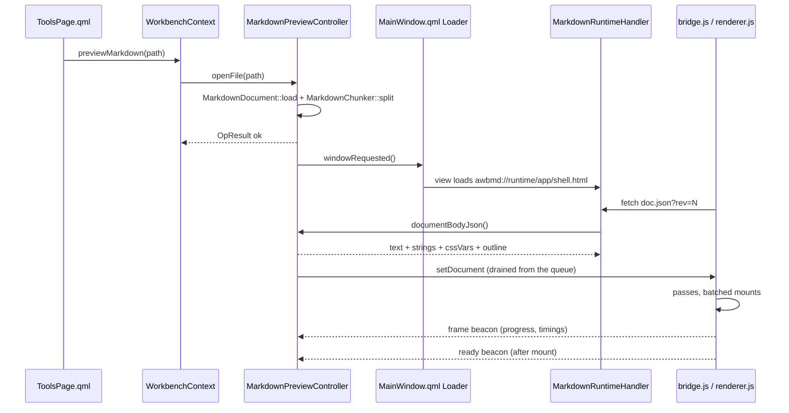

# Markdown preview

Markdown preview is a **standalone window** that renders one Markdown file — formulas, diagrams,
syntax-highlighted code — inside the embedded browser engine, and lets you edit the source and save
it back. It is opened from the Agent Tools file tree, not from the sidebar, and it is not a page in
`Workspace`.

The feature exists because of one measured property of existing Markdown previews: on a document of
a few hundred kilobytes the first paint is bounded by *the whole document*. Here the first paint is
bounded by *the first pass over it*. [The renderer](#the-renderer-passes-batches-and-visibility) is
where that claim is earned, and
[Markdown preview runtime (research)](../research/markdown-preview-runtime.md) holds the numbers
behind it.

User view: see [Markdown preview](../guide/markdown-preview.md).
Architecture context: [Layers and dependencies](../architecture/layers-and-dependencies.md),
[Frontend design](../architecture/frontend-design.md).

## What this feature is, and what it is not

- **One window, one document.** Opening a second file reuses the live window and swaps its content
  rather than building a second `WebEngineView`. Each embedded view is a Chromium frame with its own
  renderer-side memory; a preview feature that pooled them would cost more than the case it serves.
- **The window is destroyed when closed.** `MainWindow.qml` keeps the window behind a `Loader` whose
  `active` is `markdownWindowOpen && markdown.available`, and `markdownWindowOpen` goes back to false
  on `Markdown.activeChanged`. Previewing is a low-frequency action; holding a live view (and the
  ~4 MB of runtime it loads) between uses would be a permanent tax on every start.
- **Preview plus source editing plus save.** The three states are **Preview / Split / Source**. It is
  not an editor framework: no Markdown-aware reflow, no formatting toolbar, no undo beyond what the
  text field itself provides.
- **Not a general HTML viewer.** Only `.md` and `.markdown` paths are accepted
  (`MarkdownPreviewController::canPreviewPath`, which is also what decides whether the menu item
  appears). Rendering arbitrary HTML through this surface would mean executing the document's own
  scripts, which the renderer's `html: false` deliberately refuses.
- **Not an agent-facing capability.** Nothing here is exported to plugins, and no agent definition
  references it.

## Why a custom scheme, and the shape of `awbmd://`

The page needs three things that no other option provides at once: it must `fetch()` its own
document, load KaTeX's `woff2` fonts through `@font-face`, and reference images that sit next to the
Markdown file — all while nothing is written to disk and no port is opened.

`data:` URLs fail the first two (a `data:` document has an opaque origin, so `fetch()` and
`@font-face` are both blocked). Unpacking the runtime to the data directory works but puts 4 MB of
third-party JavaScript into the user's folder, where it can be edited or half-deleted. A localhost
HTTP server would need a port, a lifecycle, and a token story.

So the adapter registers a scheme, **`awbmd://runtime/…`**, and one handler serves everything from
that single origin. Being same-origin is the entire point: one host, no port.

| URL | Served from | Notes |
|---|---|---|
| `awbmd://runtime/app/shell.html` | `:/markdown/app/` | The page the view loads; `MarkdownPreviewController::pageUrl()` is its only construction site |
| `awbmd://runtime/app/<file>.js` / `.css` | `:/markdown/app/` | This project's own page runtime |
| `awbmd://runtime/vendor/<dir>/<file>` | `:/markdown/vendor/` | markdown-it, KaTeX (+ fonts), mermaid, highlight.js |
| `awbmd://runtime/doc.json?rev=N` | `MarkdownPreviewController::documentBodyJson()` | Text, `strings`, CSS variables, outline, block count; `rev` only changes when content changes |
| `awbmd://runtime/asset/<docId>/<rel>` | The document's own folder | Relative image paths resolve against the document directory; the resolved absolute path must stay inside it |
| `awbmd://runtime/event?k=<kind>&p=<json>` | — | Page → C++ beacon; answers a 1×1 PNG |

URL shapes are decided in exactly one place, `MarkdownRuntime`, and neither the page nor the handler
invents a second form. `MarkdownRuntimeHandler::routeOf()` maps a URL to one of `Resource`,
`Document`, `Asset`, `Event`, `Unknown`; anything unrecognised is `UrlNotFound` rather than a guess.
Beacons are GET-only by construction and the handler rejects any other method, so the page cannot
turn this channel into a way of touching the local machine.

**The registration order is a startup contract.** `MarkdownPreviewProvider::registerScheme()` must
run *before* `QtWebEngineQuick::initialize()`, because the engine freezes its scheme table when the
first context is created and silently ignores later registrations. The failure is not a 404: the
handler still serves documents, scripts and fonts, while `fetch()` dies with "URL scheme awbmd is not
supported" — prose renders, formulas and diagrams never do, and the build plus every pure-function
test stays green. `MarkdownPreviewProvider` therefore verifies its own registration on construction
via `QWebEngineUrlScheme::schemeByName()` and, if it is missing, leaves `available` false and logs
why.

The syntax is `QWebEngineUrlScheme::Syntax::Host`, not `HostAndPort`. With `HostAndPort` a default
port is required, and leaving it unspecified makes `registerScheme()` return early with a single
warning — precisely the half-broken state above. Our URLs carry no port, so the syntax must not
declare a port segment. Flags: `SecureScheme`, `LocalScheme`, `LocalAccessAllowed`, `CorsEnabled`,
`ServiceWorkersAllowed`, plus `FetchApiAllowed` on Qt ≥ 6.6 (the flag does not exist on 6.5, where
the page falls back to receiving its text through `runJavaScript` instead of fetching it).

## Files and classes

| File | Class / component | Responsibility | Collaborates with |
|---|---|---|---|
| `src/markdown/MarkdownDocument.{h,cpp}` | `MarkdownDocument` | One file on disk: text, dirty flag, read-only verdict, and the **byte shape it was loaded as** (BOM, line endings, UTF-8 validity) | `MarkdownPreviewController`, `core::OpResult` |
| `src/markdown/MarkdownChunker.{h,cpp}` | `MarkdownChunker`, `MarkdownBlock` | Top-level block splitting, the minimal replacement range between two splits, and the per-block hash | `MarkdownPreviewController`, `renderer.js`, `scripts/spike-markdown-chunker.js` |
| `src/markdown/MarkdownRuntime.{h,cpp}` | `MarkdownRuntime` | All page-side strings and pure computation: URL layout, MIME table, resource mapping, theme → CSS variables, page strings, outline, command/event name tables, capability verdict | Everything below; the only C++ the page protocol is written against |
| `src/markdown/MarkdownPreviewController.{h,cpp}` | `MarkdownPreviewController` | QML singleton `Markdown`: document + blocks + view settings + the pending-command queue; also the landing point for exports | `core::Settings`, `theme::Theme`, `MarkdownRuntimeHandler`, `MarkdownPreviewWindow.qml` |
| `src/markdown/webengine/MarkdownPreviewProvider.{h,cpp}` | `MarkdownPreviewProvider` | Registers the scheme, owns the preview-only profile, installs the handler, and tells the controller the surface exists | `app/main.cpp`, `MarkdownRuntimeHandler` |
| `src/markdown/webengine/MarkdownRuntimeHandler.{h,cpp}` | `MarkdownRuntimeHandler` | The single supplier for `awbmd://runtime/…`, with an in-memory cache for vendor bytes | `MarkdownPreviewController` |
| `src/markdown/webengine/runtime/*` | `shell.html`, `bridge.js`, `renderer.js`, `markdown-config.js`, `math-rule.js`, `diagram.js`, `find.js`, `theme.css` | The page: bootstrap and command dispatch, the chunked pipeline, the markdown-it configuration, KaTeX/task/alert rules, deferred mermaid, in-document search | `MarkdownRuntime` (protocol), `third_party/markdown-runtime/` |
| `src/markdown/qml/MarkdownPreviewWindow.qml` | `MarkdownPreviewWindow` | The window: toolbar, outline, view, editor, search bar, status bar, dialogs, shortcuts | `Markdown`, `MarkdownPreview`, `theme`, `workbench` |
| `src/workbench/WorkbenchContext.{h,cpp}` | `WorkbenchContext` | The cross-domain entry: `previewMarkdown()` and `canPreviewMarkdown()` for a domain the Tools page may not name | `MarkdownPreviewController`, `ToolsPage.qml` |
| `src/shell/qml/MainWindow.qml` | `MainWindow` | Hosts the `Loader` and mirrors `markdown.active` into `markdownWindowOpen` | `Markdown` |
| `cmake/AwbQtCompat.cmake` | `awb_add_vendor_resources()` | Embeds a whole directory tree under a resource prefix, preserving its sub-paths (KaTeX fonts live in `fonts/`) | `app/CMakeLists.txt`, `tests/*/CMakeLists.txt` |
| `third_party/markdown-runtime/` | — | Vendored browser builds plus `manifest.json` (versions, licenses, sha256) | `tst_markdown`, `scripts/update-markdown-runtime.sh` |

## The pure layer: document, blocks, page strings

`src/markdown/` contains no WebEngine and no QML types; only `src/markdown/webengine/` (the
`awb_markdown_webengine` adapter) links the engine, exactly as `src/web/webengine/` does for web tabs.
That split buys the ability to compile and test the whole state machine in a build that cannot render
anything.

**`MarkdownDocument` exists so that saving cannot rewrite a file.** A README that is CRLF with a BOM
must still be CRLF with a BOM after Ctrl+S — "normalising" it is a real byte-level change to the
user's data. So the load records the shape (`m_bom`, `m_crlf`, `m_validUtf8`) and `encodeText()`
reproduces it. Two size caps come out of the product requirement (smooth at a few hundred KB to
2 MB): above `kOpenCapBytes` the file is refused outright, above `kEditCapBytes` it previews read-only.
A preview window you cannot type in is still useful; an editor that re-lays-out 8 MB per keystroke
drags the whole application down. Invalid UTF-8 is a third source of read-only — decoding already
lost information, and writing it back would replace the user's bytes with U+FFFD.

`m_crlf` is only set when **every** newline is CRLF. In a mixed file, treating it as CRLF would
convert the whole document on save; leaving `\r` inside the text means `encodeText(text)` is
byte-identical to the source in both cases.

External changes arrive through `QFileSystemWatcher`, with one deliberate addition:
`MarkdownPreviewController::refreshDiskState()` re-compares against the on-disk snapshot on window
activation as well. On Windows the watcher silently loses files that are deleted and recreated (very
common for generated documentation), and without that polling fallback there are external edits that
never get reported. Saving never reports itself as an external change: `save()` re-records the
snapshot, and the watcher callback stays quiet when the comparison finds no difference.

**`MarkdownChunker` is the reason incremental rendering is possible at all.** Its output blocks map
one-to-one onto `<section>` elements in the page, so `startLine`/`endLine` are also the anchors for
"editor line → preview block". The equivalence requirement is what makes it a line-level state
machine rather than a split on blank lines: fences, display math, setext underline rows, the
continuation paragraphs of loose lists and table runs are all handled explicitly, because a wrong
block boundary changes semantics (a paragraph after a list getting absorbed into the list item).
`scripts/spike-markdown-chunker.js` checks whole-document rendering against block-by-block rendering
over the repository's own Markdown corpus, and it imports the **same** parser configuration as the
page (`markdown-config.js`) — comparing two different parsers would make the check meaningless.

**`MarkdownRuntime` collects everything the page cares about that C++ must decide**: URL construction,
MIME types, theme tokens → `--awb-*` CSS custom properties, the page's string dictionary
(`pageStrings()`), outline extraction, and the two protocol name tables. There are no translatable
literals in the `.js` files at all — they are invisible to `lupdate` and to the architecture gate, so
a string that lived there would simply never be translated. `commandNames()` and `eventKinds()` are
the single authority for the protocol; `enqueue()` refuses names that are not in the table, and the
page's dispatch branches are asserted against the same list. A string protocol without that table
drifts into "the page handles a command nobody sends".

## The renderer: passes, batches, and visibility

`renderer.js` is the performance work. Its doc comment records the measurement: on a 486 KB / 3150
block document, parsing and element construction take about 1.9 s of actual main-thread work,
mounting the prepared blocks takes ~0.03 s, and forcing a full-document layout is also ~0.03 s. So
this pipeline does not reduce the total — the parsing cannot be avoided — it removes the
**one-shot** character of it, so the first screen pays only the first pass.

Three mechanisms, kept deliberately separate:

1. **Passes.** Parsing yields the event loop after `PASS_BUDGET_MS` (48 ms — under the 50 ms
   long-task threshold, because past it input starts being dropped), with a more generous
   `FIRST_BUDGET_MS` (32 ms budget for a first pass that is allowed to be the largest) and a
   `SLICE_BLOCKS` cap so one pathological block (a half-screen table) cannot monopolise a pass.
2. **Batched mounts.** DOM cost is paid per *insertion into the tree*, not per block. Blocks are
   accumulated into a batch and appended once `MOUNT_BATCH_BLOCKS` is reached, or the parser has
   drained, or the batch has waited `MOUNT_MAX_WAIT_MS` — that last one so a small document never
   leaves content parked.
3. **CSS `content-visibility`** skips layout and paint for offscreen blocks (`theme.css`). This is
   why layout is nearly free, and it is also why there is **no JS window virtualisation**:
   virtualisation would destroy text selection, native scroll anchoring, and accessibility.

Scheduling is hand-rolled rather than `requestIdleCallback` or `requestAnimationFrame`, for reasons
recorded in the research note: the same work measured under idle callbacks and frame-bound callbacks
takes an order of magnitude longer, because Chromium's idle budget starves once there are thousands
of callbacks, and frame-bound work is capped at the frame rate rather than at the time budget.
`schedule()` therefore asks for a timer and checks elapsed milliseconds itself.

Editing uses `updateBlocks`: C++ computes the minimal replacement range from the per-block hash
(`MarkdownChunker::diff()`), and the page re-renders only those `<section>`s. Typing one character
must not re-layout the document; that is half of the incremental story, `content-visibility` is the
other half.

**Diagrams are a separate layer for a size reason.** The mermaid bundle is 2.6 MB; a document with no
diagrams should not pay to load or parse it. `diagram.js` injects the `<script>` only when the first
diagram gets near the viewport, and its own states (`queued / rendering / rendered / deferred /
error`) stay in that file rather than tangling through `renderer.js`. Concurrent renders are capped
at 2 (mermaid does synchronous layout), SVG results are cached by diagram source, and beyond
`DEFER_LIMIT` (40 diagrams) the placeholders become click-to-render.

**Search is also homegrown.** Chromium's native find is unreliable against `content-visibility: auto`
content that is in the DOM but not laid out — hit counts, "which one of how many", and the scroll
position after jumping are all unavailable, and the highlight cannot be themed. `find.js` counts and
jumps itself. Two accepted consequences: only **mounted** blocks are counted (searching immediately
after opening a large document under-reports until the passes finish), and a match spanning inline
markup (`强**调查**研`) is not found. Highlights are placed only in the block that holds the current
match, so one search step is not 20 000 DOM mutations.

## The command queue and the page protocol



This is the one lifecycle worth drawing because both halves are asynchronous and neither may assume
the other. The queue exists because QML's only route into the page is
`WebEngineView.runJavaScript`, and a command sent before the page has booted is simply lost. So
`MarkdownPreviewController::enqueue()` parks commands, emits `commandQueued()`, and the adapter drains
at two moments: when the view reports ready, and whenever a new command arrives. Only the newest
command of each kind survives — five consecutive edits send one `updateBlocks`.

Direction of travel is split by payload size on purpose. Commands C++ → page go through
`runJavaScript("AWB.dispatch(<json>)")`. Results the page → C++ that are large come back as the
*return value* of a `runJavaScript` call (`documentBodyJson()` aside, that is how `serialize()` and
`renderAll()` return the exported HTML), because the beacon is a GET URL and `kEventPayloadBytes`
(8 KiB) truncates it. Small events — `ready`, `frame`, `error`, `find` — use the beacon. The asymmetry
is recorded in the code, and keeping `markup` out of the event table is deliberate: a table that
contains one large payload invites the next person to add another.

## Entry points and wiring

`ToolsPage.qml` asks, and never decides. Its file-tree context menu contains
`visible: workbench.canPreviewMarkdown(treeRow.path)` and
`onTriggered: workbench.previewMarkdown(treeRow.path)`. The suffix rules live in the preview domain;
the QML only asks about a path it already has. `canPreviewMarkdown()` is a *method* rather than a
binding source, and that matters: the expression does not re-evaluate, so the item's visibility is
computed at menu build time — which is fine here because the capability cannot change while the
process is running.

`WorkbenchContext` is the only place that may name both domains (`src/tools` must not include
`src/markdown`; gate rule 1). It holds a nullable pointer set by `setMarkdownPreview()` from
`app/main.cpp`. When it is null — or when the controller reports itself unavailable —
`previewMarkdown()` produces a toast with the reason and nothing else, so the failure has one
explanation path instead of two.

`MainWindow.qml` hosts the window through a `Loader` and uses `source` (a resource URL string) rather
than `sourceComponent` (a type name): `MarkdownPreviewWindow.qml` is only registered into the QML
module in builds that can run it, so a type name would leave an unresolvable reference in every other
build. Loader failures are surfaced as a toast on purpose — otherwise the symptom of a mis-registered
resource is "right-click does nothing", which is much harder to diagnose than an error box.

Closing that window is a report, not a disappearance: a QML `Window` survives its own close — the
`closing` handler only hides it — so nothing would flip `markdown.active` back to false, the `Loader`
would keep holding the hidden item, and the second preview request would only `raise()` a window
nobody can see. `onClosing` therefore calls `notifyWindowClosed()` on every accepted path (the
unsaved-changes dialog just sets the approval flag and calls `close()`, so both paths report from the
same place), and `Component.onDestruction` reports again for the paths that never deliver a close
event, such as quitting the app; `MarkdownPreviewController::notifyWindowClosed()` is idempotent.

## View settings, outline, export, external browser

The four view settings (`mode`, `fontSizePx`, `contentWidthPx`, `showOutline`) are read at controller
construction by `loadView()` and written back by `persistView()`. `0` means "use the theme's
measurement" for the two sizes; `contentWidthPx` beyond the viewport is how **Full width** is
expressed, which is honest about being a CSS max-width rather than a magic value.

The outline comes from the block sequence (`MarkdownRuntime::outlineFromBlocks()`) with
`blockIndex` as its positioning anchor, so clicking an outline row is a `scrollTo` command with a
block index, not a fragile DOM query. Heading text is stripped of emphasis, links, inline code,
images and HTML tags first.

Export and "open in browser" both need the page's own serialisation, so both go through
`requestFullRender()` (flush the lazily-rendered diagrams) and then `requestMarkup(purpose)`. The page
returns the HTML, and **`reportMarkup()` is the only write site** — QML never touches the filesystem.
Landing rules differ by purpose, and both are choices:

- `"export"` writes next to the document unless the user picked a folder through
  `setExportDirectory()`. Exported HTML references images **relatively**, so only a file beside the
  document resolves them; changing the folder is a degradation the user opts into, never a default.
- `"browser"` writes to `core::Paths::markdownPreviewDir()` (`<dataRoot>/preview`), because an
  external browser cannot resolve `awbmd://` at all.

`exportFileName()` suggests the document's base name with `.html`, falling back to `Markdown.html`
when no document is loaded (which is also when `requestMarkup()` refuses).

## Capability gating: Qt 5 and `AWB_ENABLE_WEBENGINE=OFF`

`MarkdownRuntime::isSupportedBuild()` is a compile-time verdict (Qt 6 **and** WebEngine), and it is
the same condition used in three other places: whether `awb_markdown_webengine` is linked, whether the
`:/markdown/` runtime is embedded, and whether `MarkdownPreviewWindow.qml` is registered. Keeping them
in one place is the whole point — disagreement between them shows up as "menu item is clickable, page
404s".

At runtime the verdict is refined, not relaxed: `available` is `m_surfaceReady && isSupportedBuild()`,
where `m_surfaceReady` is set by the provider once the handler is actually installed on a profile.
That second term is what catches the wrong-order failure above, where the binary *does* link WebEngine
but the scheme never registered. `unavailableReason()` gives the user the sentence.

The pure layer (`awb_markdown`) is linked **always**, and `Markdown` is registered as a singleton in
every build. Qt 5 and no-WebEngine builds therefore evaluate `markdown.available` to false, hide the
menu item, and never create the window — the feature is absent rather than present and broken.
`MarkdownRuntimeHandler` and the page runtime are Qt-6-only source, so no Qt 5 branch is needed
anywhere in the pipeline; the only Qt 5/6 divergence inside the feature is the `FetchApiAllowed` flag.

## Vendored runtime and how to update it

`third_party/markdown-runtime/` holds prebuilt browser bundles, committed as build artifacts. There is
no CDN, no build-time download and no submodule: a machine packaging a release may be on an intranet
with nothing reachable, and the app must render offline. `manifest.json` records version, license, byte
size and sha256 per file, and `tst_markdown` recomputes those hashes from the source tree — an edited
or truncated vendor file fails the test suite instead of becoming a mysterious rendering bug.

Only single-file browser builds are taken. mermaid's ESM form ships as a `chunks/*.mjs` graph, and a
chunk graph turns "serve local assets from a custom scheme" into a dynamic-import resolution problem;
`mermaid.min.js` in 11.x is a self-contained IIFE with no `import(` and no reference to `chunks/`.
KaTeX fonts are woff2 only, and the upstream CSS is vendored unpatched because Chromium stops at the
first `@font-face` source it can load. highlight.js comes from the CDN-assets package, since only that
one ships a browser bundle.

```bash
bash scripts/update-markdown-runtime.sh                 # pinned versions, needs network + Node 20+
bash scripts/update-markdown-runtime.sh --set mermaid 11.18.0
bash scripts/build.sh --test                            # tst_markdown asserts the sha256 table
```

The script is never run by the build. `.gitattributes` marks the directory `-text`, because with
`core.autocrlf=true` an EOL conversion would silently break the hash comparison.

## Costs and deliberate limits

- **About 4 MB is embedded in the Qt 6 + WebEngine binary**, and 2.6 MB of that is mermaid — loaded
  only by documents that actually contain diagrams.
- **Inline HTML is not rendered** (`html: false` in `markdown-config.js`). Previewing someone else's
  Markdown over a channel with no CSP is a script-injection surface; the cost is that a document
  written with embedded `<br>` or `<details>` shows those tags as text.
- **One document at a time.** The command queue, the `docId` asset namespace and the outline are all
  single-document by construction.
- **Search counts only mounted blocks**, and cannot match across inline markup.
- **More than 40 diagrams means click-to-render.**
- **A file above `kOpenCapBytes` is refused rather than partially shown.**
- **`content-visibility` means the browser's own Ctrl+F is not usable here**, which is why search has
  to be a feature rather than an afterthought.
- **mermaid stays on 11.x** until its 12.x `dist` layout is verified to still ship a self-contained
  IIFE.
- **The rAF/idle freeze is a real constraint on verification**: a `WebEngineView` in a hidden window
  does not pump animation frames or idle callbacks, so any test that waits for the renderer must show
  its window.

## Tests

| Target | Covers |
|---|---|
| `tst_markdown` | `MarkdownChunker` (including corpus equivalence), `MarkdownDocument` (shape-preserving save, caps, read-only sources, watcher semantics), `MarkdownRuntime` (URLs, MIME, routes, protocol tables, theme → CSS, outline), `MarkdownPreviewController` (queue de-duplication, open/save/export, capability verdicts), and the vendor sha256 table |
| `tst_markdownpreview` | The page pipeline against a real `WebEngineView`: a document mounts, blocks appear, incremental updates land. The large-document case runs only under `AWB_MD_PERF` |
| `tst_markdownpreviewui` | `MarkdownPreviewWindow.qml` as loaded QML: toolbar controls driving the controller, search bar, mode switching |
| `tst_webengine` | The scheme serving resources, fonts, `doc.json` and beacons end to end |
| `tst_toolsui` | The file-tree menu item: present and clickable with the capability, absent without it, and handing the row's absolute path to `workbench.previewMarkdown` |
| `tst_workbench` | `previewMarkdown()` delegation and its toast-only failure paths |
| `tst_core` | The four `markdown.*` settings keys and `Paths::markdownPreviewDir()` |

The gates that keep `tst_markdownpreview` and `tst_markdownpreviewui` out of Qt 5 and
no-WebEngine builds are in `tests/CMakeLists.txt`, matching the feature's own condition.
