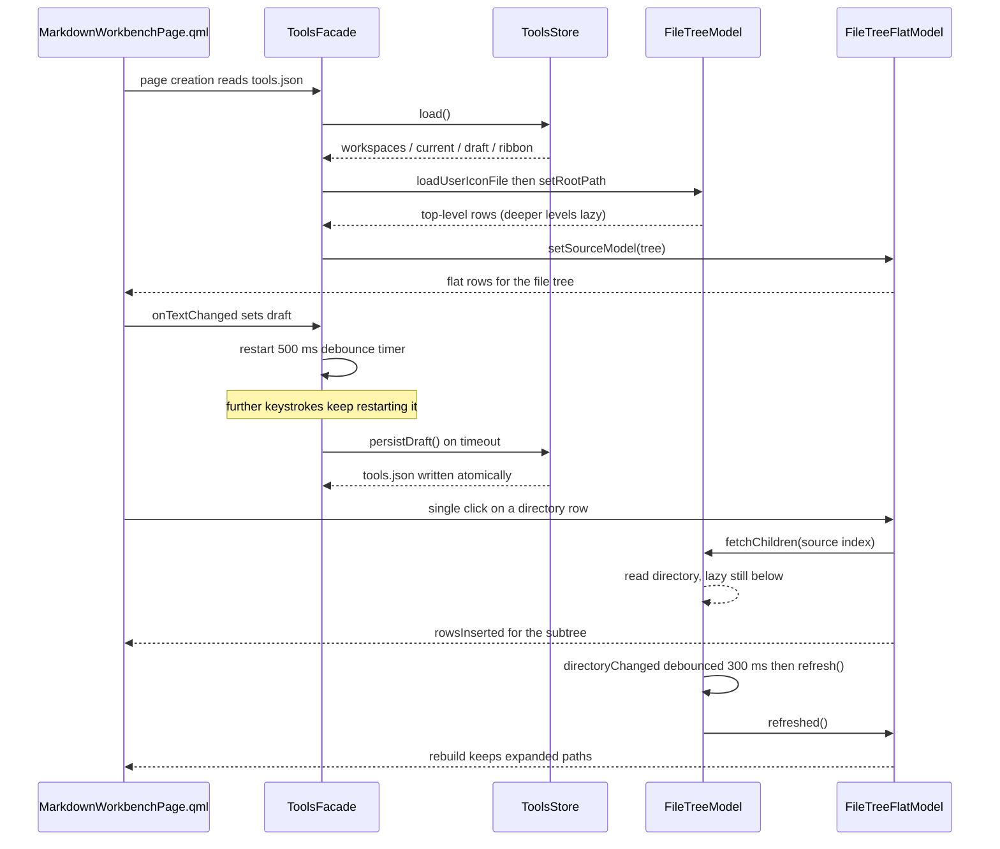
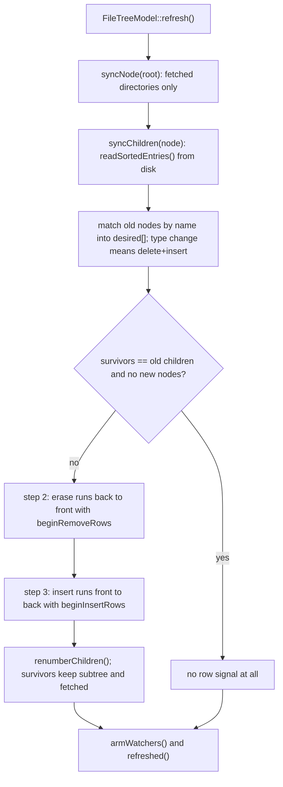
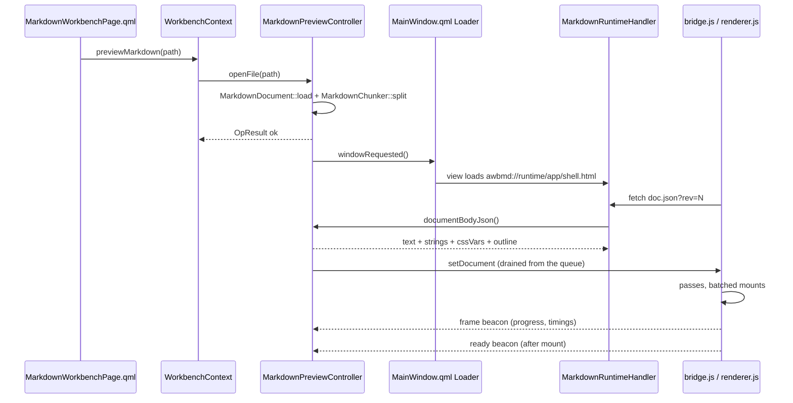

# Markdown workbench

The Markdown workbench is a **page in the main window's `Workspace`** that unifies the former prompt-writing page and the former Markdown preview window: one page, two presets, many sessions. The **prompt form** composes a prompt against a workspace file tree; the **document form** reads and edits Markdown files, one tab per file. It is entered from the sidebar's **Prompt Writing** entry (under the **Agent Tools** group label), by opening a Markdown file from the workspace tree, or by double-clicking an associated `.md` file in the system file manager. It is a `keepAlive` page: created on its first visit, then resident until the app closes — the editor's undo stack, scroll position and split proportion survive page switches.

It exists for three concrete reasons. Referencing a file in a prompt normally means hand-building a relative path — the file tree inserts `` `./relative/path` `` references by drag-and-drop or double-click. Typing a prompt straight into an agent CLI risks hitting Enter on a half-finished message — so the workbench has **no send action**: Enter inserts a newline, nothing leaves the page, and the only delivery is copy. And on a document of a few hundred kilobytes, the first paint is bounded by *the first pass over it*, not by *the whole document* — [the renderer](#the-renderer-passes-batches-and-visibility) is where that claim is earned, and
[Markdown preview runtime (research)](../research/markdown-preview-runtime.md) holds the numbers behind it.

User view: see [Markdown workbench](../guide/markdown-workbench.md).
Architecture context: [Layers and dependencies](../architecture/layers-and-dependencies.md),
[Frontend design](../architecture/frontend-design.md).

## What this page is, and what it is not

- **One page, two presets.** The presets are interface configurations of the same code, not two applications:

  | | Prompt form | Document form |
  |---|---|---|
  | Left panel | the workspace file tree, open by default | collapsed to a narrow edge that can be clicked open |
  | Ribbon | expanded (single row by default) | collapsed to its tab row |
  | Middle area | the prompt draft, with Preview / Split / Source | the open documents, one per tab, with Preview / Split / Source |

  The right side holds the outline panel, behind its toggle, serving whichever session is active (the draft has headings too). Entering from the sidebar yields the prompt form; opening a Markdown file from the workspace tree yields the document form (or retargets the live workbench to that file). The preset switch is the **Full Tools** toggle on the ribbon's View tab; a document preset that cannot be rendered (no capability, no file tab) falls back to the prompt form rather than showing a broken area. There is no user-facing "mode" concept — one workbench with more or fewer tooling.
- **The page is resident, and so are the sessions.** The page is a `keepAlive` entry in `Workspace`'s resident Repeater: it is instantiated on the first visit (navigation or a preview request) and lives until the app exits, merely hidden while other pages are current. `Component.onCompleted` reports `MarkdownPreviewController::notifyWindowOpened()` once — from then on the controller queues commands, and the page's `Connections` pump them even while hidden (the preview pane is alive, so the round trips still work; nothing is flushed until the page is visible again). Sessions never sleep during a run; they die with the process. Only closing a tab drops a session. The cost of residency is one WebEngine view (and the ~4 MB of runtime it loads) that stays warm after the first visit — the price of not losing the writing scene on every page switch, and the reason the page is *not* created at startup: it exists only after the user first needs it.
- **The prompt form works in every build.** It is a plain QML editor with highlighting; in Qt 5 and no-WebEngine builds the preview pane is simply never loaded (no `WebEngineView` exists in the process), the view switcher is absent, and the document form's entry points degrade honestly — the file-tree menu item never appears, an open request reports its reason (see [Capability gating](#capability-gating-qt-5-and-no-webengine)).
- **One render surface, many sessions.** The controller is a session container: each session carries its own document, blocks, outline, rev, per-tab view mode and export directory, addressed by `docId`. Only one session is *active* at a time; switching sessions rebuilds the page wholesale (`setDocument`). `doc.json` serves the active session, while `asset/<docId>/…` resolves against **every live session** — image requests for a tab you just switched away from may still be in flight. Each embedded view is a Chromium frame with its own renderer-side memory, which is why there is exactly one and it is reused rather than pooled.
- **File tabs are capped at eight.** Opening the same path twice activates the existing tab (deduplicated by absolute path); opening a ninth file is refused with an explanation instead of silently evicting the least recently viewed one — a tab the user is editing in must not vanish because another file was opened.
- **Saving cannot rewrite a file.** A README that is CRLF with a BOM must still be CRLF with a BOM after `Ctrl+S` — the document pipeline records the byte shape on load and reproduces it on save (see [the pure layer](#the-pure-layer-document-blocks-page-strings)). The draft, by contrast, never touches the filesystem directly: it lives in `tools.json`.
- **Not a general HTML viewer.** Only Markdown-suffixed paths are accepted (`MarkdownPreviewController::isMarkdownPath()`, the one place the suffix list lives — it also decides the file-tree menu item and the command-line file arguments). Rendering arbitrary HTML through this surface would mean executing the document's own scripts, which the renderer's `html: false` deliberately refuses.
- **No agent coupling.** The page talks to no agent, runs nothing, and edits no repository file other than the documents the user explicitly opened. Its writes are `tools.json` (workspace memory, draft, ribbon preferences), `markdown_session.json` (the session snapshot), the system clipboard, the document's own files on save, and the export copies.

## The ribbon

The page's actions live in a command bar across the top. In `AWB_ENABLE_RIBBON` builds that bar is a SARibbon `RibbonBar` (`WorkbenchRibbon.qml`); everywhere else — and in test engines that never registered the SARibbon types — it is the plain toolbar `WorkbenchToolbar.qml`. This section records how SARibbon comes into the build, what sits in each tab, and the constraints the integration must respect.

### How SARibbon comes in

- SARibbon is a git submodule at `third_party/SARibbon` (MIT licence), **pinned at `d3d45d8`** (the upstream dev-3.0 tip, 2026-10-07) — it carries the ribbon fixes the integration needs: panel child order scrambling, in-panel separators never rendering, and hit-test visibility of registered categories. From `c7f9bfd` the QML module hard-requires QWindowKit; SARibbon's CMake builds it in-tree from its own nested submodule chain (`3rdparty/qwindowkit` → `qmsetup` → `syscmdline`, each initialised offline from a populated checkout). Linking QWK does **not** force the frameless window: no `RibbonWindowAgent` is declared anywhere, so the workbench keeps the native system frame.
- `AWB_ENABLE_RIBBON` (default `ON`, declared in `cmake/AwbOptions.cmake`) wires it in: `SARIBBON_BUILD_QML=ON`, `SARIBBON_BUILD_WIDGETS` / `SARIBBON_BUILD_EXAMPLES` / `SARIBBON_BUILD_TESTS` / `SARIBBON_INSTALL` = `OFF`, static libraries. Only the QML module is built — the QWidget part of SARibbon never enters the binary.
- qmsetup (QWindowKit's build system) generates forwarding headers in the build tree whose `../../` chains are anchored at the build directory. In deep shadow build directories — Qt Creator's default `<parent>/build/Desktop_<kit>-<config>` — the path `cl.exe` has to open exceeds `MAX_PATH` (260), which is not long-path aware and fails every QWK compilation with a misleading `C1083` for a file that exists. After `add_subdirectory(third_party/SARibbon)` the root `CMakeLists.txt` therefore rewrites those one-line relative includes to absolute paths (`awb_absolutize_forwarding_headers` in `cmake/AwbThirdParty.cmake`); in-tree `build/` directories are unaffected but the rewrite is applied either way.
- `app/main.cpp` calls `saRibbonRegisterQmlTypes(&engine)` **before** `engine.load()`. Registration is imperative (there is no qmldir plugin); the function guards itself against double calls.
- The domain libraries do not link SARibbon. `awb_tools` and `awb_markdown` keep depending on `awb_core` + `awb_theme` only; the integration points are `app/` (CMake link + registration) and the command bar QML (`import SARibbon`). This keeps the third-party module out of the domain layers.

### Tabs and what lives in them

The command bar has three tabs: **Start**, **Prompt tools** and **View**.

- **Start** holds the everyday editing set: **Copy Prompt** (the delivery path — a second **Copy** sits in the quick-access bar on the title row), the clipboard group **Paste / Cut / Copy Text**, **Undo / Redo**, the character formats **Bold / Italic / Strike / Code** (all four `checkable`, `checked` bound to the `MarkdownEdit` cursor queries — a query side is the entry ticket for `checkable`), **Link**, the paragraph group **Heading** (a menu: 1/2/3 and remove), **Bullets / Numbered / Task List / Quote / Divider**, the insert group **Fence** (a language menu: none, C++, Python, JavaScript, QML, Bash) and **Table** (3 columns), plus the **View** group — the **Preview / Split / Source** three-state (for whichever session is active — the draft renders too) and the **Font Size** / **Width** menus (the former tab-strip pickers, moved onto the command bar in 2026-10: the strip answers *which document*, *how to look at it* lives here), **Find** (routes by preset — the preview search in the document form, the draft find bar in the prompt form), **Save** (document form, editable files only) and **Clear** (prompt form, non-empty draft: the confirm-and-undo guard). Every action forwards to the page's action layer or the `MarkdownEdit` statics — the command bar is an entry point only and holds no logic of its own.
- **Prompt tools** is the workbench's first **context tab** — a `RibbonContextCategory` whose `active` follows the prompt preset; in the document form it is absent entirely (decision D-2: templates and favorites are draft tools, and someone else's document is not a place to insert them). It holds **Insert Template** (expands the left panel's Templates section and focuses its search — the section is the picker), **Save as Template**, **Save Favorite**, and **Check Prompt** (the B9 trigger; the findings list lives in the right panel). Its `contextColor` is `theme.success`, deliberately not `theme.accent`: SARibbon paints the whole title row in `RibbonTheme.accent` (the theme bridge pushes the application accent there), and a context colour equal to the accent makes the band and its tab text invisible — the "context category blends into the other categories" defect this integration hit in 2026-10.
- **View** holds the switches: the outline toggle, **Full Tools** (the preset switch: on = the prompt form, off = the document form), **Collapse** (fold the whole band to its tab row), **Style** (single / two / three rows), and **Follow Theme** (whether the band's colours track the application theme). The three-state and the size/width pickers used to live here; they moved to the **Start** tab's **View** group with the 2026-10 tab-strip cleanup.

The single row is the default style, and its consequences are worth knowing before adding buttons: panel titles are hidden, and every button renders at the small size regardless of its `proportion` — grouping and button order carry the hierarchy, and labels must stay short. `minimumMode` collapses the band to its tab row; the document-form preset starts collapsed, and clicking the tab row expands it again.

### Theme bridging

Two design systems meet at exactly one point. `WorkbenchRibbon.qml` pushes the application `theme` into `RibbonTheme` — accent, content background, text colour, and the dark/light verdict — once per `Theme::changed`, gated by the **Follow Theme** preference (`tools.ribbonFollowAppTheme`, on by default; turned off, the ribbon keeps its own palette). The bridge is **one-way** (application → ribbon), with no reverse sync and no second auto-follow. The page's own QML keeps using `theme.*` tokens exclusively; the literal-colour architecture gate applies to this repository's sources exactly as before.

### Command bar constraints

- The ribbon is its own component, loaded by the page through a `Loader` **by resource URL** — the same pattern the preview surface uses. `WorkbenchRibbon.qml` is registered into the resource manifest only in `AWB_ENABLE_RIBBON` builds; when the load fails (the switch off, or a test engine without the SARibbon types) the page loads `WorkbenchToolbar.qml` instead. The load happens once at page creation and is never toggled on demand: SARibbon's leaves are created during `Component.onCompleted`, and a bar created on demand dies with an early context.
- The two skins are pure forwarders to the same page action layer — neither may grow behaviour of its own, or the two builds drift apart. The button set matches the context menu and the two ribbon tabs.
- No `Popup`/`Dialog`/`Menu` is declared inside a `RibbonPanel` — popups created during the bar's `componentComplete` become separate native windows and break the window scene. Anything popup-shaped is created through a `Loader`.
- Ribbon menus accept `RibbonMenuItem` only; the `AMenu` family stays for in-workbench context menus. An action lives in exactly one place — the same action must not appear both in a command bar tab and in a side panel, or label and enabled state will drift apart.
- SARibbon's own strings are not in this repository's `.ts` files and stay English in Chinese sessions. The workbench adds no ribbon-builtin screens beyond the bar itself.

## Sessions: one container, one render surface

`MarkdownPreviewController` (the QML singleton `Markdown`) is a **session container plus a single render surface**. A *session* is one document the user is looking at:

- a **file session** — a disk file, opened via `openFile()` (the file tree, a recent-documents row, a command-line argument or a second-instance message all land there); each has a generated `docId` (`d1`, `d2`, …);
- the **draft session** — a *virtual document* (`MarkdownDocument::setVirtual()`) holding the prompt draft, with the fixed `docId` `"draft"`. It takes no tab, it cannot be closed via tabs (it is the prompt form's own body), and it is editable-and-renderable like any file: the rendering pipeline consumes text, not paths. The draft's default view mode is **split** (it exists to be written in, and preview-first would hide the editor); builds without the preview capability degrade it to source.

Each session owns its `MarkdownDocument`, block sequence, outline, `rev`, per-tab view mode, export directory and `doc.json` payload cache. The QML property surface (`filePath`, `dirty`, `mode`, `outline`, …) reflects the **active** session; `tabs` is the tab strip's model — `[{docId, title, path, mode, dirty, active}]` in open order, files only (the `path` and `mode` fields exist for the session file; the UI reads the rest).

**Switching is a full page rebuild.** `activateSession()` enqueues `setDocument`, whose same-command overwrite semantics purge the previous session's pending `updateBlocks` — exactly the guard that keeps a stale delta from fighting a full rebuild. Incremental edits (`updateBlocks`) only ever target the active session.

**Lifecycle:**

- `openFile()` on a path that already has a session **activates** it (the tab is already there, the unsaved edits with it) instead of opening a second tab; otherwise it creates a session, activates it and emits `windowRequested()`. The cap is eight file sessions; the ninth is refused with an explanation.
- `closeSession(docId)` closes a **tab** — the view goes away, the disk file stays. Closing the active tab activates the most recently opened remaining file session; with none left, the draft.
- `notifyWindowClosed()` drops the in-flight commands and puts the sessions to sleep. In the app the page never reports closed — it is resident until the process exits, so the sessions live as long as the run; the report exists for teardown paths and the test harnesses. Only a restart needs the session file (below).
- The draft is fed by `setDraftText()` (the page's draft editor, through a 200 ms debounce — one keystroke re-chunks the whole draft, the same CPU trap as the file editor); persistence of the draft text stays in the tools domain (`tools.draft`, its own 500 ms debounce).

The diagram shows a session's life across open, switch, edit, external change, save and close:

```mermaid
sequenceDiagram
    participant WC as WorkbenchContext
    participant MC as MarkdownPreviewController
    participant S1 as Session d1 (one.md)
    participant S2 as Session d2 (two.md)
    participant Doc as MarkdownDocument
    participant Page as the preview page

    WC->>MC: openFile("one.md")
    MC->>Doc: load() (byte shape recorded)
    MC->>S1: blocks + outline + rev=1
    MC->>MC: activate(d1), emit windowRequested()
    MC->>Page: setDocument (page fetches doc.json of d1)
    WC->>MC: openFile("two.md")
    MC->>S2: new session, activate(d2)
    MC->>Page: setDocument (d1's pending updateBlocks purged)
    Note over S1: d1 stays alive: dirty flag, mode, blocks kept
    MC->>MC: activate(d1) again (tab click)
    MC->>Page: setDocument (same docId, full rebuild)
    WC->>MC: activate(d1), setEditorText edits
    MC->>S1: re-chunk + diff -> updateBlocks (active session only)
    Doc-->>MC: externallyChangedByOther (watcher)
    MC->>MC: changedOnDisk on d1 (asked only when active)
    WC->>MC: saveNow() / saveSession(d1)
    MC->>Doc: save() (byte shape reproduced)
    MC->>MC: closeSession(d1)
    MC->>MC: activate most recent file session (or the draft)
    Note over MC: the page is resident; process exit drops the sessions
```

Two invariants worth pinning:

- **Dirty flags are per session.** Editing one tab never flips another's dirty flag, and the close guard (below) inspects every dirty tab, not just the active one.
- **Signals are gated by activity.** A background session's dirty or read-only flip does not emit the controller's global signals — only the session's own state moves; the properties are correct the moment it becomes active again.

## The tab strip

The strip above the middle area renders `markdown.tabs`: one delegate per **file or draft** session — title, a dirty dot (never colour-only), and a close button (`AIconButton`). Clicking a tab activates its session and switches the document preset; the delegate's root is a plain `Item` with the visuals in a child (the required-property shadowing rule), and its handlers reach the page's action layer through a `scope` property instead of the document-root id — bare `workbenchWindow` references in a delegate's signal handler throw `ReferenceError` in qmlcachegen-compiled pages (2026-10 defect; the interpreter and the compiled engine disagree, which is why the UI tests never caught it). A second half of the same rule: **page references must be captured into locals *before* touching the model** — `activateSession` / `switchDraftTo` emit `tabsChanged` synchronously, the tab strip's Repeater rebuilds, and the running delegate's scope dies mid-handler; resolving `scope` after the model mutation throws the same `ReferenceError` (the 2026-10 "clicking a file tab collapses the left panel" report — the preset switch died halfway). Locals live on the JS stack and survive the delegate teardown. To its right sit the outline and search buttons and the More-actions menu. The reading controls — the **Preview / Split / Source** switcher (serving **both** presets: the prompt form renders the draft through the same pipeline), the text-size and width pickers — moved to the command bar's **Start** tab in the 2026-10 cleanup: the strip answers *which document*, not *how to look at it*.

Draft tabs interleave with file tabs. The session file records each draft tab by its `draftId` next to the file tabs' paths; a draft tab is restored only if the draft still exists in `tools.json` — the same skip-don't-fail discipline as a deleted file. **Closing a draft tab does not delete the draft**: the `tools.json` record stays, and opening the draft again puts the tab back. Deleting a draft is an explicit, confirmed, not-undoable action (its snapshots and recovery copy go with it). The page couples preset and session: the prompt preset activates the active draft's session, the document preset activates the last file session the user had (`lastFileDocId`, so prompt ⇄ document round-trips return to the document being read, not the newest tab).

## Session persistence (restarts)

`markdown_session.json` (`MarkdownSessionStore`, workbench domain — session state spans tools and markdown, so only L3 may own it) remembers the scene across restarts:

- the tab group: each tab's **path** (file tabs) or **draftId** (draft tabs), plus its **view mode** (no content — files are re-read from disk, drafts are re-read from `tools.json`);
- the active tab index;
- the preset and the per-preset panel/ribbon collapse states;
- a recent-documents MRU (20 entries), touched by every successful open.

Restoration happens once, when the page is first created during an app run (the controller's in-memory sessions cover everything after that): `WorkbenchContext::restoreMarkdownSession()` re-opens each tab in order — a file that no longer exists, or a draft that was deleted, is skipped with a log line, never failing the whole group — applies each tab's recorded mode, then activates the recorded tab. Draft tabs need the draft's title and body from the tools domain; `WorkbenchContext::setToolsFacade()` is the seam (assembly is the only layer that sees both domains — domain modules never include each other; in unit tests the facade is absent and draft tabs simply skip). Writes are debounced 800 ms behind tab/active/preset/panel changes (dirty-flag flips ride the same debounce; per-keystroke persistence buys nothing) and flushed undebounced on close. A corrupted file discards the whole session with one warning: layout state is not worth rescuing. The privacy stance is deliberate — local paths and draft ids only, no content, no encryption, no cleanup: "find what I had open" is the entire semantic.

The **start page** shows the top six of the MRU (file name plus parent folder, one click opens it as a tab), and `WorkbenchContext::recentMarkdownDocuments()` is its only source.

## File association (double-click a `.md`)

Three pieces, Windows only, none of them a lightweight viewer:

1. **Command line.** `app/main.cpp` scans the arguments for existing Markdown-suffixed paths (`isMarkdownPath()` — the same suffix verdict the file tree's menu item uses) and opens each as a tab via `previewMarkdown()` once the UI is loaded. A no-capability build reports the reason as a toast, exactly like a right-click there.
2. **Single-instance message.** A second instance with file arguments no longer sends a bare `"raise"` but `"open:<JSON path array>"` (`WorkbenchContext::encodeOpenMessage()` / `decodeOpenMessage()`; without a request the message is still `"raise"`). The first instance opens each path as a tab and navigates to the workbench page (`WorkbenchContext::previewMarkdown()` ends in `showPage("tools")`).
3. **The Settings action.** **Associate .md files** (Launchers section) writes HKCU only: the ProgId `AgentWorkbench.Markdown.1` with `shell\open\command` pointing at the current executable, registered in `OpenWithProgids` for `.md` and `.markdown`. **UserChoice is never touched** — Windows 10+ guards the default-app choice with a signature, and silently stealing it is neither reliable nor polite. The goal is to appear in the Open-with list; the default app is chosen in Windows Settings, and the UI copy says exactly that. A registry write blocked by policy fails with an honest error. Uninstall does not clean up the keys (harmless leftovers, the Windows convention).

Double-clicking a file in the explorer starts the **full application** — shell, sidebar, engine — not an instant viewer; that is a deliberate decision, and the honest cost is the startup time. Builds without the preview capability hide the association action entirely (registering an entry that would only ever produce an error toast is worse than not offering it).

## Drafts: many at once

M4 turns the single draft into a set. `tools.json` grows three keys (all additive — the old `draft` key still reads: an M3-era file becomes one draft, body intact, the compat red line):

- **`drafts`** — `[{id, title, body, workspace, createdAt, updatedAt}]`, capped at 20. The cap **refuses** rather than silently evicting: drafts are user assets, and which one to drop is not the program's call. Ids are `d%1` and must never be hand-edited — they are the session-store and tab-strip address.
- **`snapshots`** — `[{draftId, body, reason, createdAt, charCount}]`, newest first per draft, capped per draft (oldest evicted). Six reasons: `copy`, `clear`, `replace`, `switch`, `manual`, `rollback`.
- **`recovery`** — `{draftId, body}`: the crash copy. Written at a throttled cadence while editing, cleared on a clean exit, asked about once at the next start ("restore as a new draft" or "discard").

The controller holds **one session per draft** (`openDraftSession(draftId, title, body)`, idempotent; `closeDraftSession`, `setDraftTitle`, `setDraftText(draftId, …)`), so drafts render through the same pipeline as files and draft tabs behave exactly like file tabs in the strip. Closing a draft tab falls back to the most recent draft, then the last file session, then empty.

**DocId namespaces.** File sessions are `f%1`, drafts keep the tools domain's `d%1`. The two domains each run their own counter, and a shared prefix means a guaranteed collision — which is exactly what happened during M4 wiring: a file `d1` and a draft `d1` coexisted, `isDraftId()` matched by string, the file session was misclassified as a draft and the preset switch re-activated the draft over it. Ids are the shared address space for tabs, activation and asset routing; a collision is crossed sessions.

**Rollback.** `rollbackToSnapshot(id, createdAt)` returns `{ok, body, error}` — not an `OpResult`, whose `Q_GADGET` property table carries only `ok`/`error`. The QML side needs the body to swap the editor; a gadget without it leaves `result.body` undefined and the editor silently unchanged. The current version is saved as a `rollback` snapshot **before** the swap, so both ends keep an escape hatch.

**Switching flushes at the boundary.** The 500 ms edit debounce buffers into `m_draft`; any path that replaces the active draft (`createDraft`, `duplicateDraft`, `recoverToNewDraft`) flushes the buffer into the *old* draft first and only then moves the id cache — the reverse order writes the new draft's body into the old draft's id. The undo stack is not shared: the editor's text is reset on switch, so undo history stays per draft.

The page layer adds the actions: `newDraft`, `newDraftFromDocument` (E4 — document text becomes a draft, one-way; a draft never writes back into the file), `rename` / `duplicate` / `delete` (delete confirms and is not undoable — history and recovery copy go too), `closeCurrentDraftTab`, `switchDraftTo` (snapshots the outgoing draft), `saveDraftVersion`, and `rollbackDraftVersion` behind a confirm dialog. The ribbon's Drafts panel lives on the **Start** tab — E4 only makes sense in the document preset, and the Start tab is present in both. The history panel (right column) lists the active draft's snapshots and offers the rollback.

## Templates and favorites

The prompt side of the page grows a library: **templates** are skeletons with placeholders to fill, **favorites** are finished prompts to reuse as-is. The distinction is enforced in the UI, not just documented — the two live in separate panels, separate storage, separate actions, because mixing them would make every click start with "which kind is this?".

### Where templates come from, and the override rule

`PromptTemplateLibrary` (tools domain) merges two sources:

1. **Built-ins** — `config/default_prompt_templates.json`, shipped read-only inside the binary (`:/config/…`), same convention as the agent and icon defaults: data, not code, and never hardcoded in C++. Ten skeletons ship: fix-a-bug, add-a-feature, write-tests, review-code, refactor, write-documentation, explain-this-code, commit-message, reproduce-an-issue, plan-a-change. Each is structure and questions only — specifics belong to the variables.
2. **User templates** — `<dataRoot>/prompt_templates/`, one file per template. Users can hand-edit, back up, and git the directory; a broken file is skipped with a warning rather than dragging the library down.

A user file whose id matches a built-in **overrides it in place** — the same mental model as `agents.json` ("user edits win, built-ins regenerate every start"). Deleting a user template file simply returns the built-in to its shipped shape; built-ins cannot be deleted.

### The one-file header format

A user template is Markdown with a minimal header — a separator line, `key: value` lines, another separator. **It is not YAML**; the parser is deliberately one layer deep:

```markdown
---
title: Fix a parser bug
category: My templates
tags: parser, bug
description: My own shape for bug reports.
---
## Symptom
{{symptom:What visibly goes wrong}}
...
```

Parsing is tolerant: a file with no header is all body (title falls back to the file name), an unclosed header falls back to the whole file being body, and a bad line (no colon, unknown key) is skipped with a warning. Round-tripping through `PromptTemplateIo::serialize()` preserves every field. The header keys are `id` (optional; the file's base name is the fallback), `title`, `category`, `tags` (comma-separated), `description`.

### The variable engine

`PromptVariables` is pure string work — no network, no model, no template language (no loops, no conditionals; the day those are needed the feature is template composition, not a programming language).

| Syntax | Meaning |
|---|---|
| `{{task}}` | a placeholder to fill |
| `{{task:fallback text}}` | a placeholder with a default |
| `{{workspace}}` / `{{date}}` | built-ins, auto-evaluated, never asked of the user |
| `{{selection}}` | built-in, filled from the editor's selection at insert time |

Rules the implementation and the tests both lock:

- **Name syntax:** ASCII identifiers only (no Chinese, no leading digits). The include form `{{> name}}` and non-identifier braces are not matched.
- **One name, one fill.** Every occurrence of `{{task}}` is replaced from a single value.
- **Values beat defaults; defaults beat nothing.** An explicit value wins over `{{task:fallback}}`'s fallback; with neither, the placeholder **stays verbatim** — skipping is an intentional act that leaves a visible `{{task}}` to come back to, not a failure.
- **Built-ins evaluate inside `renderTemplate()`:** `workspace` is the current workspace, `date` is today in ISO form. `selection` is passed in by the page (the facade cannot see the editor).

### The UI: three sections, one picker, one context tab

- **The left panel is three collapsible sections** (`ASectionHeader` + chevron): the workspace/file tree (as before), **Templates** (expanded by default: an `ASearchField` filtering live, a list capped at 30 rows, a **built-in** pill on shipped skeletons, click = insert), and **Favorites** (collapsed by default; click = insert the body, hover reveals copy and remove, an empty state that says what belongs here).
- **Inserting always targets the draft.** A file tab is someone else's document — templates and favorites never go into it. Clicking a template while the document form is showing first switches back to the prompt preset, then inserts at the cursor.
- **The variable form** (`variableForm`, an `ADialog`) appears only when the chosen template has variables to fill: one row per variable (name + `ATextField` pre-filled with the default), `Enter` confirms, `Esc` cancels, **empty fields are skips** — the caption says so, and the placeholders stay in the text. Tab moves between fields; the flow is keyboard-first.
- **Save as Template** (ribbon and toolbar) opens a small dialog with title (pre-filled from the draft's first line, markdown markers stripped), category (default "My templates") and description; `saveAsTemplate()` derives the file name as a slug from the title and **suffixes on collision** — it never silently overwrites an existing file. Overriding a built-in is done by hand-editing a user file with the same id, an explicit act.
- **The ribbon's first context tab.** **Prompt tools** is a `RibbonContextCategory` whose `active` follows `preset === "prompt"` — the first landing of decision D-2: in the document form the tab disappears entirely. Its panels hold **Insert Template** and **Save as Template** (plus **Save Favorite** in the second panel); the fallback toolbar carries the same three buttons, enabled only while the draft is active and non-empty.
- **The left panel is the picker.** Insert Template does not open a second list — it expands the Templates section and focuses its search field. SARibbon's `RibbonGallery.groups` and `menuItems` are static `QQmlListProperty`s that cannot bind a model, so a ribbon-hosted duplicate list would be a lie about what is selected; the section is both browser and picker.

### `tools.json` gains `favorites`

An array of `{title, body, tags, createdAt}` — finished prompts, new first, cap 50 with the oldest evicted, same-title-and-body saves are idempotent (a re-save refreshes the timestamp and moves it to the head, it does not take a new slot), removal is by exact title **and** body. The key is purely additive: an old three-key `tools.json` loads with an empty favorites list and keeps its `draft` verbatim — covered by a compat test.

One deliberate scope cut: the planning documents describe `templateVariables` *proposing* conversions when saving a template (file references → `{{file}}`, repeated proper nouns → `{{name}}`). That suggestion pass is **not implemented** — the save dialog takes the text as-is, and a user who wants variables writes them into the template by hand. Nothing else in the flow assumes the proposals exist.

## Editing actions, checks and the budget

The page's editing side grows three layers, all of them offline: the **format actions** (B1), **find and replace** (B2), and the two quality surfaces — the **prompt checks** (B9) and the **context budget estimate** (C4/E6). They share one shape: a pure, `QTextDocument`-driven or string-driven layer in `awb_tools` that the tests drive directly, and a thin QML assembly in the page.

### The format actions and their query side

`MarkdownEdit` (the tools-domain singleton the page attaches to every editor) now carries the full set. Every action is the same shape as the original three — a static `*ToCursor(QTextCursor &)` wrapped in a `Q_INVOKABLE` instance method — which is what keeps them testable without focus and working after a menu has stolen it. Each is one `beginEditBlock`, so one `Ctrl+Z` undoes the whole action.

| Action | Behaviour |
|---|---|
| `applyHeading(level)` | sets `#`/`##`/`###` at the line start; an existing heading is **re-levelled, never stacked**, and same-level toggles it off |
| `applyNumbered()` | prefixes every selected line `1. ` `2. ` … incrementing; already-fully-numbered selections are un-numbered |
| `applyTask()` | `- [ ] ` per line (acceptance lists are the common use); toggles off the same way |
| `applyQuote()` | `> ` per line, **empty lines stay empty**; fully-quoted selections un-quote |
| `applyLink()` | with a selection `[sel](url)` and the url selected for typing; without, `[](url)` with the cursor inside the brackets |
| `applyFence(language)` | wraps the selection (or empty lines) in a fenced block carrying the language; single-line selections fall back to inline code. The old `applyCode()` keeps its original semantics — `applyFence()` is a separate entry, not a behaviour change |
| `insertTable(columns)` | header row + separator + one example row; blank-line normalisation around it |
| `insertDivider()` | `---` with blank-line normalisation so it never glues onto a heading |
| `applyItalic()` / `applyStrike()` | real wrap actions — they were placeholders routing to bold before M3, which made their (existing) checkable state a lie; fixed, with tests |

The **query side** is the hard precondition for the checkable buttons: `isBoldAt` / `isItalicAt` / `isStrikeAt` / `isCodeAt` / `headingLevelAt` answer "what is true at the cursor" (the selection's first character for the format queries, the line's `#` count for the heading). The ribbon's Bold/Italic/Strike/Code buttons are `checkable` **and** bind `checked` to those queries; an action without a query must not be `checkable` — a button that always reads unchecked is a button that lies. Queries move with the cursor because the bindings re-evaluate on selection changes.

**The unified-editor dividend, honestly stated:** the actions run against `activeEditor` — the draft editor in the prompt form, the file source editor in the document form (when the file is editable). Formatting therefore works in both places. The **find bar does not**: it is wired to the draft editor only, and the file source editor has no in-source find yet — the code comment at the wiring says so explicitly, so the gap is a decision to revisit, not an accident.

### Find and replace

The pure layer is `MarkdownEdit::findFrom()` (and friends) over `QTextDocument::find()`: `find(textArea, needle, from, caseSensitive, wholeWords)` returns `{start, length, wrapped}` — `wrapped` is how the UI says "searched from the start" instead of pretending the tail hit is just the next one. `replaceAndFindNext()` performs the replacement and positions the next match (replace-one then auto-advance, so `Replace` `Replace` `Replace` walks the document); `replaceAll()` is one edit block — one undo reverts the entire sweep — and returns the count.

The UI is a bar that slides in above the draft editor, not a dialog: find field, replace field, **Aa** (match case) and **Whole** (whole words) toggles, Previous / Next / Replace / All, and a close button. The two toggles persist (`tools.json` → `editor.findCaseSensitive` / `findWholeWords`) so a case-habit survives the session. `All` asks once and toasts the count. `Esc` closes whichever bar is open.

**`Ctrl+F` routes by preset.** In the document form it opens the preview's in-document search (unchanged); in the prompt form it opens the draft find bar. The two searches answer different questions — rendered page text versus source text — and sharing one shortcut is fine because they are never both reachable at once.

### Prompt checks (pure rules)

`PromptChecks::run(text)` is a pure function: text in, findings out, same input → same output, no IO. Ten rules ship:

| id | Fires when | Suggestion |
|---|---|---|
| `vague-wording` | vague phrasing (优化一下 / 尽量 / improve it / asap …) | make it verifiable |
| `question-only` | the body asks but never instructs | write an instruction |
| `no-acceptance` | no test/expect/assert vocabulary | say what "done" looks like |
| `backslash-path` | `.\src\a.cpp` or bare Windows paths | `./src/a.cpp` |
| `no-context` | no language / framework / file mentioned | name the stack |
| `token-risk` | the estimate exceeds the level threshold | reference files instead of inlining |
| `flat-structure` | > 30 lines with no heading or list | structure it |
| `unfilled-placeholder` | `{{…}}` left in the text (the **same regex** as the template engine — one syntax, one parser) | fill or remove |
| `trailing-whitespace` | trailing spaces / 3+ blank runs | clean up |
| `smart-quotes` | `“”‘’` / `—` (they break command lines) | straight quotes, hyphen |

Each finding carries `ruleId`, a severity (0 info / 1 caution / 2 warning), a range (`start`/`length`; rule-level findings that have no range use `start = -1`), and a message. **No score, no grade** — a score would make people write for the score; a list makes them fill the gaps. The findings panel on the right (prompt preset only: checks are a prompt-quality tool, not a Markdown linter) shows severity dots and messages; a row with a range jumps to it and selects it in the editor when clicked; the row's × ("Don't remind me of this again") appends the rule id to `checks.disabled`, and the list re-runs immediately so the class vanishes on the spot. The check runs on demand — the **Check** button in the panel, **Check Prompt** on the ribbon's Prompt tools tab, and the toolbar's button all land in `runDraftChecks()`.

`PromptChecks` itself does not know about the switch list — the pure layer judges, the caller filters. That split is what keeps the function testable.

### The context budget estimate

`ContextBudget::estimateTokens(text)`: ASCII characters ÷ 4 + non-ASCII × 0.9. It exists to give a sense of magnitude, and **the estimate wording is a hard requirement, not a courtesy** — the status line says `~1,240 tokens (estimated)`, the tooltip explains what the number is measured against, and the guide repeats it. The formula does not promise agreement with any tokenizer; claiming otherwise would make this a misleading feature.

Levels compare against the context window (`tools.json` → `editor.contextWindowTokens`, default 32000, clamped to 1000–1000000): **safe** below 25%, **caution** 25–60%, **over** above 60%. In the status line the token label's colour follows the level (neutral → warning → danger tokens); state is never colour-only, the number and the "(estimated)" word are always there.

The **document tabs show the same estimate** (E6): the file's source text runs through the identical function, next to the file's size and version numbers. One estimator, two surfaces — the draft bar answers "will this prompt blow the context", the document line answers "how big is this file to read".

### Clearing the draft

**Clear** (Start tab; enabled while the prompt form is showing a non-empty draft) always asks first — the dialog names the escape hatch in its own text ("You can undo it right after with Ctrl+Z"), and `clear()` is a single undoable edit, so the undo stack is the second safety net. The plan's threshold was "ask when more than 200 characters would be lost"; the implementation asks for any non-empty draft, which is the stricter variant and costs one click on a three-word draft.

### `tools.json` gains `editor` and `checks`

Both purely additive — an M2-era file loads with the defaults and keeps everything it had. `editor`: `findCaseSensitive` (false), `findWholeWords` (false), `contextWindowTokens` (32000). `checks`: `disabled` (empty array of rule ids). There is no settings-page UI for these yet; the context window and the rule switches are edited in the file itself, and the guide says so.

## Files and classes

| File | Class / component | Responsibility | Collaborates with |
|---|---|---|---|
| `src/workbench/qml/MarkdownWorkbenchPage.qml` | `MarkdownWorkbenchPage` | The page (a `keepAlive` `Item`, resident after first visit): command bar slot, side panels (the left panel with three collapsible sections: workspace tree, templates, favorites; the right panel with outline, checks and history sections behind one border), the file tab strip, the draft/document middle area (one split structure serving both presets), the **draft find bar** (B2), search bar, status line (with the C4/E6 token estimates), dialogs (variable form, save-as-template, clear-draft confirm, replace-all confirm), shortcuts (`Ctrl+F` routed by preset, all gated on `pageCurrent`), session save/restore (evolved from the former `MarkdownPreviewWindow.qml`; the resource alias moved from `markdown/` to `workbench/`) | `ToolsFacade`, `Markdown`, `MarkdownEdit`, `MarkdownContextMenu`, `workbench`, `theme`, `nav` |
| `src/workbench/qml/WorkbenchRibbon.qml` | `WorkbenchRibbon` | The SARibbon command bar: Start, **Prompt tools** (a `RibbonContextCategory`, visible only in the prompt preset, `contextColor: theme.success`) and View, single-row default, style from `tools.ribbonStyle`, the one-way theme bridge; pure forwarding to the page's action layer | the page QML, `RibbonTheme`, `tools.*` |
| `src/workbench/qml/WorkbenchToolbar.qml` | `WorkbenchToolbar` | The no-ribbon fallback: a plain toolbar with the same actions (including Insert Template / Save as Template / Save Favorite, enabled while the draft is active), loaded when the ribbon file is absent | the page QML |
| `src/markdown/qml/MarkdownPreviewPane.qml` | `MarkdownPreviewPane` | The preview surface (the `WebEngineView` and its wiring), loaded by resource URL only when the capability exists | `Markdown`, the page QML |
| `src/workbench/BuiltinPages.{h,cpp}` | `BuiltinPages` | Registers the built-in pages and the sidebar group labels, including the **Agent Tools** group with its **Prompt Writing** member (id `tools`, `keepAlive`, `level` 1) | `NavigationModel`, `WorkbenchContext` |
| `src/tools/ToolsStore.{h,cpp}` | `ToolsStore` | `tools.json` state: MRU workspace list, current workspace, the `drafts` array (cap 20, **refuses** when full; the old `draft` key reads as one draft), the `snapshots` array (six reasons, per-draft cap, oldest evicted), the crash `recovery` copy, the `ribbon` section (`collapsed` / `style` / `followAppTheme` / `lastTabIndex`), the `favorites` array (new first, cap 50, idempotent same-title-same-body saves), the `editor` section (`findCaseSensitive` / `findWholeWords` / `contextWindowTokens`, default 32000) and the `checks` section (`disabled` rule-id list); `kMaxWorkspaces` = 20 | `ToolsFacade`, `core::JsonStore` |
| `src/tools/ToolsFacade.{h,cpp}` | `ToolsFacade` | QML facade: workspace properties, `drafts`/`activeDraftId`/`draftBody` and the draft set (create/switch/rename/duplicate/remove), `snapshots`/`addSnapshot`/`rollbackToSnapshot` (returns `{ok, body, error}`), `pendingRecovery`/`recoverToNewDraft`/`discardRecovery`, `addWorkspace`/`removeWorkspace`/`refresh`/`fileReference`, the flat tree model as `model`, the four `ribbon*` interface preferences; the M2 surface — `templates` / `filteredTemplates` / `templateVariables` / `renderTemplate` / `saveAsTemplate` / `removeTemplate` / `templateDirectory` and `favorites` / `addFavorite` / `removeFavorite`; the M3 surface — `findCaseSensitive` / `findWholeWords` / `contextWindowTokens` / `disabledCheckIds` properties and `runChecks()` / `checkRuleTitle()` / `checkRuleIds()` / `estimateTokens()` / `budgetLevel()`; 500 ms draft debounce that **flushes at every draft boundary** plus destructor flush | the page QML, `app/main.cpp` (`tools` alias), `FileTreeModel`, `FileTreeFlatModel`, `PromptTemplateLibrary`, `PromptChecks`, `WorkbenchContext` (via `setToolsFacade`) |
| `src/tools/PromptTemplate.{h,cpp}` | `PromptTemplate`, `PromptTemplateIo`, `PromptVariables` | The value type (id/title/category/tags/description/body/scope), the minimal-header parse/serialize, and the pure variable engine (extract/apply, built-ins `workspace`/`date`) | `PromptTemplateLibrary`, `ToolsFacade::renderTemplate()` |
| `src/tools/PromptTemplateLibrary.{h,cpp}` | `PromptTemplateLibrary` | Merges shipped built-ins (`config/default_prompt_templates.json`, read-only) with `<dataRoot>/prompt_templates/*.md` (user id overrides built-in in place); search over title/description/tags/body AND tag filter; save/remove write the user directory | `ToolsFacade` (owns one), `core::JsonStore` |
| `src/tools/FileTreeModel.{h,cpp}` | `FileTreeModel` (with private `Node`) | Lazy directory tree over one workspace root; incremental `refresh()`; `QFileSystemWatcher` | `ToolsFacade`, `FileTreeFlatModel` |
| `src/tools/FileTreeFlatModel.{h,cpp}` | `FileTreeFlatModel` (with private `Row`) | Flattened projection for the QML `ListView`; owns the expanded-path set | the page QML, `FileTreeModel` |
| `src/tools/FileIcons.{h,cpp}` | `FileIcons` | Three lookup tables (file names / suffixes / folder names) plus fallbacks; `forFile()`/`forFolder()` | `FileTreeModel` (`IconRole`), `core::IconResolver` |
| `src/tools/MarkdownEdit.{h,cpp}` | `MarkdownEdit` | QML singleton (`AgentWorkbench.App`): `attach()`, the B1 action set (`applyBold/Italic/Strike/Code/Bullet/Numbered/Task/Quote/Link/Fence(language)/Heading(level)`, `insertTable(columns)`, `insertDivider()`), the cursor **queries** (`isBoldAt/isItalicAt/isStrikeAt/isCodeAt/headingLevelAt`) that the checkable buttons bind, and the B2 find family (`find()`, `replaceAndFindNext()`, `replaceAll()` over `QTextDocument::find()`) — all static `QTextCursor`/`QTextDocument` work behind `Q_INVOKABLE` wrappers, one edit block each | the page QML, `MarkdownContextMenu`, `theme::Theme` |
| `src/tools/PromptChecks.{h,cpp}` | `PromptChecks`, `ContextBudget` | Pure functions: the ten check rules (text → findings with ruleId/severity/range/message; the switch list is the caller's business) and the token estimate + level thresholds (same input, same output — the estimator both the draft budget label and the document status line consume) | `ToolsFacade` (wraps for QML), the page QML |
| `src/tools/MarkdownHighlighter.{h,cpp}` | `MarkdownHighlighter`, `MarkdownColors` | Lightweight per-block Markdown highlighter; colour tokens | `MarkdownEdit` |
| `src/tools/qml/MarkdownContextMenu.qml` | `MarkdownContextMenu` | The draft editor's `AMenu`: top formatting toolbar + undo/redo/cut/copy/paste items | `MarkdownEdit`, `AMenu`/`AMenuItem` |
| `src/markdown/MarkdownDocument.{h,cpp}` | `MarkdownDocument` | One file on disk: text, dirty flag, read-only verdict, and the **byte shape it was loaded as** (BOM, line endings, UTF-8 validity); `setVirtual()` turns it into a file-less carrier (the draft session: never dirty, `save()` refused, the 2 MB edit cap still applies) | `MarkdownPreviewController`, `core::OpResult` |
| `src/markdown/MarkdownChunker.{h,cpp}` | `MarkdownChunker`, `MarkdownBlock` | Top-level block splitting, the minimal replacement range between two splits, the per-block hash | `MarkdownPreviewController`, `renderer.js`, `scripts/spike-markdown-chunker.js` |
| `src/markdown/MarkdownRuntime.{h,cpp}` | `MarkdownRuntime` | All page-side strings and pure computation: URL layout, MIME table, resource mapping, theme → CSS variables, page strings, outline, command/event name tables, capability verdict | everything below; the only C++ the page protocol is written against |
| `src/markdown/MarkdownPreviewController.{h,cpp}` | `MarkdownPreviewController` | QML singleton `Markdown`: the **session container** (one `Session` per open document plus one per draft, `docId`-addressed — files are `f%1`, drafts keep the tools domain's `d%1`; `kMaxFileSessions` = 8, `isMarkdownPath()` is the single suffix verdict), the pending-command queue, and the landing point for exports; `saveSession(docId)` saves a file session without switching activation; the draft family `openDraftSession` (idempotent) / `closeDraftSession` / `setDraftTitle` / `setDraftText(draftId, …)` | `core::Settings`, `theme::Theme`, `MarkdownRuntimeHandler`, the page QML |
| `src/markdown/webengine/MarkdownPreviewProvider.{h,cpp}` | `MarkdownPreviewProvider` | Registers the scheme, owns the preview-only profile, installs the handler, and tells the controller the surface exists | `app/main.cpp`, `MarkdownRuntimeHandler` |
| `src/markdown/webengine/MarkdownRuntimeHandler.{h,cpp}` | `MarkdownRuntimeHandler` | The single supplier for `awbmd://runtime/…`, with an in-memory cache for vendor bytes | `MarkdownPreviewController` |
| `src/markdown/webengine/runtime/*` | `shell.html`, `bridge.js`, `renderer.js`, `markdown-config.js`, `math-rule.js`, `diagram.js`, `find.js`, `theme.css` | The page: bootstrap and command dispatch, the chunked pipeline, the markdown-it configuration, KaTeX/task/alert rules, deferred mermaid, in-document search | `MarkdownRuntime` (protocol), `third_party/markdown-runtime/` |
| `src/workbench/WorkbenchContext.{h,cpp}` | `WorkbenchContext` | The cross-domain entry: `previewMarkdown()` (loads the document, then navigates to the page) / `canPreviewMarkdown()` for the document form, `openMarkdownWorkbench()` (navigation only) for the prompt form, `restoreMarkdownSession()` / `saveMarkdownSession()` / `recentMarkdownDocuments()` for the session file and MRU (draft tabs need `setToolsFacade()` — assembly is the only layer that sees both domains), `registerMarkdownFileAssociation()` / `markdownFileAssociationRegistered()` plus the single-instance `encodeOpenMessage()` / `decodeOpenMessage()` for file association, and `openTemplateDirectory()` (creates the user template folder on demand and opens it in the file manager) — for domains that may not name each other | `MarkdownPreviewController`, `MarkdownSessionStore`, `ToolsFacade`, the page QML, `BuiltinPages`, `app/main.cpp` |
| `src/workbench/MarkdownSessionStore.{h,cpp}` | `MarkdownSessionStore`, `MarkdownSessionState` | `markdown_session.json`: tab group (path **or** `draftId`, each with its mode), active index, preset and panel states, the 20-entry recent-documents MRU; corrupted file = default state with a warning | `WorkbenchContext`, `core::JsonStore` |
| `src/shell/qml/MainWindow.qml` | `MainWindow` | Hosts the exit guard for unsaved markdown documents (the page is resident, so the guard lives in the main window's exit flow: `requestExit()` intercepts, the dialog offers save-all / discard / cancel) | `Markdown`, `WorkbenchContext` |
| `cmake/AwbOptions.cmake`, `app/CMakeLists.txt` | `AWB_ENABLE_RIBBON` wiring | SARibbon submodule build (with the nested QWindowKit chain) and the page's resource registration | `third_party/SARibbon` |
| `third_party/markdown-runtime/` | — | Vendored browser builds plus `manifest.json` (versions, licences, sha256) | `tst_markdown`, `scripts/update-markdown-runtime.sh` |

Outside the modules the page leans on `core::Paths::dataRoot()`, `config/default_file_icons.json`, `theme::Theme`, the shell `A*` components, `workbench.copyText()`/`notify()` and `ui.pickFolder()`.

## Frontend design

### Page skeleton and the two presets

```
┌────────────────────────────────────────────────────────────────┐
│ Command bar: WorkbenchRibbon.qml (SARibbon) or the toolbar     │
│  tabs: Start · Prompt tools (prompt preset only) · View        │
├───────────────┬────────────────────────────┬───────┬───────────┤
│ left panel    │ middle area                │ out-  │ checks    │
│ workspace     │ file tab strip (dirty dots)│ line  │ (prompt   │
│ + file tree   │ find bar · editor /        │ panel │  preset   │
│ templates     │ preview · status line      │       │  only)    │
│ favorites     │                            │       │           │
└───────────────┴────────────────────────────┴───────┴───────────┘
```

- The left panel is **three collapsible sections** behind `ASectionHeader`s: the workspace/file tree (the migrated prompt-page tree panel: a compact header row with workspace `AComboBox`, folder-picker and refresh `AIconButton`s above the tree; collapses to a narrow clickable edge, and the document-form preset starts it collapsed), **Templates** (search field + capped list, expanded by default in the prompt form), and **Favorites** (collapsed by default). Neither the panel nor the editor takes a corner radius where they meet — flush squares at the junction. The two list rows are `AListRow`s driven by an `ObjectModel` rebuilt from the facade — which means the row's `width` must track the list explicitly (see Pitfalls).
- The right panel is the outline, behind the outline toggle, serving the **active session** — the draft has headings too, so it is no longer document-form-only. Beside it (prompt preset only) sits the **checks panel**: the Check button, the findings list with severity dots, jump-to-range on click, and the per-finding "don't remind me again" ×. Checks are a prompt-quality tool, so the panel takes no space in the document form.
- The middle area is headed by the **file tab strip** (`Repeater` over `markdown.tabs`): one tab per file session with its title, dirty dot and close button; the strip also carries the view switcher, the outline and search buttons, the text-size and column-width pickers, and the **More actions** menu. The switcher serves both presets — the draft renders through the same pipeline as the files.
- The middle body is **one split structure for both presets**: the editor slot holds the draft editor when the draft session is active and the file source editor otherwise, and the preview pane renders the active session. It is a hand-rolled two-pane layout, not a `SplitView`: two of the three view states squeeze one pane to zero width, and `SplitView`'s handling of `visible` panes differs across Qt versions. The divider is 4 px visually with a 12 px hit area; the split proportion (`editorShare`) is page state — dragging it should not touch the disk.
- Under the middle area sits the **status line**: in the prompt form it shows the draft's character and line counts **and the token estimate** (`~N tokens (estimated)`, colour by level, tooltip naming the context window size — see [Editing actions, checks and the budget](#editing-actions-checks-and-the-budget)); in the document form it shows the file's path, the **Unsaved changes** mark, the read-only reason when one applies, the file size, the renderer's version numbers **and the same token estimate for the file's text**. State is never colour-only — dirty and read-only are written out as words.
- The prompt form's ribbon preferences (collapse state, style row, last tab, theme following) persist in `tools.json`'s `ribbon` section. The per-preset panel states and the document form's ribbon collapse persist in the **session file**; within one app run they survive page switches trivially, because the page itself is resident.

### The draft editor

The editor is the migrated prompt editor, now living in the page's editor slot. A vertical `Flickable` (`objectName: "promptScroll"`, `clip`, `StopAtBounds`, `ScrollBar.vertical: AScrollBar {}`) carries an `ATextArea` (`objectName: "promptEditor"`) through the `TextArea.flickable` attached property. The text is initialised once in `Component.onCompleted` (`text = tools.draft`, then `MarkdownEdit.attach(promptEditor)`) rather than two-way bound — a permanent binding would fight the user's typing. The write path is **double**: `onTextChanged` writes `tools.draft` (the tools domain persists it through its own 500 ms debounce) and restarts the 200 ms `draftSyncTimer`, which feeds the draft **session** via `setDraftText()` — one keystroke re-chunks the whole draft, so per-keystroke feeding burns CPU on intermediate states. The placeholder states the contract in so many words: Enter only inserts a new line, nothing is sent from this page.

A `DropArea` filling the editor accepts only drags from the file tree (`drop.source.isFileReferenceDrag`), computes the insertion offset with `promptEditor.positionAt(drop.x, drop.y)` and inserts `drop.text`; the local drop coordinates are already document coordinates. A right-button `MouseArea` sets `editorMenu.editor = promptEditor` and pops `MarkdownContextMenu`.

### The document body

In the document form the middle body holds the source editor and the preview pane side by side. The source editor is a second `ATextArea` (`editorArea`) in the same `Flickable` structure, in the theme's mono family (tables and code blocks depend on the alignment), read-only when the document is not editable, and carrying the same `MarkdownEdit.attach()` highlighting as the draft — read-only documents get it too, because reading source benefits as much as writing it. Its text is written on init and on external reloads, never two-way bound, and edits are handed to the controller through a 200 ms debounce: one keystroke re-chunks and diffs the whole document, and paying that per keystroke on a 2 MB file burns CPU on intermediate states that are about to be overwritten.

The preview pane is a `Loader` (`active: markdown.available`) whose `source` is the resource URL of `MarkdownPreviewPane.qml` — registered into the binary only in builds that can run it, so a build without WebEngine never creates a `WebEngineView` at all. A load failure surfaces as an error toast, not a silent blank.

### The file tree panel

- **Workspace `AComboBox`.** `model: tools.workspaces`. Both `contentItem` and `delegate` are overridden — the default `ItemDelegate` background is a hard-coded light palette that is unreadable in dark themes — with a per-item remove `AIconButton` in the content row.
- **File tree `ListView` (`objectName: "fileTree"`).** `model: tools.model` (the flat projection), `AScrollBar.vertical`, an empty-state label when the workspace is set but `tools.model.visibleCount === 0`, and an `AEmptyState` when no workspace is selected.
- **Delegate.** Every role is a `required property` (`name`, `path`, `relativePath`, `isDir`, `iconSource`, `depth`, `expanded`, `hasChildren`) **and** `index` — declaring any required property clears `contextObject` in Qt 5.15, and a bare `index` would throw and abort the single-click expand handler. A `rebinding` flag toggled by a `Connections` on `onModelReset` keeps the chevron animation quiet during model resets. Drag-out uses `Drag.Automatic` with `Drag.mimeData` text from `tools.fileReference(relativePath)`. Two `TapHandler`s do single-click expand and double-click insert; a right-button `MouseArea` opens an `AMenu` (`objectName: "treeRowMenu"`) holding two copy-path items plus — when `workbench.canPreviewMarkdown(treeRow.path)` says yes — **Preview Markdown** and a separator above the copy items. The extension list and the capability check both live in the preview domain; the QML never tests a suffix, so a build without the capability simply shows the two copy items.
- **`AEmptyState` constraint.** Its root is a plain `Item` and must not carry `anchors`; inside it use `Column`, not `ColumnLayout` (Qt 5 recursive re-arrange).

### The editor context menu and the command bar skins

`MarkdownContextMenu.qml` is an `AMenu` whose first child is a plain `Item` — a 34 px toolbar holding three `AIconButton`s (Bold, Code, Bulleted list) — so mixing it with `AMenuItem`s yields "toolbar on top, items below" with a faint divider. Actions run through `run(action)`, which closes the menu, returns focus to `editor`, and only then executes: the editor's selection and insertion must receive focus first, or input and selection writes land nowhere. The same discipline governs the command bar: both skins (`WorkbenchRibbon.qml`, `WorkbenchToolbar.qml`) only forward to the page's action layer, which itself returns focus to the active editor before applying a format or clipboard operation.

## Backend design

### `ToolsStore`

Owns `tools.json` under the data root. The keys are `workspaces` (string array, MRU first), `current` (current workspace absolute path), `draft` (the full prompt) and `ribbon` (an object with `collapsed`, `style`, `followAppTheme`, `lastTabIndex`). **The key names are part of the on-disk format; renaming one loses user data.** `load()` skips non-string entries and dedupes, and clears `current` when it no longer appears in the list. The `ribbon` section is read with tolerance: a missing section, wrong types or an unknown style string all fall back to the defaults (expanded, single row, following on, first tab) rather than failing the load. `addWorkspace()` removes the path and prepends it (one MRU-touch path), evicts past `kMaxWorkspaces` = 20 from the tail, and sets it current. `removeWorkspace()` promotes the remaining head if the current entry goes. `setCurrentWorkspace()` accepts the empty string. `setDraft()` returns without writing when the text is unchanged. `save()` writes atomically through `core::JsonStore`.

### `ToolsFacade`

Properties: `model` (CONSTANT, the flat projection), `workspaces`, `currentWorkspace` (WRITE), `draft` (WRITE), plus the four ribbon preferences — `ribbonCollapsed`, `ribbonStyle`, `ribbonFollowAppTheme`, `ribbonLastTabIndex` — each with a `WRITE` that persists immediately and one shared `ribbonSettingsChanged()` signal. Invokables: `addWorkspace`, `removeWorkspace`, `refresh`, `fileReference`. The `awb::core::OpResult` return type of `addWorkspace`/`removeWorkspace` must stay fully qualified: Qt 5's moc records the written name while QML resolves the `QMetaType` registration name, so a short name yields "Unknown method return type" and the button does nothing.

- **Draft debounce.** `setDraft()` updates the buffer, emits `draftChanged()` and restarts a single-shot 500 ms `QTimer`; `persistDraft()` runs on timeout, and the destructor flushes too, so the last keystrokes survive shutdown.
- **Icon table ordering.** The constructor calls `loadUserIconFile(dataRoot + "/file_icons.json")` **before** setting the root — the model does not retroactively emit `dataChanged` for rendered rows.
- **Root selection.** The tree root is set only when the remembered directory exists; otherwise the tree stays empty rather than showing a permanently empty fake root.
- **`refresh()`.** Async-shaped but synchronously completed today; forwards to `FileTreeModel::refresh()` and relays `refreshed` as `refreshFinished()`, so QML cannot tell watcher-triggered refreshes from manual ones.

### `FileTreeModel`, `FileTreeFlatModel`, `FileIcons`

`FileTreeModel` is a lazy tree over one root: `hasChildren()` is true for any unfetched directory (the expander shows before reading), `fetchMore()` reads it, and `fetchChildren()` is an idempotent `Q_INVOKABLE` fallback. `setRootPath()` builds the whole staging tree — including the top level — outside `beginResetModel`; a reset followed immediately by inserted rows is double-counted by the view. Incremental `refresh()` walks every *fetched* directory (collapsed-but-fetched ones too, or their stale rows would show on the next expand) and reconciles in three steps inside `begin`/`end` pairs: match old nodes by name into the desired sequence (a type change is delete-plus-insert), erase runs back to front, insert runs front to back. Survivors keep their subtrees, `fetched` state and expansion state; when nothing changed, no row signal is emitted at all. `QFileSystemWatcher::directoryChanged` is connected through a 300 ms single-shot debounce; `armWatchers()` rebuilds the watch list after any structural change. Sort: directories first, then case-insensitive file name, with a case-sensitive tie-break for stability.

`FileTreeFlatModel` projects the tree into a linear row order and holds the expanded state itself (Qt 6.3's QML `TreeView` does not exist in Qt 5.15, so both versions share one delegate). It consumes only `modelReset` (root change → clear the expanded paths, rebuild) and `FileTreeModel::refreshed`; the per-directory `rows*` signals during a refresh are not consumed, avoiding a rebuild storm. Expanded state is a set of paths relative to the root, so it survives a refresh. `toggleExpanded(row)` expands (fetch fallback, recursive projection into one `rowsInserted`) or **recursively** collapses. The role enum is mapped explicitly to the source model's enum because the numeric values differ.

`FileIcons` holds three tables — `fileNames`, `suffixes`, `folderNames` — plus a fallback per kind; the constructor merges the built-in `:/config/default_file_icons.json` and `loadUserFile()` overlays `<dataRoot>/file_icons.json` with user keys winning. Lookup is case-insensitive, ordered complete file name → suffix → fallback, and every value is normalised through `core::IconResolver`.

### `MarkdownEdit` and `MarkdownHighlighter`

`MarkdownEdit` is the QML singleton behind the formatting actions. `attach(textArea)` reads the `QQuickTextDocument` and installs a `MarkdownHighlighter` parented to the document; a second call for the same document is a no-op. Colours come from the current `theme::Theme` and are re-applied on `Theme::changed` followed by `rehighlight()`; dead highlighter pointers are pruned via `QPointer`. Both the draft editor and the document source editor are its attached clients.

The three formatting actions are pure static cursor operations, so tests drive them against a `QTextDocument`:

- `applyBoldToCursor()`: empty selection inserts `****` and parks the cursor in the middle; otherwise it wraps the trimmed selection in `**`, leaving outer whitespace outside the markers, and re-selects the content.
- `applyCodeToCursor()`: empty selection inserts ` `` `; a single-line selection gets inline backticks; a selection containing a newline gets a fenced block (the `` ``` `` lines are placed after the leading newline and before the trailing newline so existing separators are reused).
- `applyBulletToCursor()`: adds `- ` at the start of every line in the selection (or the cursor's line) and re-selects the whole affected range.

Each action runs inside one `beginEditBlock`/`endEditBlock`, so a single undo reverts it. The selection read goes through the control's `selectionStart`/`selectionEnd` properties and does **not** depend on focus — which is why both the context menu and the command bar can take focus and still operate on the editor's selection.

### Draft debounce and lazy tree

The first diagram shows the draft debounce and the lazy file tree from the page and facade side.



The second diagram shows the incremental refresh reconciliation inside `FileTreeModel`.



### Workspace memory and file references

The workspace list is MRU-ordered, capped at 20, and the current entry is always either in the list or empty; deleting the current entry promotes the head of the remaining list; the empty string is a legitimate current value. `ToolsFacade::fileReference()` produces `` `./relative/path` `` — backtick wrapped, forward slashes — and drag-and-drop and double-click both use it, so the prompt always receives the same shape.

## The rendering pipeline

### Why a custom scheme, and the shape of `awbmd://`

The preview page needs three things at once: it must `fetch()` its own document, load KaTeX's `woff2` fonts through `@font-face`, and reference images that sit next to the Markdown file — all while nothing is written to disk and no port is opened. `data:` URLs fail the first two (opaque origin); unpacking the runtime to the data directory puts 4 MB of third-party JavaScript into the user's folder; a localhost HTTP server would need a port, a lifecycle and a token story. So the adapter registers a scheme, **`awbmd://runtime/…`**, and one handler serves everything from that single origin.

| URL | Served from | Notes |
|---|---|---|
| `awbmd://runtime/app/shell.html` | `:/markdown/app/` | The page the view loads; `MarkdownPreviewController::pageUrl()` is its only construction site |
| `awbmd://runtime/app/<file>.js` / `.css` | `:/markdown/app/` | This project's own page runtime |
| `awbmd://runtime/vendor/<dir>/<file>` | `:/markdown/vendor/` | markdown-it, KaTeX (+ fonts), mermaid, highlight.js |
| `awbmd://runtime/doc.json?rev=N` | `MarkdownPreviewController::documentBodyJson()` | Text, `strings`, CSS variables, outline, block count; `rev` only changes when content changes |
| `awbmd://runtime/asset/<docId>/<rel>` | The document's own folder | Relative image paths resolve against the document directory; the resolved absolute path must stay inside it |
| `awbmd://runtime/event?k=<kind>&p=<json>` | — | Page → C++ beacon; answers a 1×1 PNG |

URL shapes are decided in exactly one place, `MarkdownRuntime`; `MarkdownRuntimeHandler::routeOf()` maps a URL to one of `Resource`, `Document`, `Asset`, `Event`, `Unknown`, and anything unrecognised is `UrlNotFound` rather than a guess. Beacons are GET-only by construction and the handler rejects any other method, so the page cannot turn this channel into a way of touching the local machine.

**The registration order is a startup contract.** `MarkdownPreviewProvider::registerScheme()` must run *before* `QtWebEngineQuick::initialize()`, because the engine freezes its scheme table when the first context is created and silently ignores later registrations. The failure is not a 404: the handler still serves documents, scripts and fonts, while `fetch()` dies with "URL scheme awbmd is not supported" — prose renders, formulas and diagrams never do, and the build plus every pure-function test stays green. `MarkdownPreviewProvider` therefore verifies its own registration on construction via `QWebEngineUrlScheme::schemeByName()` and, if it is missing, leaves `available` false and logs why. The syntax is `QWebEngineUrlScheme::Syntax::Host`, not `HostAndPort` (with `HostAndPort` a default port is required, and leaving it unspecified makes `registerScheme()` return early with a single warning — precisely the half-broken state above). Flags: `SecureScheme`, `LocalScheme`, `LocalAccessAllowed`, `CorsEnabled`, `ServiceWorkersAllowed`, plus `FetchApiAllowed` on Qt ≥ 6.6 (the flag does not exist on 6.5, where the page receives its text through `runJavaScript` instead of fetching it).

### The pure layer: document, blocks, page strings

`src/markdown/` contains no WebEngine; only `src/markdown/webengine/` (the `awb_markdown_webengine` adapter) links the engine. That split buys the ability to compile and test the whole state machine in a build that cannot render anything.

`MarkdownDocument` exists so that saving cannot rewrite a file: the load records the shape (`m_bom`, `m_crlf`, `m_validUtf8`) and `encodeText()` reproduces it. `m_crlf` is only set when **every** newline is CRLF — in a mixed file, leaving `\r` inside the text keeps `encodeText(text)` byte-identical to the source. Two size caps come out of the product requirement (smooth at a few hundred KB to 2 MB): above `kOpenCapBytes` the file is refused outright, above `kEditCapBytes` it previews read-only. Invalid UTF-8 is a third source of read-only — decoding already lost information, and writing it back would replace the user's bytes with U+FFFD. External changes arrive through `QFileSystemWatcher`, with one deliberate addition: `MarkdownPreviewController::refreshDiskState()` re-compares against the on-disk snapshot on window activation as well, because on Windows the watcher silently loses files that are deleted and recreated. Saving never reports itself as an external change: `save()` re-records the snapshot.

`MarkdownChunker` is the reason incremental rendering is possible at all: its output blocks map one-to-one onto `<section>` elements in the page, so `startLine`/`endLine` are also the anchors for "editor line → preview block". The equivalence requirement is what makes it a line-level state machine rather than a split on blank lines — fences, display math, setext underlines, loose-list continuations and table runs are all handled explicitly, because a wrong block boundary changes semantics. `scripts/spike-markdown-chunker.js` checks whole-document rendering against block-by-block rendering over the repository's own Markdown corpus, importing the **same** parser configuration as the page.

`MarkdownRuntime` collects everything the page cares about that C++ must decide: URL construction, MIME types, theme tokens → `--awb-*` CSS custom properties, the page's string dictionary (`pageStrings()`), outline extraction, and the two protocol name tables. There are no translatable literals in the `.js` files at all — they are invisible to `lupdate`, so a string that lived there would simply never be translated. `commandNames()` and `eventKinds()` are the single authority for the protocol: `enqueue()` refuses names that are not in the table, and the page's dispatch branches are asserted against the same list.

### The renderer: passes, batches, and visibility

`renderer.js` is the performance work. Its doc comment records the measurement: on a 486 KB / 3150 block document, parsing and element construction take about 1.9 s of actual main-thread work, mounting the prepared blocks takes ~0.03 s, and forcing a full-document layout is also ~0.03 s. So this pipeline does not reduce the total — the parsing cannot be avoided — it removes the **one-shot** character of it, so the first screen pays only the first pass.

Three mechanisms, kept deliberately separate:

1. **Passes.** Parsing yields to the event loop after `PASS_BUDGET_MS` (48 ms — under the 50 ms long-task threshold, because past it input starts being dropped), with a more generous `FIRST_BUDGET_MS` for the first pass and a `SLICE_BLOCKS` cap so one pathological block cannot monopolise a pass.
2. **Batched mounts.** DOM cost is paid per *insertion into the tree*, not per block. Blocks accumulate into a batch and are appended once `MOUNT_BATCH_BLOCKS` is reached, or the parser has drained, or the batch has waited `MOUNT_MAX_WAIT_MS` — that last one so a small document never leaves content parked. In an out-of-order batch the insertion anchor must be a node **already on the tree**: blocks sitting in the batch are parsed-but-unmounted, and using one as the `insertBefore` reference throws `NotFoundError`, aborting the whole flush task — the rest of the batch is then neither in the DOM nor in `pending`, lost for good (the 2026-10 "top of the page vanished while editing" report; the anchor check is `parentNode === root`).
3. **CSS `content-visibility`** skips layout and paint for offscreen blocks (`theme.css`). This is why layout is nearly free, and it is also why there is **no JS window virtualisation**: virtualisation would destroy text selection, native scroll anchoring, and accessibility.

Scheduling is hand-rolled rather than `requestIdleCallback` or `requestAnimationFrame`: the same work measured under idle callbacks takes an order of magnitude longer (Chromium's idle budget starves once there are thousands of callbacks), and frame-bound work is capped at the frame rate rather than at the time budget. Editing uses `updateBlocks`: C++ computes the minimal replacement range from the per-block hash (`MarkdownChunker::diff()`), and the page re-renders only those `<section>`s — typing one character must not re-layout the document.

Diagrams are a separate layer for a size reason: the mermaid bundle is 2.6 MB, and a document with no diagrams should not pay to load it. `diagram.js` injects the `<script>` only when the first diagram gets near the viewport; concurrent renders are capped at 2, SVG results are cached by diagram source, and beyond `DEFER_LIMIT` (40 diagrams) the placeholders become click-to-render. Search is also homegrown: Chromium's native find is unreliable against `content-visibility` content, so `find.js` counts and jumps itself — accepting that only **mounted** blocks are counted and that a match spanning inline markup is not found.

### The command queue and the page protocol



Both halves of this lifecycle are asynchronous and neither may assume the other. The queue exists because QML's only route into the page is `WebEngineView.runJavaScript`, and a command sent before the page has booted is simply lost: `MarkdownPreviewController::enqueue()` parks commands, emits `commandQueued()`, and the adapter drains at two moments — when the view reports ready, and whenever a new command arrives. Only the newest command of each kind survives (five consecutive edits send one `updateBlocks`).

Direction of travel is split by payload size on purpose. Commands C++ → page go through `runJavaScript("AWB.dispatch(<json>)")`. Large results the page → C++ come back as the *return value* of a `runJavaScript` call (`serialize()` and `renderAll()` return the exported HTML that way), because the beacon is a GET URL and `kEventPayloadBytes` (8 KiB) truncates it. Small events — `ready`, `frame`, `error`, `find` — use the beacon. Keeping `markup` out of the event table is deliberate: a table that contains one large payload invites the next person to add another.

### One preview surface

The rendering pipeline lives behind `MarkdownPreviewPane.qml`, loaded by resource URL only when `markdown.available` — a build without WebEngine never creates a `WebEngineView`. There is exactly one preview pane in the page, and it renders **whatever the active session is**: a file tab or the draft. In a build without the capability the pane is absent, the view switcher disappears (absent, not greyed out — the same principle the preview entry follows), and the draft's view mode degrades to source.

## Entry points and wiring

The file tree asks, and never decides. Its context menu contains `visible: workbench.canPreviewMarkdown(treeRow.path)` and `onTriggered: workbench.previewMarkdown(treeRow.path)`. The suffix rules live in the preview domain (`isMarkdownPath()`); the QML only asks about a path it already has. `canPreviewMarkdown()` is a *method* rather than a binding source, and that matters: the expression does not re-evaluate, so the item's visibility is computed at menu build time — fine here, because the capability cannot change while the process is running.

The same `previewMarkdown()` is the landing point for every "open a Markdown file" intent: the file tree, a recent-documents row on the start page, a command-line argument, a second-instance message, and a double-clicked associated file in the explorer. One entry, one set of failure paths, one MRU touch.

`WorkbenchContext` is the only place that may name both domains (`src/tools` must not include `src/markdown`; gate rule 1). It holds a nullable pointer to the preview controller, set by `setMarkdownPreview()` from `app/main.cpp`. When it is null — or when the controller reports itself unavailable — `previewMarkdown()` produces a toast with the reason and nothing else, so the failure has one explanation path instead of two. The second intent, `openMarkdownWorkbench()`, is plain navigation to the page (the auto-open preference calls it too). The session intents — `restoreMarkdownSession()` on the page's first creation, `saveMarkdownSession()` behind the page's changes — and the file-association pair live here too, all on the same object the QML already talks to.

The page is registered like any other page: `BuiltinPages` hands its resource URL to `PageDescriptor::source` (id `tools`, `keepAlive`), and `Workspace`'s resident Repeater instantiates it on the first visit — the shell stays independent of which command-bar variant exists because the page's lazily-loaded pieces (command bar, preview pane) are still addressed by URL string, never by type name. The page's `Component.onCompleted` infers the starting preset from the controller's state: an active file session (a preview request, or a restored session) lands in the document form, anything else in the prompt form. Page load failures are surfaced as a toast on purpose — otherwise the symptom of a mis-registered resource is "right-click does nothing", which is much harder to diagnose than an error box.

The startup side of file association and of the auto-open preference also lives in `app/main.cpp`: the argument scan and the second-instance message decoding run after the engine loaded (the UI is up, the tabs open through the normal path), and `markdown.autoOpenWorkbench` calls `openMarkdownWorkbench()` — a plain navigation to the page — right after the tray wiring.

## View settings, outline, export, external browser

The view settings are read at controller construction by `loadView()` and written back by `persistView()`. The three **global** preferences — `fontSizePx`, `contentWidthPx`, `showOutline` — apply to every session; `0` means "use the theme's measurement" for the two sizes, and `contentWidthPx` beyond the viewport is how **Full width** is expressed. The **mode** (`preview` / `split` / `source`) is **per session**: each tab remembers its own, and a session created from the session file takes back the mode it was saved with; the settings value is the default for newly opened sessions, and `setMode()` syncs it so the preference tracks the user's latest choice. Switching the view on the draft or a file both route through the same `setView` command.

The outline comes from the block sequence (`MarkdownRuntime::outlineFromBlocks()`) with `blockIndex` as its positioning anchor, so clicking an outline row is a `scrollTo` command with a block index, not a fragile DOM query. Heading text is stripped of emphasis, links, inline code, images and HTML tags first. The outline follows the active session — the draft's headings are one click away.

Export and "open in browser" both need the page's own serialisation, so both go through `requestFullRender()` (flush the lazily-rendered diagrams) and then `requestMarkup(purpose)`. The page returns the HTML, and **`reportMarkup()` is the only write site** — QML never touches the filesystem. The export directory is per session: a user choice made on one document does not leak to the next (a leftover choice would export a README into some other project). Landing rules differ by purpose: `"export"` writes next to the document unless the user picked a folder through `setExportDirectory()` (exported HTML references images **relatively**, so only a file beside the document resolves them); `"browser"` writes to `core::Paths::markdownPreviewDir()` (`<dataRoot>/preview`), because an external browser cannot resolve `awbmd://` at all. `exportFileName()` suggests the document's base name with `.html`, falling back to `Markdown.html` when no document is loaded.

## Capability gating: Qt 5 and no WebEngine

`MarkdownRuntime::isSupportedBuild()` is a compile-time verdict (Qt 6 **and** WebEngine), and the same condition decides whether `awb_markdown_webengine` is linked, whether the `:/markdown/` runtime is embedded, and whether the preview pane is registered. Keeping them in one place is the whole point — disagreement between them shows up as "menu item is clickable, page 404s".

At runtime the verdict is refined, not relaxed: `available` is `m_surfaceReady && isSupportedBuild()`, where `m_surfaceReady` is set by the provider once the handler is actually installed on a profile. `unavailableReason()` gives the user the sentence. In a build without the capability the file tree's Preview Markdown item never appears, the preview pane's `Loader` never activates, the view switcher is absent, and a document-preset request falls back to the prompt form — the feature is absent rather than present and broken. The prompt form, needing none of this, stays fully usable, and the draft's view mode degrades to source.

Document-tab and file-association entry points report their reason rather than failing silently: an open request that reaches a no-capability build produces the honest toast (the association action is hidden there in the first place, since registering an entry that can only ever error is worse than not offering it).

The command bar adds a second axis to the matrix: `AWB_ENABLE_RIBBON=ON` and `OFF` must each configure, build and pass the tests, with the OFF build showing the toolbar fallback described above.

## Vendored runtime and how to update it

`third_party/markdown-runtime/` holds prebuilt browser bundles, committed as build artifacts. There is no CDN, no build-time download and no submodule pointer beyond the checkout: a machine packaging a release may be on an intranet with nothing reachable, and the app must render offline. `manifest.json` records version, licence, byte size and sha256 per file, and `tst_markdown` recomputes those hashes — an edited or truncated vendor file fails the test suite instead of becoming a mysterious rendering bug.

Only single-file browser builds are taken: mermaid's ESM form ships as a `chunks/*.mjs` graph, which turns "serve local assets from a custom scheme" into a dynamic-import resolution problem, while `mermaid.min.js` in 11.x is a self-contained IIFE. KaTeX fonts are woff2 only; highlight.js comes from the CDN-assets package. The script is never run by the build, and `.gitattributes` marks the directory `-text` because an EOL conversion would silently break the hash comparison.

```bash
bash scripts/update-markdown-runtime.sh                 # pinned versions, needs network + Node 20+
bash scripts/update-markdown-runtime.sh --set mermaid 11.18.0
bash scripts/build.sh --test                            # tst_markdown asserts the sha256 table
```

## Costs and deliberate limits

- **No send path, ever.** The workbench has no send action and no delivery channel other than copy; Enter inserts a newline. Any change that introduces a send path contradicts the feature's reason to exist.
- **One render surface.** Switching sessions is a full page rebuild (`setDocument`); only the active session gets incremental edits. The first screen of a newly switched tab pays the first pass again — the "first paint bounded by the first pass" guarantee does not extend to free tab switching.
- **Eight file tabs.** The ninth open is refused with an explanation; nothing is silently evicted.
- **The session file holds paths, not content.** A file that changed on disk between runs is re-read as it is now; the session restores the *layout*, not the texts.
- **Double-clicking an associated file starts the full application.** No lightweight viewer process exists by decision; the honest cost is the startup time.
- **About 4 MB is embedded in the Qt 6 + WebEngine binary**, and 2.6 MB of that is mermaid — loaded only by documents that actually contain diagrams.
- **Inline HTML is not rendered** (`html: false`). Previewing someone else's Markdown over a channel with no CSP is a script-injection surface; the cost is that a document written with embedded `<br>` or `<details>` shows those tags as text.
- **One live render surface, many documents.** The command queue and the `doc.json` body serve the active session; the `docId` asset namespace resolves for every live session. The pane is reused and its content swapped, never pooled.
- **Search counts only mounted blocks**, and cannot match across inline markup.
- **More than 40 diagrams means click-to-render.**
- **A file above `kOpenCapBytes` is refused** rather than partially shown.
- **`content-visibility` means the browser's own Ctrl+F is not usable here**, which is why search has to be a feature rather than an afterthought.
- **mermaid stays on 11.x** until its 12.x `dist` layout is verified to still ship a self-contained IIFE.
- **The rAF/idle freeze is a real constraint on verification**: a hidden `WebEngineView` does not pump animation frames or idle callbacks, so any test that waits for the renderer must show its window.
- **Single-row ribbon**: no panel titles, no large buttons — hierarchy is carried by grouping and order, and labels must stay short.
- **Ribbon-builtin strings stay English** in non-English sessions; they are outside this repository's translation pipeline.

## Pitfalls and conventions

- **Role names and order are a contract.** `FileTreeModel::Roles`, `FileTreeFlatModel::Roles` and the delegate's `required property` names must stay in sync; the flat model's explicit `case` mapping exists because the enum numbers differ.
- **No pooling signal on `ListView`.** The chevron animation is muted during a model reset via the `Connections` on `onModelReset` plus the `rebinding` flag.
- **Draft debounce.** Never write `tools.json` per keystroke; the 500 ms debounce plus the destructor flush is the contract.
- **`awb::core::OpResult` fully qualified** on the facade invokables.
- **`ui.pickFolder` is the folder picker.** The QML `FolderDialog` is exclusive to Qt 6 QuickDialogs2; the C++ native dialog is the only route that behaves identically on Qt 5 and Qt 6.
- **`objectName`s are test contracts.** The interaction smoke locates `promptEditor`, `promptScroll`, `promptScrollBar`, `editorMenu`, `fileTree` and `treeRowMenu` by `objectName`; renaming them breaks the test. Command bar controls are created by the third-party host or the fallback toolbar and have no reliable `objectName` — test the actions through the window's action layer, the facade methods and `MarkdownEdit`'s pure functions instead.
- **The command bar skins only forward.** `WorkbenchRibbon.qml` and `WorkbenchToolbar.qml` carry the same actions to the same window functions; behaviour grown in either skin is a drift bug.
- **Actions have exactly one home.** A control appears in the command bar, in a side panel or in the context menu — never in two of them.
- **Session writes go through `saveMarkdownSession()`.** The page composes the state and hands it to `WorkbenchContext` in one call (tab group from the controller, preset from the window, MRU from the context) — writing the file from anywhere else risks losing one of the three sources.
- **The multi-class test runner and `-o`.** `awbRunRegisteredTests()` passes `-o <file>` through to each class's `qExec`; the argument used to be eaten as a test filter, which silently skipped every class and reported success. When debugging a multi-class suite, run one case by name and check it actually ran.
- **Dialogs are declared, not loaded.** `variableForm` and `saveTemplateDialog` are plain `ADialog` children of the window, not `Loader`-created: a Popup instantiated from a `Loader`'s `sourceComponent` takes a call into freed memory during the popup's reparenting (a real crash, `feeefeee` pattern — three workaround shapes were tried). A closed dialog costs nothing, so laziness buys nothing here.
- **QML JavaScript has no `.trimmed()`.** `String.prototype.trim()` exists; `.trimmed()` does not. The save-dialog's title guess hand-trims after stripping markdown markers.
- **`ObjectModel` rows need an explicit width.** The view positions those objects directly; `AListRow` has no `implicitWidth`, so an unbound width is zero and clicks land on nothing. Bind `width: theList.width` on the row.
- **Test resources must be named uniquely per directory.** `qt_add_resources` writes a shared `.qt/rcc/<name>.qrc` for every target in one directory — `tst_tools` and `tst_toolsui` both using `test_resources` had the icon list silently winning and the template resource never shipping. Prefix the resource name with the target.
- **Pure-layer strings need `QT_TRANSLATE_NOOP`.** `PromptChecks` returns English messages from a free function — no QObject, no `tr()` context. The strings are declared `QT_TRANSLATE_NOOP("PromptChecks", "…")` so lupdate records them and the UI layer can translate at display time with the same context. Without this pattern a pure layer's user-facing text is silently untranslatable, forever.
- **`OpResult` cannot carry a payload.** Its `Q_GADGET` property table is exactly `ok`/`error`. When QML needs data back from a failed-able operation (the rollback body), return a `QVariantMap` — `result.body` on an `OpResult` is undefined and the failure is silent.
- **Draft switches flush at the boundary.** Any path that replaces the active draft (`createDraft`, `duplicateDraft`, `recoverToNewDraft`) must flush the debounce buffer into the *old* draft and move `m_activeDraftIdCache` in that order. The reverse order wrote the new draft's empty body into the old draft's id — found because a smoke's "switch back" refused to restore the text.
- **QML ids are file-scoped, not root-object properties.** `workbenchWindow.promptEditor` resolves as a *property lookup* on the window and returns undefined; the guard swallowed it and the editor never switched text. Reference the id directly (`promptEditor`) — it resolves anywhere in the same file.
- **A dialog button search must not match the title.** The rollback smoke searched children by `text == "Roll back"` and found the dialog's *title label* first (same string); the click landed on the label and nothing fired. Match an AButton-specific property (`variant`) in addition to the text.

## Tests

| Target | Covers |
|---|---|
| `tst_tools` | `ToolsStore` semantics (MRU, cap, draft debounce, ribbon section tolerance, **the `favorites` lifecycle, the old-three-key-file compat line, and the `editor`/`checks` defaults on M2-era files**, **the M4 lines: the old `draft`-key compat (one draft, body intact), the drafts cap refusing, snapshot triggers/eviction/rollback (current saved first), and the recovery ask**), lazy tree model (roles, fetch, incremental refresh), icon mapping, facade wiring, `TestPromptTemplates` — header round-trip/tolerance, variable extract/apply, library merge (override + append)/search/save/remove, and the shipped resource actually containing the ten built-ins — plus `TestPromptChecks`: the rule table, empty text clean, determinism, each rule's positive and negative case, and the estimator's stability (pure ASCII, pure Chinese, mixed) and level thresholds |
| `tst_markdownedit` (inside `tst_tools`) | The B1 actions through a real `QTextDocument`: every action's three input shapes (empty / single-line / multi-line selection), one-undo-step reverts, the heading re-level and same-level-off semantics, the toggling list actions (numbered/task/quote remove when fully applied), link with and without a selection, fence with language, the table skeleton and divider blank-line normalisation, the cursor queries at several positions — and the B2 layer: forward search with wrap, case and whole-word flags, replace-and-advance, replace-all counting (including a needle that contains its own replacement) and its one-step undo |
| `tst_toolsui` | The page-level interaction smoke: loads the workbench page (hosted in a `QQuickView`), drives the draft editor, the file tree and the context menu through the `objectName` contracts; the M2 cases cover the built-in template list, the variable form end-to-end (including the skip semantics — an empty field leaves `{{placeholder}}` in the text), inserting a favorite from the list, and saving the draft to favorites through a real toolbar click; the M3 cases cover the draft find bar opening on `Ctrl+F` (and closing on `Esc`), a real toolbar click formatting the draft as a numbered list, and the checks panel plus budget label appearing after a run; the M4 cases cover draft create-and-switch (the editor swaps text, undo history does not cross drafts), snapshot save plus a real rollback through the confirm dialog, and E4 end-to-end (a document preset tab becomes a draft) |
| `tst_markdown` | `MarkdownChunker` (including corpus equivalence), `MarkdownDocument` (shape-preserving save, caps, read-only sources, watcher semantics, **the virtual document**), `MarkdownRuntime` (URLs, MIME, routes, protocol tables, theme → CSS, outline), `MarkdownPreviewController` (**the session container**: open/switch/close, path dedup, the 8-tab cap, dirty isolation, doc.json-follows-active, asset resolution for live sessions, the draft session, close-keeps-sessions, save-without-switching; queue de-duplication, open/save/export, capability verdicts), and the vendor sha256 table |
| `tst_markdownpreview` | The page pipeline against a real `WebEngineView`: a document mounts, blocks appear, incremental updates land. The large-document case runs only under `AWB_MD_PERF` |
| `tst_markdownpreviewui` | The shipped `MarkdownWorkbenchPage.qml` as loaded QML (hosted in a window and in a keepAlive-style Loader): the command pump runs, find/serialize round-trip, the open-reporting contract, residency across a second request (Qt 6 + WebEngine only) |
| `tst_webengine` | The scheme serving resources, fonts, `doc.json` and beacons end to end |
| `tst_workbench` | `previewMarkdown()` / `openMarkdownWorkbench()` delegation and the toast-only failure paths; the single-instance **open-message round trip**; the file-association **registered-state verdict** (default and after registration, on builds where the registry is writable) |
| `tst_core` | The five `markdown.*` settings keys and `Paths::markdownPreviewDir()` |

The gates that keep `tst_markdownpreview` and `tst_markdownpreviewui` out of Qt 5 and no-WebEngine builds are in `tests/CMakeLists.txt`, matching the feature's own condition. The command bar axis (`AWB_ENABLE_RIBBON` on/off) applies to the whole suite: both states must be green.

## Change checklist

- [ ] New `.cpp`/`.h` files are added to the owning module's `CMakeLists.txt`; if a new source uses `tr()`, add it to `cmake/AwbTranslations.cmake`.
- [ ] New or moved `.qml` files are registered in `app/CMakeLists.txt` (the page and command bar live under the `workbench/` resource alias; the ribbon file only in `AWB_ENABLE_RIBBON` builds) and in `AWB_TS_SOURCES` if they use `qsTr()`.
- [ ] `objectName`s used by the interaction smoke are unchanged, or the test is updated in the same commit.
- [ ] `tools.json` key names (`workspaces`, `current`, `draft`, `ribbon` with its four inner keys, `favorites` with per-entry `title`/`body`/`tags`/`createdAt`, `editor` with `findCaseSensitive`/`findWholeWords`/`contextWindowTokens`, `checks` with `disabled`, `drafts` with per-entry `id`/`title`/`body`/`workspace`/`createdAt`/`updatedAt`, `snapshots` with per-entry `draftId`/`body`/`reason`/`createdAt`, `recovery`) are unchanged — they are on-disk format. The draft `id` values are addresses (tab strip, session store) and must not be regenerated. The template header keys (`id`/`title`/`category`/`tags`/`description`) are on-disk format too — renaming one loses user templates. The check rule ids in `PromptChecks.cpp` are on-disk format as well: a renamed id orphans the user's "don't remind me" choice.
- [ ] `markdown_session.json` key names (`tabs`, `activeIndex`, `preset`, `promptLeftOpen`, `documentLeftOpen`, `documentRibbonCollapsed`, `recentDocuments`, and per-tab `path`/`draftId`/`mode`) are unchanged — same rule. The file-session docId prefix (`f%1`) and the draft ids (`d%1`) live in separate namespaces; do not let them share a prefix again.
- [ ] The single-instance message format (`open:<JSON array>` / `raise`) stays in sync between `encodeOpenMessage()` and `decodeOpenMessage()`, and the ProgId (`AgentWorkbench.Markdown.1`) is not renamed — renaming it orphans the registry entry the user already registered.
- [ ] `FileIcons` key names in `config/default_file_icons.json` were not renamed.
- [ ] Both `AWB_ENABLE_RIBBON` states configure, build and pass the tests.
- [ ] `bash scripts/build.sh --test` is green, including `check_architecture`.

## Related

- [Skills browser](skill-browser.md) — the other directory-scanning surface, and the first consumer of the shared `A*` components.
- [Shell and navigation](shell-and-navigation.md) — how pages are registered and loaded, and where the start page fits.
- [Workbench and pages](workbench-and-pages.md) — the cross-domain wiring the page sits on.
- [WebEngine adapter](webengine-adapter.md) — the other WebEngine-linking adapter, and the compat bridge pattern this pipeline shares.
- [Settings](settings.md) — the `A*` form controls the page reuses.
- [Markdown workbench (guide)](../guide/markdown-workbench.md) — the user-facing description.
- [Frontend design](../architecture/frontend-design.md) — the `A*` component shelf and the `AMenu` family.
- [Layers and dependencies](../architecture/layers-and-dependencies.md) — why `tools` and `markdown` may not depend on each other, and why the window lives in `workbench`.
