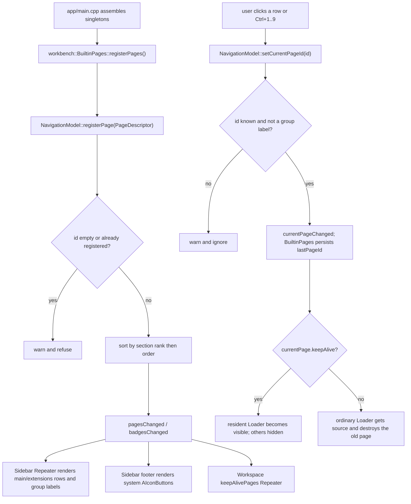

# Shell and navigation

## What this feature does

The shell is the application's outer frame and UI framework: the sidebar, the
workspace host, the status bar, the toast overlay, the page registry and the
shared `A*` component shelf. It knows about pages, sections, badges and window
geometry — and **nothing about agents, skills, web tabs or tools**. Those are
business concepts that arrive through page *registration* from the assembly
layer (`awb_workbench`), never as shell dependencies.

Boundaries:

- The shell does not create pages. `workbench::BuiltinPages` registers
  `PageDescriptor`s; the shell only sorts, renders and switches between them.
- The shell does not perform business actions. The sidebar answers "where do I
  go", never "do something".
- Page state that must survive a page switch lives in C++; the workspace
  destroys ordinary pages on switch. The one exception is a page declaring
  `keepAlive` (currently the Web page), which the workspace hosts permanently.

## Files and classes

| File | Class / component | Responsibility | Collaborates with |
|---|---|---|---|
| `src/shell/PageDescriptor.h` | `PageDescriptor`, `NavKind` | The shell's view of one sidebar row — a page or a static group label: `id`, `title`, `iconSource`, `source`, `section`, `order`, `badgeText`, `enabled`, `keepAlive`, `kind`, `level` | `NavigationModel`, `BuiltinPages` |
| `src/shell/NavigationModel.h` | `NavigationModel` | Sidebar-row registry plus the sidebar/workspace list model; properties `currentPageId`, `currentPage`, `badges`, `keepAlivePages`; `Roles` | `Sidebar.qml`, `Workspace.qml`, `StatusBar.qml`, `MainWindow.qml`, `BuiltinPages` |
| `src/shell/NavigationModel.cpp` | `NavigationModel` | Registration validation, section sort, badge updates, ordered page ids, rejecting group labels as destinations | `BuiltinPages` |
| `src/shell/ShellController.h` | `ShellController` | Window-level state persisted to `settings.json`: title, size, sidebar width/collapse, `lastPageId`, Web surface and Chromium flags, tray/remembered-close/single-instance switches | `MainWindow.qml`, `Sidebar.qml`, `SettingsWebPage.qml`, `SettingsLaunchersPage.qml`, `core::Settings` |
| `src/shell/ShellController.cpp` | `ShellController` | Getters/setters, `saveWindowSize()`, `valueChanged` re-broadcast | `core::Settings` |
| `src/shell/TrayController.h` / `.cpp` | `TrayController` | System-tray icon (`QSystemTrayIcon` + `QMenu`) with a minimal Show/Hide + Quit menu; hide-to-tray, raise-from-tray, `quitRequested` | `MainWindow.qml` (onClosing, quit flow), `core::Settings` |
| `src/shell/UiServices.h` | `UiServices` | Clipboard, external URL/file-manager, native folder/colour dialogs, recent-colour memory; colour-picker support data | `MarkdownWorkbenchPage.qml`, `AgentEditDialog.qml`, `AColorPicker.qml`, `WorkbenchContext` |
| `src/shell/UiServices.cpp` | `UiServices` | Native Win32 `IFileDialog` / `ChooseColor` implementations, `OpResult` errors | `core::OpResult` |
| `src/shell/Notifications.h` | `Notifications` | Non-blocking toast queue model: `IdRole`/`LevelRole`/`TitleRole`/`TextRole`, `notify()`, `dismiss()`, `durationFor()`, `maxVisible()` | `AToastStack.qml`, `Toasts.qml`, `WorkbenchContext`, `BuiltinPages` |
| `src/shell/Notifications.cpp` | `Notifications` | Append/remove only; all timing lives in QML | `AToastStack.qml` |
| `src/shell/qml/MainWindow.qml` | `MainWindow` | Window assembly: size clamping, lowercase alias bridge, global shortcuts, exit confirmation (tray-aware), legacy-import notice, font binding | all singletons, `Sidebar`, `Workspace`, `StatusBar`, `Toasts` |
| `src/shell/qml/Sidebar.qml` | `Sidebar` | Sectioned navigation: scrollable `main`/`extensions` with group labels and indented rows, pinned `system` footer with the collapse handle, badges | `nav`, `shell`, `AIconButton`, `APill` |
| `src/shell/qml/Workspace.qml` | `Workspace` | Loads exactly one page; `keepAlive` pages via a resident `Repeater`, ordinary pages via a destroying `Loader` | `nav`, `PageHeader` consumers, `workbench` |
| `src/shell/qml/StatusBar.qml` | `StatusBar` | Running-agent and tab counters from `nav.badges`, Python/Node badges from `environment` | `nav`, `environment`, `core::Settings` via `ShellController` |
| `src/shell/qml/Toasts.qml` | `Toasts` | Anchors `AToastStack` to the bottom-right of the window | `Notifications` |
| `src/shell/qml/PageHeader.qml` | `PageHeader` | Title + subtitle + an `actions` slot pushed to the right edge | every page |
| `src/shell/qml/SettingsPage.qml` | `SettingsPage` | Settings shell: left section nav + right `StackLayout`, pinned app version | `Settings*Page.qml` (see [Settings](settings.md)) |
| `src/shell/qml/Settings{Appearance,Launchers,Environment,Skills,Web,Markdown,Plugins,Advanced}Page.qml` | eight section pages | One settings section each; kept instantiated by the `StackLayout` | `theme`, `agents`, `environment`, `skills`, `shell`, `workbench` |
| `src/shell/qml/components/*.qml` | the `A*` shelf | 26 reusable themed components (see the shelf table below) | every page |
| `src/shell/CMakeLists.txt` | build target `awb_shell` | Static library | — |

Cross-module pieces that participate in page registration and the status bar
live outside `src/shell/` and are listed here because the shell is useless
without them:

| File | Class | Role |
|---|---|---|
| `src/workbench/BuiltinPages.h` / `.cpp` | `BuiltinPages` | Registers the five built-in pages plus the sidebar group label, wires sidebar badges, persists the last page, wires the cross-domain Web rules |
| `src/workbench/EnvironmentService.h` / `.cpp` | `EnvironmentService` | Python/Node detection behind the status-bar badges and the Settings rows |
| `src/workbench/WorkbenchContext.h` / `.cpp` | `WorkbenchContext` | The `workbench` singleton: `showPage()`, `notify()`, `copyText()`, plugin switches and `legacyImportNotice` |
| `app/main.cpp` | `main()` | Assembly order, the single-instance guard (`SingleApplication`) and singleton registration on the `AgentWorkbench.App` URI |

## Frontend design

### `MainWindow.qml`

The window assembles the frame:

- **Layout.** A `RowLayout` holds the `Sidebar` and a `ColumnLayout` of
  `Workspace` plus `StatusBar`: the sidebar runs the full window height, and
  the status bar occupies only the workspace column, starting at the sidebar's
  right edge. The pinned system-page icons and the collapse handle therefore
  sit flush against the window bottom instead of one status-bar height above
  it.
- **Size clamping.** `width`/`height` come from `shell.windowWidth`/`windowHeight`
  clamped by `Screen.desktopAvailableWidth`/`Height`, with a 1024×540 minimum.
  The title is `shell.windowTitle` or the untranslated brand name.
- **The lowercase alias bridge.** The root declares `readonly property var`
  aliases `theme`, `nav`, `shell`, `ui`, `toasts`, `agents`, `web`, `skills`,
  `tools`, `workbench`, `environment`, each bound to its capitalized singleton.
  Every descendant resolves `theme.` / `nav.` through this root, so the QML
  contract name is lowercase while the registered type name is uppercase.
- **Global shortcuts.** `Ctrl+B` toggles `shell.sidebarCollapsed`; `Ctrl+,` calls
  `workbench.showPage("settings")`; `Ctrl+1`…`Ctrl+9` call `goToPageNumber(n)`,
  which reads `nav.pageIdsInOrder()` and calls `nav.setCurrentPageId()`. Pinned
  pages sort last, so Ctrl+9 reaching a `system` page is expected. One scoped
  exception lives outside the shell: the Markdown workbench's editors accept
  `Ctrl+B` (bold) via `Keys.onShortcutOverride` while they hold focus, so the
  window-level shortcut simply never sees those key presses — no rebinding and
  no arbitration needed (see [Markdown workbench](markdown-workbench.md)).
- **Font binding.** `font.family: theme.family.length > 0 ? theme.family :
  undefined`, so an empty token falls back to the system default; `theme.changed`
  makes it live.
- **Close choice and exit confirmation.** `onClosing` first calls
  `shell.saveWindowSize()`. With a tray available it opens a close-choice
  `ADialog` until `launcher.rememberCloseAction` is true; the choice can exit or
  minimize to the tray and may save the action. A remembered tray action hides
  the window. Any exit path still blocks for the existing three-button
  `ADialog` when `agents.hasLaunchedAgents()` is true (close background terminals
  via `agents.stopAll()`, exit anyway, cancel).
- **Legacy notice.** An `AAlertDialog` opens once in `Component.onCompleted`
  when `workbench.legacyImportNotice` is non-empty.

### `Sidebar.qml`

Renders the navigation model grouped by section, drawing each row as a page
entry or as a static group label. The root is an `Item` because
the sidebar is a frosted-glass panel whose visual body is a stack of declared
layers, bottom to top: an `AWorkspaceGlow` backdrop (the light the glass lets
through), a translucent base `theme.alpha(theme.sidebarBg, 0.72)` dark /
`0.88` light, a top reflection veil, an `ASpotlight` overlay, the content
column, and on the right edge a `borderSubtle` divider line plus a dark-theme-
only 1 px inner highlight. The spotlight follows the pointer over the panel and
paints a 2 px sheen along its border. Because the panel is full height, its
gradient radii are overridden from the sidebar width rather than the component
default (which scales from `max(width, height)` and is meant for a roughly
square card), and the two themes are tuned in opposite directions. On the dark
base `theme.accent` already reads as light, so the card intensities are too
bright for a panel and both peaks come down (`spotAlpha` 0.15, `ringAlpha`
0.42 — the sheen more, because 2 px of it is what the eye picks out). A
near-white light base has no brightness left to add, so a white spot there is
indistinguishable from no change: the only thing the eye can follow is the hue
shift, so the spot uses `theme.accent` too, just faint (`spotAlpha` 0.22) — any
denser and it is a blue smudge on a pale panel, any lighter and the follow
disappears. Its radius stays under the panel width (0.95 × width) so the pool
clusters around the pointer instead of washing over the whole sidebar, and the
2 px sheen keeps the full peak (`ringAlpha` 1.0). Note the measurement differs
by theme: the dark spot raises luminance, the light one *lowers* it while
raising blue, so judging the light theme by a luminance delta reads as a
regression. Real backdrop blur is
deliberately out (the same conclusion as `AMenu`: not portable across Qt major
versions; desktop-level acrylic would need native composition and is not
attempted either). See `designs.md` section 2.4 for the full recipe.

- **Pointer state.** `HoverHandler` at the root only covers the blank area,
  because hover is delivered exclusively: the row `MouseArea`s, the footer
  `AIconButton`s, the `AScrollBar` and the resize handle each swallow it. The
  panel therefore merges the criterion itself — a root `HoverHandler` OR a
  non-zero hold counter — and takes its coordinates from whichever child
  reported last (`setPointerFrom()`, mapped into the sidebar's coordinate
  system). The counter is a count rather than a boolean because the relative
  order of `entered` and `exited` between two rows is not guaranteed; a boolean
  would be cleared by the later `exited`. A delegate or control destroyed while
  hovered releases its hold in `Component.onDestruction`, otherwise the counter
  never returns to zero and the spotlight stays lit.

- **Scrollable region.** A `Flickable` over a `ColumnLayout` with a `Repeater`
  bound to `nav`; each `NavRow` is visible only when `model.enabled`,
  `model.section !== "system"`, and — for a group label — the sidebar is not
  collapsed. Section dividers are drawn by the first row of
  every non-`main` section (`index === nav.rowOfFirstInSection(model.section)`).
- **Group label rows.** One inline delegate renders both shapes of a row, picked
  by `model.kind`. A `"header"` row is static text: caption-size
  `theme.fontSizeCaption` in `theme.textMuted`, bold, no icon. It gets a
  `theme.spacingS` gap above it so the group reads as a group — unless it opens
  its section, where the section divider already provides the air. Its
  `MouseArea` is
  disabled with `hoverEnabled` off, so it cannot be clicked, cannot be
  highlighted, and does not swallow the pointer hover — the panel spotlight
  travels over it just as it does over blank space. Rows with `model.level > 0`
  indent their whole chip (background, accent bar, icon slot and label) by
  `model.level * theme.spacingM`, and indentation is dropped when collapsed
  because the collapsed sidebar is an icon column.
- **Current row.** `nav.currentPageId === model.pageId` drives a
  `theme.alpha(theme.surfaceBg, 0.78)` background and a 3 px accent bar; hover
  uses `theme.alpha(theme.surfaceHoverBg, 0.62)`. Neither is drawn on a group
  label — it is never the current page (`setCurrentPageId()` rejects it), so
  giving it a selected state would promise a destination it does not have. Both
  are translucent rather
  than solid because the spotlight sits under the content column: an opaque row
  chip hides the light exactly where the pointer is, which is all the light
  theme has to show.
- **Width.** `implicitWidth` is `theme.sidebarCollapsedWidth` when collapsed,
  otherwise `shell.sidebarWidth` (falling back to `theme.sidebarWidth` when the
  setting is 0). Using `implicitWidth` matters because the parent `RowLayout`
  only reflows on implicit-size changes.
- **Resize handle.** A 6 px strip on the right edge (hidden when collapsed):
  hovering it turns the cursor into a split-horizontal arrow; dragging adjusts
  the width. During the drag the width follows a local `pendingWidth` (the
  `Behavior on implicitWidth` is disabled so the edge tracks the pointer
  frame-by-frame), and releasing commits once via `shell.setSidebarWidth()`,
  which clamps to `[180, 480]` and persists. Pointer positions are mapped to
  `sidebar.parent` before differencing — the parent `RowLayout`'s geometry does
  not change while the sidebar resizes, so raw `mouse.x` (which moves with the
  edge) would cancel itself out. The release order matters: `setSidebarWidth()`
  runs **before** `resizing = false`, so when the `implicitWidth` binding
  switches back to the `shell.sidebarWidth` branch the two values are already
  equal and no write happens. The other order snaps the width back to the
  previous persisted value for one write (the `Behavior.enabled` binding
  re-evaluates *after* the `implicitWidth` binding, so the intermediate write
  lands directly) and then animates from there to the released width.
- **Pinned footer.** The `system`-section pages render as plain `AIconButton`s
  (`active` when current, title in the tooltip) in a fixed footer, together with
  the collapse handle; expanded puts icons left and the handle right, collapsed
  stacks them vertically centred. The footer's `Repeater` skips `"header"` rows
  — a group label has no icon to pin, and the footer stacks by row index, so a
  label there would push the icons out of position. Group labels therefore
  belong to `main`/`extensions` only (`designs.md`).
- **Tooltips.** Collapsed rows show the title in a tooltip; `NavRow` and the
  footer buttons both carry `Component.onDestruction: ToolTip.hide()`.

### `Workspace.qml`

Shows exactly one page at a time.

- **`keepAlive` pages** come from `nav.keepAlivePages` and are instantiated once
  by a resident `Repeater` of `Loader`s. Visibility is
  `nav.currentPageId === pageId`; they are never destroyed on switch.
- **Ordinary pages** use a single `Loader` whose `source` is
  `nav.currentPage.source`, but only when the current page is *not* a `keepAlive`
  page (`isKeepAliveCurrent`); otherwise the same page would be instantiated
  twice. Switching away destroys the old page.
- **Load failures** are reported through `workbench.notify("error", ...)` on
  `Loader.Error`.
- **Empty state.** A centred "Pick a page from the sidebar" label shows while
  `nav.currentPageId` is empty (a transitional state, since the last page is
  restored at startup).

### `StatusBar.qml`

Lives at the bottom of the workspace column, starting at the sidebar's right
edge (the sidebar runs the full window height, so the bar no longer spans the
full width). A `RowLayout` inside a `Rectangle` whose height comes from
`implicitHeight: theme.statusBarHeight` (a direct `height` binding would
trigger Qt 5's recursive re-arrange); a 1 px `theme.separator` line on the top
edge separates it from the workspace — the colour difference alone became too
weak once the sidebar went translucent. It shows `Running: %1` from
`nav.badges["agents"]` and the Python/Node badges bound to `environment.*` (a
red `×` when missing, with a tooltip explaining the consequence). The
application version is not here any more; it moved to the pinned footer of
`SettingsPage`. The web-tab count is **deliberately absent**: the sidebar
already shows it as the `web` page badge (`BuiltinPages::wireBadges()`), and an
earlier `Tabs: %1` label here never rendered because its condition
(`nav.countInSection("web")`) counts page sections, of which none is `web` — it
was removed rather than wired to a second source of the same number.

### `PageHeader.qml`

A `RowLayout` with a title/subtitle column, a flexible spacer, and a `default
property alias actions` slot so pages can inject action buttons that stick to
the right edge.

## Backend design

### `PageDescriptor`

The shell's view of **one sidebar row**: either a page the workspace can open,
or a static group label that only names the rows under it. `id` is the
registration key; `title` is an English source string evaluated by the
registrant at registration time (see [Internationalisation](i18n.md) for why
`BuiltinPages` uses an explicit translation context here); `iconSource` is a
`qrc:` URL; `source` is the page QML URL.

| Field | Meaning |
|---|---|
| `id` | Registration key; must be unique |
| `title` | English source string, evaluated by the registrant at registration time |
| `iconSource` | `qrc:` icon URL |
| `source` | Page QML URL, e.g. `qrc:/qt/qml/AgentWorkbench/agentcatalog/AgentGridPage.qml` |
| `section` | `main` \| `extensions` \| `system`; `system` pins to the sidebar footer |
| `order` | Sort key inside the section; equal values keep registration order |
| `badgeText` | Sidebar badge; empty means none |
| `enabled` | When false the row is hidden from the sidebar |
| `keepAlive` | When true the workspace keeps it instantiated and only hides it |
| `kind` | `NavKind::Page` (a destination) \| `NavKind::Header` (a static group label: no `source`, never current, absent from the shortcut sequence and the badge map) |
| `level` | Sidebar indent depth: 0 = top level, 1 = hangs under the row above it |

A label and the rows it heads are ordinary adjacent model rows — grouping is
produced by `order` plus `level`, not by a parent/child structure. That keeps
the existing stable sort untouched and leaves room for a second menu level
later without changing the shape of a registration.

### `NavigationModel`

- **Registration validation.** `registerPage()` refuses an empty id or a
  duplicate (both warn, neither is fatal — the shell never guesses which page
  was meant). Acceptance resets the whole model because the insert position is
  decided by the sort, then broadcasts `pagesChanged()` and `badgesChanged()`.
- **Section ordering.** `sort()` is a `stable_sort` by `sectionRank`
  (`main` < `extensions` < `system`) then `order`; equal `order` keeps
  registration order. Group labels take part in the same sort — they are rows,
  not a separate tree.
- **Two kinds of row.** `roleNames()` exposes `kind` (`"page"` / `"header"`) and
  `level` so one delegate can render both. Only page rows are *pages*:
  `pageIdsInOrder()`, `badges()` and `setBadge()` skip label rows, and
  `setCurrentPageId()` rejects an id that belongs to one (warns, leaves the
  current page alone). `countInSection()` and `rowOfFirstInSection()` count
  model rows, so they include labels — the divider is drawn per row and must not
  skip one.
- **Persistence.** `NavigationModel` itself does not persist; `BuiltinPages`
  calls `ShellController::setLastPageId()` on `currentPageChanged()` and restores
  it at startup.
- **Properties that must have NOTIFY.** `currentPageId` and `currentPage` drive
  the workspace `source` binding; `badges` lets `StatusBar` bind
  `nav.badges["agents"]` (the `page(id)` invokable has no notify signal);
  `keepAlivePages` lets the workspace `Repeater` re-evaluate on registration.
  All three are `Q_PROPERTY`s with NOTIFY for exactly these bindings.
- **`setCurrentPageId` is `Q_INVOKABLE`.** A bare `Q_PROPERTY` WRITE accessor is
  not in the meta-object method table, so `nav.setCurrentPageId(...)` would throw
  "is not a function"; sidebar clicks and Ctrl+N switching failed silently
  before this was fixed. Assignment (`nav.currentPageId = x`) also still works.
- Helpers `pageIdsInOrder()`, `countInSection()` and `rowOfFirstInSection()` are
  invokables used by the shortcuts and the sidebar's section rendering.
  `pageIdsInOrder()` is the `Ctrl+1…9` sequence, so a group label never takes a
  number.

### `ShellController`

Projects window-level state as bindable properties; values live only in
`core::Settings`, with no local cache. Setters write the setting and call
`save()` immediately. The constructor connects `core::Settings::valueChanged` so
external edits to `settings.json` re-broadcast `window.sidebarCollapsed`,
`window.sidebarWidth`, `window.width`/`height`, `window.title`, `web.surface` and
`web.chromiumFlags`. `setWebSurface`/`setWebChromiumFlags`/`setSidebarWidth` are
`Q_INVOKABLE` because they have no WRITE accessor. `setSidebarWidth` (the sidebar
drag handle's commit entry point) clamps to the `sidebarMinWidth`/`sidebarMaxWidth`
properties (180/480, `CONSTANT`) and also exposes them to QML; the read side stays
tolerant so a hand-edited `window.sidebarWidth` of 0..1024 keeps its existing
"0 = theme fallback" meaning.

### `TrayController`

A `QObject` wrapping a `QSystemTrayIcon` plus its `QMenu`; it exists because
the shell module links `Qt::Widgets` solely for the tray (the app itself is a
`SingleApplication`, i.e. a `QApplication`). It owns no state beyond the menu,
a one-time notice flag and the optional `QWindow *` set by `main.cpp` after the
engine loads.

- **Lifecycle.** Constructed early in `main.cpp` so the icon is up as soon as
  the settings allow it; `setWindow()` attaches the root window so
  `showWindow()` can un-minimize, `raise()` and `requestActivate()` it.
  The menu (Show / Hide / Quit) is a plain `QMenu` deleted in an explicit
  destructor so it dies before the base `QObject` teardown.
- **Settings.** `launcher.trayEnabled` gates the icon; a `valueChanged`
  connection re-syncs the icon when the settings page toggles it at runtime.
  `MainWindow.qml` consults `launcher.rememberCloseAction` before opening the
  close-choice dialog and uses `launcher.closeToTray` only for a remembered
  action. `available` mirrors `QSystemTrayIcon::isSystemTrayAvailable()` (with
  `availableChanged`), and `hidden` tracks hide-to-tray state. The icon carries
  a tooltip because Windows lists hidden-area icons by that text: without it the
  entry in the "Show hidden icons" flyout is anonymous, and `syncIcon()` logs
  `trayEnabled` / `isSystemTrayAvailable()` / whether the icon object exists so
  "where is my tray icon" is answerable from the log alone.
- **The tray never quits on its own.** Quit emits `quitRequested`; the window
  decides. This keeps the exit confirmation (running agents) as the single
  exit path — the connection in `MainWindow.qml` first un-hides the window so
  the dialog is actually visible, then runs the same confirm flow as the
  window's close button.
- **Quit-on-last-window interplay.** While the tray is available `main.cpp`
  turns `quitOnLastWindowClosed` off (re-enabled on `availableChanged`), so
  every real exit is an explicit `workbench.quit()` — nothing exits merely
  because the window closed. `hideToTray()` shows a one-time balloon hint.
- **Activation.** Left-click and the tray's activated signal map to
  show/hide toggling; the single-instance guard routes "raise" messages from
  secondary instances into `showWindow()` here.

### `UiServices`

The single place for system-level UI operations: `copyText()`,
`openExternalUrl()`, `revealFile()`, `openFolder()`, `pickFolder()`,
`pickSaveFile()`, `pickColor()`, `rememberColor()`, and the colour-picker
support data (`colorThemes`, `standardColors`, `recentColors`). All fallible
operations return `awb::core::OpResult` **written fully qualified**: Qt 5's moc
records the return type as written while QML resolves the `QMetaType`
registration name (the classes' fully qualified name), so a short type name
throws "Unknown method return type" and the call silently fails.
`pickFolder`/`pickSaveFile`/`pickColor` use native Win32 dialogs because
`QFileDialog`/`QColorDialog` need QtWidgets (linked into the shell only for the
tray; core must stay widget-free) and QML's `FolderDialog` is Qt 6
QuickDialogs2 only; the native route is the only version-independent one.
Recent colours are an in-process, non-persisted list capped at 10, newest
first.

### `Notifications`

A `QAbstractListModel` that only appends and removes toasts. `notify(level,
title, text)` ignores an empty toast and generates a string id; `dismiss(id)`
removes by id and ignores unknown ids. `durationFor(level)` returns the dwell
time — warning 5000 ms, error 8000 ms, everything else 3000 ms — but the actual
timing and hover-pause live in `AToastStack.qml`, not in C++. `maxVisible()` is
3.

### `EnvironmentService`

Backs the Python/Node badges in the status bar and the two rows of the Settings
page; `statusBar` binds `pythonInstalled` / `pythonVersion` (and the `node`
twins, plus `pythonStatus` / `nodeStatus` to tell "not installed" from "no
verdict yet") through one `changed()` signal. The detection itself does not run
here: `EnvironmentProbe::run()` is a pure worker that `EnvironmentService`
dispatches to the thread pool, and the result comes back through a
`QFutureWatcher` finished handler on the GUI thread. `detecting` is true while
such a round is in flight, and `refresh()` (the Re-detect action) dispatches a
new one unless a round is already running.

The behaviour, the three-way verdict rule and the caching are documented in
[Workbench and pages](../development/workbench-and-pages.md); the key point for a
reader of this page is that the status bar shows an ellipsis while no verdict
exists, because "the check has no answer yet" is not the same message as "not
installed".

## Component shelf

`src/shell/qml/components/` is the only legal source of reusable widgets; the
visual recipes are owned by `designs.md`, which is authoritative over this list.

| Component | Purpose |
|---|---|
| `AButton` | Text button with primary/secondary/ghost/danger variants and `accentColor` |
| `AIconButton` | Icon button (28 px, 44 px large), mandatory tooltip, `active` nav state |
| `ATextField` | Single-line themed input with focus ring and invalid state |
| `ATextArea` | Multi-line themed editor (surface background) |
| `AFormLabel` | Form label row with required star and info tooltip |
| `ASearchField` | Search input with leading icon and clear button |
| `AComboBox` | Fully themed combo box; override `contentItem`/`delegate` at use sites |
| `AColorField` | `#RRGGBB` input plus mini swatch, backed by `AColorPicker` |
| `AColorPicker` | Office-style colour picker (theme colours, standards, custom, recent) |
| `AColorSwatch` | Colour cell/swatch with a "no colour" state |
| `ACard` | Card container (surface, radius, border, hover) |
| `ASpotlight` | Pointer spotlight + border shimmer overlay for glass cards and panels |
| `AWorkspaceGlow` | Page backdrop of two faint radial glows under glass cards |
| `AListRow` | List/settings row with an injected content `RowLayout` |
| `APill` | Badge pill for counts and source labels |
| `AEmptyState` | Whole-block empty state with an `extra` slot and an action |
| `ADialog` | Modal dialog skeleton (centred, scrim, Esc, first-focus) |
| `AConfirmDialog` | Confirm dialog built on `ADialog` |
| `AAlertDialog` | Alert/error dialog with a scrollable mono detail block |
| `ASectionHeader` | Settings section header with a trailing `extra` action |
| `AStatusDot` | On/off status dot, never colour-only |
| `AToastStack` | Bottom-right toast stack (max 3 visible, hover pauses) |
| `AScrollBar` | Always-visible themed scrollbar |
| `AMenu` | The only menu base (glass surface, soft shadow, top sheen) |
| `AMenuItem` | Menu item with a fixed 16 px icon slot |
| `AMenuSeparator` | Menu group divider |
| `AgentAvatar` | Agent icon plus status corner badge |

## Business logic

The diagram traces how a page travels from the assembly layer into the sidebar
and the workspace, and how a switch is applied.

The workspace and sidebar communicate only through `nav`; the shell never imports
a domain type. `BuiltinPages` bridges domains: it reads the agent model for the
`agents` badge, the web tab model for the `web` badge, and wires the cross-domain
Web rules (offline overlay, session-URL retarget, close-on-remove, external-open
toast).

## Pitfalls and conventions

- **QML only talks to facades and models.** Pages do not read files and do not
  call `Qt.openUrlExternally` directly; they go through `ui.*`, `workbench.*` or
  their own facade.
- **Delegate tooltips.** Any row that is a delegate (sidebar rows, settings
  list rows, toast hosts) needs `Component.onDestruction: ToolTip.hide()`, or the
  shared tooltip freezes on screen when the hover host dies.
- **ComboBox echo uses a loop, not `indexOfValue`.** A binding that only depends
  on the id (via `indexOfValue(theme.themeId)`) evaluates to -1 when the internal
  delegate model is not ready and is never recomputed; iterating a NOTIFY
  property (`theme.availableThemes`) re-evaluates when the list is ready. Both
  the theme and font combos in `SettingsAppearancePage.qml` use the loop.
- **The `system` section never enters the scrollable list.** Pinned pages are
  rendered only in the footer; putting them in the `Repeater` as well would
  duplicate them.
- **A group label is a row, not a container.** `registerPage()` accepts it like
  any other descriptor, so nothing enforces that a label sits above its rows:
  the pairing is `order` adjacency (`designs.md`), and a label with no row under
  it is just a stray line of text. Because it is a row, its title has no badge
  slot and no `Ctrl+1…9` number — and it must not be the page the app restores on
  startup, which `setCurrentPageId()` already guarantees by rejecting it.
- **`keepAlive` pages are created at 0x0.** Layout children of a resident page
  must supply sizes through `implicitWidth`/`implicitHeight`; direct `width`/
  `height` bindings are overwritten by the first reflow.
- **`implicitWidth` for layout children.** The sidebar uses it so the workspace
  reflows; writing `width` directly leaves the workspace frozen at its old size.
- **`nav.badges[...]`, not `nav.page(id)`.** The invokable has no notify signal,
  so a binding through it never recomputes when a badge changes.

## Adding a page

To add a page you touch, at minimum:

1. **The page QML** in the owning module's `qml/` directory.
2. **`app/CMakeLists.txt`** — add the file to the module's `_*_qml` list (which
   sets the `QT_RESOURCE_ALIAS` that forms its URL).
3. **`cmake/AwbTranslations.cmake`** — add it to `AWB_TS_SOURCES` if it contains
   `qsTr()`.
4. **`src/workbench/BuiltinPages.cpp`** — build a `PageDescriptor` and call
   `registerPage()`, choosing `id`, `title`, `iconSource`, `source`, `section`
   and `order`.
5. **Wiring** — if the page needs a badge, update it from the relevant facade in
   `BuiltinPages`; if it needs a shortcut, add it in `MainWindow.qml` (remember
   `keepAlive` pages must disable their own shortcuts when not current).
6. **Documentation** — update this document and the corresponding Guide page
   (both the English source and its Chinese mirror).

To hang the page under a group label instead of leaving it at top level,
register the label as one more descriptor: `kind = NavKind::Header`, the same
`section` as the page, no `source`, an `order` immediately below the group's
first page — and set `level = 1` on the page itself. A label with no rows under
it renders as a stray line of text, so both registrations belong in the same
commit.

## Related

- [Skills browser](skill-browser.md) — a page registered through the same path.
- [Markdown workbench](markdown-workbench.md) — the window the shell hosts
  rather than a registered page, and a heavy consumer of the `A*` shelf.
- [Settings](settings.md) — the `system`-section page and its sections.
- [Interface (guide)](../guide/index.md) — the user-facing description.
- [Frontend design](../architecture/frontend-design.md) — the visual recipes and
  the reuse-first rule.
- [Layers and dependencies](../architecture/layers-and-dependencies.md) — why
  the shell may not import a domain module.
