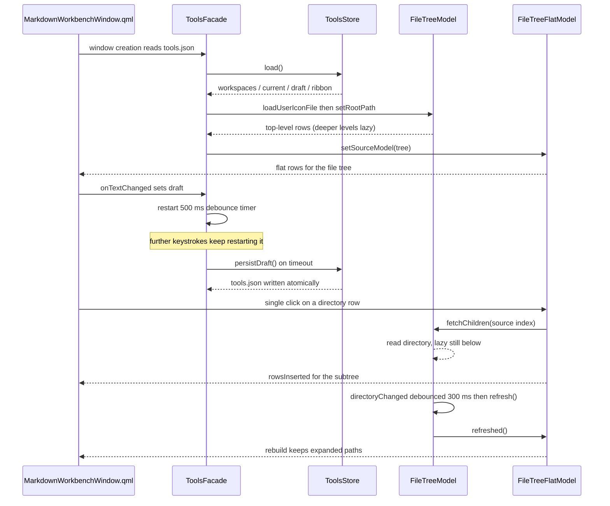
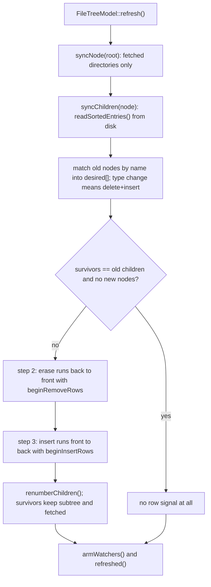
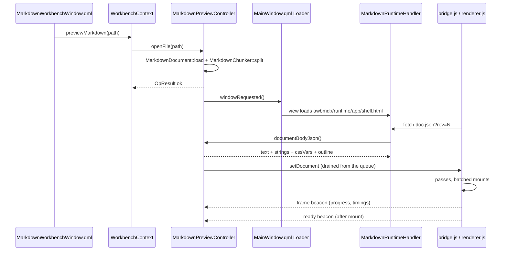

# Markdown 工作台

Markdown 工作台是一个**独立窗口**，把原先的提示词撰写页与 Markdown 预览窗合为一体：一个窗口、两种预设。**提示词模式**对着工作区文件树撰写提示词；**文档模式**阅读并编辑一份 Markdown 文件。它从侧栏的 **Markdown** 条目或从工作区文件树打开，不是 `Workspace` 里的一个页面。

它为三个具体理由而存在。在提示词里引用文件，通常要手拼相对路径——文件树经拖放或双击插入 `` `./相对路径` `` 引用。直接把提示词敲进 agent CLI，有在半成品上误触回车的风险——因此本窗口**没有发送动作**：回车只换行，什么都不会离开窗口，交付只有复制。以及：几百 KB 的文档，首屏时间被**第一趟**而不是**整篇文档**决定——「渲染器：分趟、攒批与可见性」一节写的是这句承诺怎么兑现，数字与实验过程记在调研记录里（`docs/research/markdown-preview-runtime.md`，调研记录只写英文、不做镜像）。

用户视角见 [Markdown 工作台](../guide/Markdown工作台.md)。
架构背景见 [分层与依赖](../architecture/分层与依赖.md) 与
[前端设计](../architecture/前端设计.md)。

## 这个窗口是什么，以及它不是什么

- **一个窗口，两种预设。** 预设是同一套代码的两份界面配置，不是两个应用：

  | | 提示词模式 | 文档模式 |
  |---|---|---|
  | 左侧面板 | 工作区文件树，默认展开 | 收起为一条可点击展开的窄边 |
  | Ribbon | 展开（默认单行） | 折叠为 tab 行 |
  | 中间区 | 提示词草稿（编辑器本体） | 打开的那份文档，带 预览 / 分栏 / 源码 |

  右侧是大纲面板，只在文档模式、跟在大纲开关后面。从侧栏或启动页打开窗口得到提示词模式；从工作区文件树打开一份 Markdown 文件得到文档模式（或让活着的窗口换到那个文件）。切预设的入口是 Ribbon 视图页的 **Full Tools** 开关；渲染不了的文档预设（无能力、无文档）会退回提示词模式，而不是亮出一个坏窗口。用户视角里没有「模式」这个概念——只有一个窗口、工具多一点少一点。
- **窗口关掉即销毁。** `MainWindow.qml` 用一个 `Loader` 持有它，`active` 不再包含 `markdown.available`——唯一把它置假的是窗口自己报到关闭。QML 的 `Window` 关不掉自己，所以 `onClosing` 的每一条放行路径都调 `MarkdownPreviewController::notifyWindowClosed()`，而根本没有关闭事件的那些路径（例如退出应用）由 `Component.onDestruction` 再报一次——报到是幂等的。两次使用之间常驻一个活视图（连带它那约 4 MB 的运行时）等于给每次启动都加税。
- **提示词模式在每种构建里都可用。** 它是纯 QML 编辑器加高亮；Qt 5 与无 WebEngine 的构建里预览面根本不装载（进程里不存在 `WebEngineView`）、文档模式的入口不出现——功能是**不存在**，而不是存在且坏掉（见「能力门禁」一节）。
- **一次一份文档。** 再打开第二个文件会复用活着的窗口、换掉它的内容，而不是建第二个 `WebEngineView`。每个内嵌视图都是一个 Chromium 帧，各自带着渲染进程那侧的内存；一个会攒着多个预览视图的功能，代价比它服务的场景更大——这是预览窗当年的决策，原样带过来。
- **存盘不能改写文件。** 一份 CRLF + BOM 的 README，Ctrl+S 之后必须还是 CRLF + BOM——文档管线在载入时记下字节形态、存盘时按原样编回（见「纯层」一节）。草稿则从不直接碰文件系统：它活在 `tools.json` 里。
- **不是通用 HTML 查看器。** 只有 `.md` 与 `.markdown` 会被接受（`MarkdownPreviewController::canPreviewPath`，它同时也是文件树菜单项出不出场的依据）。用这块表面渲染任意 HTML 等于执行文档自带的脚本，而渲染器的 `html: false` 明确拒绝这件事。
- **不与 agent 耦合。** 窗口不与任何 agent 通信、不运行任何东西，除了用户显式打开的那份文档之外不编辑任何仓库文件。它的写入只有 `tools.json`（工作区记忆、草稿、Ribbon 偏好）、系统剪贴板、文档自己的存盘，以及导出副本。

## Ribbon

窗口的动作住在顶部一条命令带里。`AWB_ENABLE_RIBBON` 的构建里它是 SARibbon 的 `RibbonBar`（`WorkbenchRibbon.qml`）；其余场合——以及没注册过 SARibbon 类型的单测引擎——它是普通工具栏 `WorkbenchToolbar.qml`。本节记录 SARibbon 怎么进构建、每个标签页里有什么、以及集成必须遵守的约束。

### SARibbon 怎么引入

- SARibbon 是 `third_party/SARibbon` 处的 git submodule（MIT 许可），**钉在 `f89a02e`**——刻意不取上游顶端：顶端在 QML 模块打开时强制引入第二个第三方依赖（QWindowKit），而工作台窗口保留系统原生边框。
- `AWB_ENABLE_RIBBON`（默认 `ON`，声明在 `cmake/AwbOptions.cmake`）负责接线：`SARIBBON_BUILD_QML=ON`、`SARIBBON_BUILD_WIDGETS` / `SARIBBON_BUILD_EXAMPLES` / `SARIBBON_BUILD_TESTS` / `SARIBBON_INSTALL` = `OFF`、静态库。只编 QML 模块——SARibbon 的 QWidget 部分永远进不了二进制。
- `app/main.cpp` 在 `engine.load()` **之前**调 `saRibbonRegisterQmlTypes(&engine)`。注册是命令式的（没有 qmldir 插件）；函数自带重复调用守卫。
- 领域库不链 SARibbon。`awb_tools` 与 `awb_markdown` 照旧只依赖 `awb_core` + `awb_theme`；集成点在 `app/`（CMake 链接 + 注册）与命令带 QML（`import SARibbon`）。第三方模块因此进不了领域层。

### 标签页与内容

命令带只有两个标签页：**开始** 与 **视图**。

- **开始** 装着迁移来的动作：**Copy Prompt**（交付路径——标题行的快速访问栏里还有第二个 **Copy**）、剪贴板组 **Paste / Cut / Copy Text**、**Undo / Redo**，以及格式三件套 **加粗 / 代码段 / 要点列表**。文档显示期间，这一页还有 **Find**（打开文档搜索）与 **Save**（仅当文档可编辑时可用）。每一个动作都转发到窗口的动作层或既有的 `MarkdownEdit` 静态光标操作——命令带只做入口，不含自己的逻辑。
- **视图** 装着开关：**Preview / Split / Source** 三态与大纲开关（都在文档显示期间）、**Full Tools**（预设切换：开 = 提示词模式，关 = 文档模式）、**Collapse**（把整条功能带折叠成 tab 行）、**Style**（单行 / 两行 / 三行）、**Follow Theme**（功能带的颜色是否跟随应用主题）。

单行是默认样式档，它的后果在加按钮前值得知道：面板标题隐藏，所有按钮不论 `proportion` 一律按小尺寸渲染——层级靠分组与按钮顺序表达，文字必须短。`minimumMode` 把功能带折叠成一行 tab；文档模式预设默认折叠，点 tab 行即再展开。

### 主题桥接

两套设计系统只在一个点相遇。`WorkbenchRibbon.qml` 把应用 `theme` 推进 `RibbonTheme`——accent、内容底色、文字色，以及深浅判定——每次 `Theme::changed` 推一次，受 **Follow Theme** 偏好（`tools.ribbonFollowAppTheme`，默认开）门控；关掉时 ribbon 保留自己的调色板。桥接是**单向**的（应用 → ribbon），没有反向同步，也没有第二套自动跟随。窗口自己的 QML 照旧只用 `theme.*` 令牌；「QML 无字面颜色」的架构门禁对本仓源码的约束一寸不变。

### 命令带的约束

- ribbon 是独立组件，由窗口经 `Loader` **按资源 URL** 装载——与预览面同一个模式。`WorkbenchRibbon.qml` 只在 `AWB_ENABLE_RIBBON` 的构建里登记进资源清单；装载失败（开关关着，或没注册过 SARibbon 类型的测试引擎）时窗口改载 `WorkbenchToolbar.qml`。装载发生在窗口创建那一刻、绝不按需反复切换：SARibbon 的叶子在 `Component.onCompleted` 期间创建，按需创建的 bar 会因上下文早死而亡。
- 两张皮都是对同一窗口动作层的纯转发——谁都不许长自己的行为，否则两种构建各自漂移。按钮集与右键菜单、两个 ribbon 标签页对齐。
- 不在 `RibbonPanel` 里声明 `Popup`/`Dialog`/`Menu`——bar 的 `componentComplete` 期间创建的弹窗会变成独立原生窗口、毁掉窗口场景。凡是弹窗形状的都经 `Loader` 创建。
- Ribbon 菜单只收 `RibbonMenuItem`；`AMenu` 家族留给窗口内上下文菜单。一个动作只有一处出口——同一个动作不许同时出现在命令带标签页和侧面板里，否则文案与启用态必然漂移。
- SARibbon 自带的字符串不进本仓 `.ts`，中文环境下是英文。窗口除这条 bar 本体外不引入任何 ribbon 自带界面。

## 文件与类清单

| 文件 | 类 / 组件 | 职责 | 与谁协作 |
|---|---|---|---|
| `src/workbench/qml/MarkdownWorkbenchWindow.qml` | `MarkdownWorkbenchWindow` | 窗口：命令带槽位、侧面板、草稿/文档中间区、搜索条、状态行、对话框、快捷键（由原 `MarkdownPreviewWindow.qml` 演化而来；资源别名从 `markdown/` 挪到 `workbench/`） | `ToolsFacade`、`Markdown`、`MarkdownEdit`、`MarkdownContextMenu`、`workbench`、`theme` |
| `src/workbench/qml/WorkbenchRibbon.qml` | `WorkbenchRibbon` | SARibbon 命令带：两个标签页、默认单行、样式档取自 `tools.ribbonStyle`、单向主题桥；对窗口动作层纯转发 | 窗口 QML、`RibbonTheme`、`tools.*` |
| `src/workbench/qml/WorkbenchToolbar.qml` | `WorkbenchToolbar` | 无 Ribbon 的降级形态：一条普通工具栏、同一批动作，ribbon 文件缺席时装载它 | 窗口 QML |
| `src/markdown/qml/MarkdownPreviewPane.qml` | `MarkdownPreviewPane` | 预览面（`WebEngineView` 及其接线），仅在有能力的构建里按资源 URL 装载 | `Markdown`、窗口 QML |
| `src/shell/qml/MarkdownStartPage.qml` | `MarkdownStartPage` | 侧栏的 **Markdown** 启动页：一个页头加一个打开（或抬前）工作台窗口的按钮——薄壳，不是编辑器本体 | `workbench.openMarkdownWorkbench()` |
| `src/workbench/BuiltinPages.{h,cpp}` | `BuiltinPages` | 注册内置页面，含 **Markdown** 启动页 | `NavigationModel`、`WorkbenchContext` |
| `src/tools/ToolsStore.{h,cpp}` | `ToolsStore` | `tools.json` 状态：MRU 工作区列表、当前工作区、提示词草稿，以及 `ribbon` 段（`collapsed` / `style` / `followAppTheme` / `lastTabIndex`）；`kMaxWorkspaces` = 20 | `ToolsFacade`、`core::JsonStore` |
| `src/tools/ToolsFacade.{h,cpp}` | `ToolsFacade` | QML 门面：工作区属性、草稿属性、`addWorkspace`/`removeWorkspace`/`refresh`/`fileReference`、经 `model` 暴露的扁平树模型，外加四个 `ribbon*` 界面偏好；500 ms 草稿防抖加析构补写 | 窗口 QML、`app/main.cpp`（`tools` 别名）、`FileTreeModel`、`FileTreeFlatModel` |
| `src/tools/FileTreeModel.{h,cpp}` | `FileTreeModel`（含私有 `Node`） | 单个工作区根上的懒加载目录树；增量 `refresh()`；`QFileSystemWatcher` | `ToolsFacade`、`FileTreeFlatModel` |
| `src/tools/FileTreeFlatModel.{h,cpp}` | `FileTreeFlatModel`（含私有 `Row`） | 供 QML `ListView` 消费的扁平投影；持有展开路径集合 | 窗口 QML、`FileTreeModel` |
| `src/tools/FileIcons.{h,cpp}` | `FileIcons` | 三张查找表（文件名 / 后缀 / 目录名）加兜底；`forFile()`/`forFolder()` | `FileTreeModel`（`IconRole`）、`core::IconResolver` |
| `src/tools/MarkdownEdit.{h,cpp}` | `MarkdownEdit` | QML 单例（`AgentWorkbench.App`）：`attach()`、`applyBold()`、`applyCode()`、`applyBullet()`——命令带开始页与编辑器右键菜单背后的格式动作 | 窗口 QML、`MarkdownContextMenu`、`theme::Theme` |
| `src/tools/MarkdownHighlighter.{h,cpp}` | `MarkdownHighlighter`、`MarkdownColors` | 轻量逐块 Markdown 高亮器；配色令牌 | `MarkdownEdit` |
| `src/tools/qml/MarkdownContextMenu.qml` | `MarkdownContextMenu` | 草稿编辑器的 `AMenu`：顶部格式化工具栏 + 撤销/重做/剪切/复制/粘贴条目 | `MarkdownEdit`、`AMenu`/`AMenuItem` |
| `src/markdown/MarkdownDocument.{h,cpp}` | `MarkdownDocument` | 磁盘上那一个文件：文本、脏标记、只读判定，以及**载入时看到的字节形态**（BOM、行尾、UTF-8 是否合法） | `MarkdownPreviewController`、`core::OpResult` |
| `src/markdown/MarkdownChunker.{h,cpp}` | `MarkdownChunker`、`MarkdownBlock` | 顶层块切分、两次切分之间的最小替换区间、块摘要 | `MarkdownPreviewController`、`renderer.js`、`scripts/spike-markdown-chunker.js` |
| `src/markdown/MarkdownRuntime.{h,cpp}` | `MarkdownRuntime` | 页面侧全部的纯字符串与纯计算：URL 布局、MIME 表、资源映射、主题 → CSS 变量、页面文案、大纲、命令/事件名表、能力判定 | 下面所有成员；页面协议唯一对着的 C++ |
| `src/markdown/MarkdownPreviewController.{h,cpp}` | `MarkdownPreviewController` | QML 单例 `Markdown`：文档 + 块 + 视图设置 + 待发送命令队列；导出件的落盘点 | `core::Settings`、`theme::Theme`、`MarkdownRuntimeHandler`、窗口 QML |
| `src/markdown/webengine/MarkdownPreviewProvider.{h,cpp}` | `MarkdownPreviewProvider` | 注册 scheme、持有只服务预览的 profile、装好供体，并告诉控制器「表面现在真的存在」 | `app/main.cpp`、`MarkdownRuntimeHandler` |
| `src/markdown/webengine/MarkdownRuntimeHandler.{h,cpp}` | `MarkdownRuntimeHandler` | `awbmd://runtime/…` 的唯一供体，随包字节带内存缓存 | `MarkdownPreviewController` |
| `src/markdown/webengine/runtime/*` | `shell.html`、`bridge.js`、`renderer.js`、`markdown-config.js`、`math-rule.js`、`diagram.js`、`find.js`、`theme.css` | 页面：启动与命令分发、分块管线、markdown-it 配置、KaTeX/任务项/告警规则、懒加载 mermaid、文档内搜索 | `MarkdownRuntime`（协议）、`third_party/markdown-runtime/` |
| `src/workbench/WorkbenchContext.{h,cpp}` | `WorkbenchContext` | 跨域入口：文档形态走 `previewMarkdown()` / `canPreviewMarkdown()`，提示词形态走 `openMarkdownWorkbench()`——替不许互相点名的域说话 | `MarkdownPreviewController`、窗口 QML、启动页 |
| `src/shell/qml/MainWindow.qml` | `MainWindow` | 承载窗口的那个 `Loader`；按开窗意图写窗口的 `initialPreset` | `Markdown`、`WorkbenchContext` |
| `cmake/AwbOptions.cmake`、`app/CMakeLists.txt` | `AWB_ENABLE_RIBBON` 接线 | SARibbon submodule 构建与窗口的资源登记 | `third_party/SARibbon` |
| `third_party/markdown-runtime/` | —— | 随包的浏览器构建产物，外加 `manifest.json`（版本、许可、sha256） | `tst_markdown`、`scripts/update-markdown-runtime.sh` |

模块之外，窗口依赖 `core::Paths::dataRoot()`、`config/default_file_icons.json`、`theme::Theme`、shell 的 `A*` 组件、`workbench.copyText()`/`notify()` 与 `ui.pickFolder()`。

## 前端设计

### 窗口骨架与两种预设

```
┌────────────────────────────────────────────────────────────────┐
│ 命令带：WorkbenchRibbon.qml（SARibbon）或工具栏降级；            │
│        标签页：开始 · 视图                                       │
├───────────────┬────────────────────────────────┬───────────────┤
│ 左侧面板       │ 中间区                          │ 大纲面板       │
│ 工作区         │ 单 tab 条（Draft / File 徽标）   │（仅文档模式，  │
│ + 文件树       │ 草稿，或带 预览/分栏/源码 的文档 │  跟在大纲开关  │
│               │ 搜索条 · 状态行                  │  后面）        │
└───────────────┴────────────────────────────────┴───────────────┘
```

- 左侧面板是迁过来的提示词页树面板：顶部一排紧凑头部（`Layout.fillWidth` 的工作区 `AComboBox`、选文件夹的 `AIconButton`、刷新 `AIconButton`），下面是树。它折叠成一条可点击的窄边；文档模式预设默认收起。面板与编辑器在相接处都不带圆角——直角齐平。
- 右侧面板是大纲，只在文档模式、跟在大纲开关后面存在。提示词模式没有右区——没有内容的面板不画。
- 中间区的头部是一条**单 tab 条**：一枚 `Draft` 或 `File` 徽标（`APill`）加标题（草稿，或文件名）。文档显示期间，这条带上还有文档自己的控件：预览/分栏/源码切换器、大纲开关、搜索按钮、字号与栏宽选择，以及 **More actions** 菜单。这条带就是将来多 tab 条生长的地方；今天它只装一个 tab。
- 中间主体在提示词模式下是草稿编辑器，在文档模式下是文档的两栏。文档主体是手写两栏布局，不是 `SplitView`：三态里有两态要把一栏挤成 0 宽，而 `SplitView` 对 `visible` 栏的处理跨 Qt 版本不一致。分隔条视觉 4 px、命中区 12 px；分栏比例（`editorShare`）是窗口内状态——拖一下不该碰磁盘。
- 中间区底部是**状态行**：提示词模式显示草稿的字符数与行数；文档模式显示文件路径、**有未保存的改动** 标记、只读原因（若有）、文件大小与渲染器版本号。状态永远不只靠颜色——脏与只读都写成文字。
- 提示词模式的 Ribbon 偏好（折叠位、样式档、上次标签页、主题跟随）持久化在 `tools.json` 的 `ribbon` 段里。面板状态与文档模式的 Ribbon 折叠位只活窗口一命——关窗即重置，这是「不逐键写界面状态」的诚实代价。

### 草稿编辑器

编辑器就是迁过来的提示词编辑器，如今住在窗口里。一个纵向 `Flickable`（`objectName: "promptScroll"`、`clip`、`StopAtBounds`、`ScrollBar.vertical: AScrollBar {}`）经 `TextArea.flickable` 附加属性挂一个 `ATextArea`（`objectName: "promptEditor"`）。文本只在 `Component.onCompleted` 初始化一次（`text = tools.draft`，随后 `MarkdownEdit.attach(promptEditor)`），不做双向绑定——常驻绑定会与用户输入打架；`onTextChanged: tools.draft = text` 是写路径。占位文本把契约写在明处：回车只插入一个新行，这个窗口不发送任何东西。

铺满编辑器的 `DropArea` 只接受来自文件树的拖拽（`drop.source.isFileReferenceDrag`），用 `promptEditor.positionAt(drop.x, drop.y)` 求插入偏移并把 `drop.text` 插进去；落点坐标本身就是文档坐标。只吃右键的 `MouseArea` 设 `editorMenu.editor = promptEditor` 再弹 `MarkdownContextMenu`。

### 文档主体

文档模式下，中间主体是源码编辑器与预览面并排。源码编辑器是第二个 `ATextArea`（`editorArea`），同样走 `Flickable` 那套结构，用主题的等宽字体（表格与代码块依赖对齐），文档不可编辑时只读，并且与草稿一样挂着 `MarkdownEdit.attach()` 高亮——只读文档也挂，读源码与写源码同样受益。它的文本只在初始化与「磁盘那份进来了」时写入，从不双向绑定；编辑经 200 ms 防抖交给控制器：一次敲键要把整篇重新切块并算差异，2 MB 文档上每键一次就是把 CPU 花在马上会被改掉的中间态上。

预览面是一个 `Loader`（`active: markdown.available`），`source` 是 `MarkdownPreviewPane.qml` 的资源 URL——只在跑得动它的构建里登记进二进制，无 WebEngine 的构建里进程根本不会创建 `WebEngineView`。装载失败弹 error toast，不留一个无声的空白。

### 文件树面板

- **工作区 `AComboBox`。** `model: tools.workspaces`。`contentItem` 与 `delegate` 都被覆写——默认 `ItemDelegate` 的背景是硬编码浅色系、深色主题下不可读——内容行里带逐项删除的 `AIconButton`。
- **文件树 `ListView`（`objectName: "fileTree"`）。** `model: tools.model`（扁平投影）、`AScrollBar.vertical`、工作区已设但 `tools.model.visibleCount === 0` 时的空提示，以及未选工作区时的 `AEmptyState`。
- **delegate。** 每个 role 都声明为 `required property`（`name`、`path`、`relativePath`、`isDir`、`iconSource`、`depth`、`expanded`、`hasChildren`）**外加** `index`——Qt 5.15 里一旦声明任何 required property `contextObject` 就被清空，裸 `index` 会抛 `ReferenceError`、单击展开的 handler 整段中止。一个由 `Connections` 监听 `onModelReset` 翻转的 `rebinding` 标记让模型 reset 期间箭头动画保持安静。拖出用 `Drag.Automatic`、`Drag.mimeData` 取 `tools.fileReference(relativePath)`。两个 `TapHandler` 负责单击展开与双击插入；只吃右键的 `MouseArea` 弹一份 `AMenu`（`objectName: "treeRowMenu"`），里面是两条复制路径，外加——当 `workbench.canPreviewMarkdown(treeRow.path)` 说是时——**预览 Markdown** 和一条把它们分开的分隔线。后缀清单与能力判定都住在预览域里，QML 从不判断后缀，所以没有这个能力的构建里菜单就只剩两条复制项。
- **`AEmptyState` 的约束。** 它的根是普通 `Item`，不能带 `anchors`；内部用 `Column` 而不是 `ColumnLayout`（Qt 5 的递归重排）。

### 编辑器右键菜单与命令带的两张皮

`MarkdownContextMenu.qml` 是一个 `AMenu`，第一个子项是普通 `Item`——一个 34 px 工具栏，放三个 `AIconButton`（Bold、Code、Bulleted list）——把它与 `AMenuItem` 混排就得到「工具栏在上、条目在下」的形态，中间一条极淡分隔线。动作统一经 `run(action)`：先关菜单、把焦点还给 `editor`，再执行——编辑器的选区与插入必须先拿到焦点，否则输入与选区写入都落不到目标上。同一条纪律管着命令带：两张皮（`WorkbenchRibbon.qml`、`WorkbenchToolbar.qml`）都只转发到窗口的动作层，后者在应用格式或剪贴板操作之前同样先把焦点还给激活的编辑器。

## 后端设计

### `ToolsStore`

持有数据根下的 `tools.json`。键是 `workspaces`（字符串数组，MRU 在前）、`current`（当前工作区绝对路径）、`draft`（提示词全文）与 `ribbon`（一个对象，含 `collapsed`、`style`、`followAppTheme`、`lastTabIndex`）。**键名是磁盘格式的一部分，改键名等于丢用户数据。** `load()` 跳过非字符串条目并去重，`current` 不在列表里时清空。`ribbon` 段的读取带容错：段缺失、类型不对、样式串不认识，都落回默认值（展开、单行、跟随开、第一个标签页），而不是让装载失败。`addWorkspace()` 先移除再插队首（统一两条 MRU 触碰路径），超出 `kMaxWorkspaces` = 20 从队尾淘汰，并设为当前。`removeWorkspace()` 移除该路径，若它正是当前项则把剩余队首顺延上来。`setCurrentWorkspace()` 接受空串。`setDraft()` 内容未变时不写盘。`save()` 经 `core::JsonStore` 原子写。

### `ToolsFacade`

属性：`model`（CONSTANT，扁平投影）、`workspaces`、`currentWorkspace`（WRITE）、`draft`（WRITE），外加四个 Ribbon 偏好——`ribbonCollapsed`、`ribbonStyle`、`ribbonFollowAppTheme`、`ribbonLastTabIndex`——每个都带立即写盘的 `WRITE`，共用一条 `ribbonSettingsChanged()` 信号。invokable：`addWorkspace`、`removeWorkspace`、`refresh`、`fileReference`。`addWorkspace`/`removeWorkspace` 的 `awb::core::OpResult` 返回类型必须保持全限定名：Qt 5 的 moc 按书写形式记录，而 QML 按 `QMetaType` 注册名解析，短名会抛 "Unknown method return type"、按钮静默无响应。

- **草稿防抖。** `setDraft()` 更新缓冲、发 `draftChanged()` 并重启一个单次 500 ms 的 `QTimer`；`persistDraft()` 在超时时执行，析构函数也补写一次，最后一次敲键能活过关闭。
- **图标表时序。** 构造函数在设根**之前**调 `loadUserIconFile(dataRoot + "/file_icons.json")`——模型不会为已经渲染的行补发 `dataChanged`。
- **根选择。** 只在记忆的目录存在时才设树根；否则树保持空，而不是显示一个永远为空的假根。
- **`refresh()`。** 按异步形状设计、当前同步完成；转发到 `FileTreeModel::refresh()`，后者的 `refreshed` 信号被转到 `refreshFinished()`，所以 QML 分不出 watcher 触发的重扫与手动重扫。

### `FileTreeModel`、`FileTreeFlatModel`、`FileIcons`

`FileTreeModel` 是单个根上的懒加载树：`hasChildren()` 对任何未读取的目录返回 true（视图据此提前显示展开箭头），`fetchMore()` 读取它，`fetchChildren()` 是幂等的 `Q_INVOKABLE` 兜底。`setRootPath()` 把整棵 staging 树——含顶层——建在 `beginResetModel` 之外；reset 之后立刻插入的行会被视图重复计入。增量 `refresh()` 遍历每个**已读取**目录（读过的收起目录也要对账，否则下次展开就是过期数据），在 `begin`/`end` 之间做三步对账：按名字匹配旧节点得到目标序列（类型变了的按「删一个插一个」处理）、从后往前逐段删除、从前往后逐段插入。幸存者的子树、`fetched` 状态与展开状态全部保留；没有任何变化时一个行信号都不发。`QFileSystemWatcher::directoryChanged` 经 300 ms 单次防抖触发 `refresh()`；任何结构变化后 `armWatchers()` 都按「已读目录」集合重建监听列表。排序：目录在前，再按文件名大小写不敏感排序，同字母异大小写按原序保证稳定。

`FileTreeFlatModel` 把树投影成 `ListView` 可消费的线性行序，展开状态由它自己持有（Qt 6.3 的 QML `TreeView` 在 Qt 5.15 不存在，两个版本共用一份 delegate）。它只消费 `modelReset`（换根 → 清展开路径并重投影）与 `FileTreeModel::refreshed`；refresh 过程中的逐目录 `rows*` 信号不消费，避免一个 burst 重建多次。展开状态用相对根的路径集合持有，因此能跨 refresh 保留。`toggleExpanded(row)` 或展开（fetch 兜底，子树经一次 `rowsInserted` 递归投影）或**递归**收起。role 枚举显式映射到源模型的枚举，因为数值不同。

`FileIcons` 持有三张表——`fileNames`、`suffixes`、`folderNames`——加每种一个兜底；构造函数并入内置的 `:/config/default_file_icons.json`，`loadUserFile()` 叠加 `<dataRoot>/file_icons.json`，同名键用户赢。查表大小写不敏感，顺序是完整文件名 → 后缀 → 兜底，所有值经 `core::IconResolver` 归一。

### `MarkdownEdit` 与 `MarkdownHighlighter`

`MarkdownEdit` 是格式动作背后的 QML 单例。`attach(textArea)` 从控件读 `QQuickTextDocument` 并挂一个以文档为父的 `MarkdownHighlighter`；对同一文档重复调用无害。配色取自当前 `theme::Theme`，在 `Theme::changed` 时重灌并 `rehighlight()`；已死的高亮器指针经 `QPointer` 回收。草稿编辑器与文档源码区都是它的客户。

三个格式化动作是纯静态光标操作，测试可直接拿 `QTextDocument` 驱动：

- `applyBoldToCursor()`：空选区插入 `****` 并把光标停在中间；否则把去空白的选区包进 `**`，两端空白留在标记外，再重新选中内容。
- `applyCodeToCursor()`：空选区插入 ` `` `；单行选区加行内反引号；含换行的选区改围栏块（`` ``` `` 行插在首换行之后、尾换行之前，复用现成的行分隔）。
- `applyBulletToCursor()`：给选区（无选区时给光标所在行）每一行行首加 `- `，完成后重新选中整个受影响范围。

每个动作都在一次 `beginEditBlock`/`endEditBlock` 内完成，一次撤销即可回退。选区经控件的 `selectionStart`/`selectionEnd` 属性读取，**不**依赖焦点——这正是右键菜单和命令带都可以拿走焦点、却仍能操作编辑器选区的原因。

### 草稿防抖与懒加载树

第一张图展示窗口与门面一侧的草稿防抖与懒加载文件树。



第二张图展示 `FileTreeModel` 内部的增量对账。



### 工作区记忆与文件引用

工作区列表按 MRU 排序、上限 20，当前项要么在列表里要么为空；删除当前项把剩余列表的队首顺延上来；空串是合法的当前值。`ToolsFacade::fileReference()` 产出 `` `./相对路径` ``——反引号包裹、正斜杠——拖放与双击都走它，提示词收到的形状始终一致。

## 渲染管线

### 为什么要自定义 scheme，以及 `awbmd://` 的形状

预览页面同时需要三件事：`fetch()` 自己那份文档、经 `@font-face` 加载 KaTeX 的 `woff2` 字体、引用与 Markdown 文件放在一起的图片——并且全程不落盘、不开端口。`data:` URL 前两件做不到（不透明 origin）；把运行时解包到数据目录等于把 4 MB 第三方 JavaScript 放进用户目录；本机 HTTP 服务要端口、要生命周期、还要一套 token 说辞。所以适配层注册了一个 scheme，**`awbmd://runtime/…`**，一个供体把所有东西从同一个 origin 供出去。

| URL | 由谁供给 | 说明 |
|---|---|---|
| `awbmd://runtime/app/shell.html` | `:/markdown/app/` | 视图真正加载的页面；`MarkdownPreviewController::pageUrl()` 是它唯一的拼装处 |
| `awbmd://runtime/app/<file>.js` / `.css` | `:/markdown/app/` | 本项目自有的页面运行时 |
| `awbmd://runtime/vendor/<dir>/<file>` | `:/markdown/vendor/` | markdown-it、KaTeX（含字体）、mermaid、highlight.js |
| `awbmd://runtime/doc.json?rev=N` | `MarkdownPreviewController::documentBodyJson()` | 文本、`strings`、CSS 变量、大纲、块数；`rev` 只在内容真的变了时才动 |
| `awbmd://runtime/asset/<docId>/<rel>` | 文档自己所在目录 | 文档里的相对图片路径以此为基准解析；解析后的绝对路径必须仍落在该目录内 |
| `awbmd://runtime/event?k=<kind>&p=<json>` | —— | 页面 → C++ 的信标；回一张 1×1 的 PNG |

URL 的形状只由 `MarkdownRuntime` 一处决定；`MarkdownRuntimeHandler::routeOf()` 把 URL 归到 `Resource`、`Document`、`Asset`、`Event`、`Unknown` 之一，认不出来的一律 `UrlNotFound` 而不是猜。信标天然只有 GET，供体把其它方法一律挡在这里，页面脚本就借不到这条通道去碰本机任何东西。

**注册顺序是一条启动契约。** `MarkdownPreviewProvider::registerScheme()` 必须排在 `QtWebEngineQuick::initialize()` **之前**：引擎在第一次创建上下文时就把 scheme 表锁死，之后注册会被静默忽略。失败的表现不是 404——供体照样把文档、脚本、字体供出去，坏掉的是 `fetch()`，页面于是「正文在、公式和图表永远出不来」，而构建和所有纯函数用例照样全绿。因此 `MarkdownPreviewProvider` 在构造时用 `QWebEngineUrlScheme::schemeByName()` 当场核对一次自己的注册，核对不上就让 `available` 落成假并留下日志。语法用的是 `QWebEngineUrlScheme::Syntax::Host`，不是 `HostAndPort`（选了 `HostAndPort` 就必须给默认端口，端口留空会让 `registerScheme()` 直接提前返回——只有一条警告，正是上面那种半失效状态）。标志位：`SecureScheme`、`LocalScheme`、`LocalAccessAllowed`、`CorsEnabled`、`ServiceWorkersAllowed`，Qt ≥ 6.6 再加 `FetchApiAllowed`（6.5 上这个标志还不存在，该构建走「文本由 C++ 经 `runJavaScript` 推进页面」的兜底路径）。

### 纯层：文档、块、页面文案

`src/markdown/` 里没有 WebEngine；只有 `src/markdown/webengine/`（`awb_markdown_webengine` 适配层）链引擎。这条分界换来的是：整套状态机能在一个根本渲染不出东西的构建里编译并测试。

`MarkdownDocument` 存在的理由是「存盘不能改写文件」：载入时把形态记下来（`m_bom`、`m_crlf`、`m_validUtf8`），`encodeText()` 按原样编回去。`m_crlf` 只在**每一个**换行都是 CRLF 时才置真——混用的文件若按 CRLF 处理，保存会把整篇改掉；让 `\r` 留在文本里原样回写，`encodeText(text)` 与来路逐字节相同。两个大小上限来自产品要求（几百 KB 到 2 MB 要流畅）：超过 `kOpenCapBytes` 直接拒绝打开，超过 `kEditCapBytes` 只给只读预览。非法 UTF-8 是只读的第三个来源——解码那一步已经丢过信息，再写回去就是把用户的字节换成一片 U+FFFD。外部改动经 `QFileSystemWatcher` 上报，另加了一处刻意的补偿：`MarkdownPreviewController::refreshDiskState()` 在窗口激活时也会重新比对一次磁盘快照——Windows 上 watcher 会静默丢掉「删除后重建」的文件。自己保存引起的那一次不算外部改动：`save()` 会重记快照。

`MarkdownChunker` 是增量渲染得以成立的前提：它切出的块与页面上的 `<section>` 一一对应，因此 `startLine`/`endLine` 同时也是「编辑器行号 → 预览块」的定位锚点。等价性要求决定了它必须是行级状态机而不是「按空行 split」——围栏、显示数学、setext 标题下划线、松散列表的延续段、表格连续段都要显式处理，因为块边界切错会改变语义。`scripts/spike-markdown-chunker.js` 拿本仓库自己的 Markdown 当语料比对「整篇渲染」与「逐块渲染」，且 import 的是页面**同一份**解析配置。

`MarkdownRuntime` 收的是「页面在意、但必须由 C++ 决定」的那一堆：URL 构造、MIME、主题令牌 → `--awb-*` CSS 自定义属性、页面文案字典（`pageStrings()`）、大纲提取，以及两张协议名表。`.js` 文件里一个可翻译源串都没有——它们对 `lupdate` 不可见，文案放在那里等于永远不被翻译。`commandNames()` 与 `eventKinds()` 是唯一权威：`enqueue()` 按表挡下写错的名字，页面的分发分支也对着同一张表断言。

### 渲染器：分趟、攒批与可见性

`renderer.js` 就是那件性能工作。它的文件注释留着测量结果：一篇 486 KB / 3150 块的文档，解析加建元素约 1.9 s 的实际主线程工作，把攒好的块挂上树约 0.03 s，强制整篇布局也是 0.03 s 量级。这条管线省的不是**总量**——该做的解析一次都省不掉——而是**一次性**：首屏只付第一趟的账。

三个机制刻意分开：

1. **分趟。** 解析每占用满 `PASS_BUDGET_MS`（48 ms，卡在 50 ms 长任务门槛之下，再大就开始丢输入）就让出事件循环；第一趟另给更宽裕的 `FIRST_BUDGET_MS`，另有 `SLICE_BLOCKS` 上限，防止一块病态内容独占一趟。
2. **攒批挂载。** DOM 的代价按「上树次数」算，不按块数算。块先攒进 batch，攒够 `MOUNT_BATCH_BLOCKS`、或解析已排空、或一批已经等了 `MOUNT_MAX_WAIT_MS` 才上树——最后那条是兜底，别让短文档的内容瘫在半路。
3. **CSS `content-visibility`** 跳过屏外块的布局与绘制（在 `theme.css`）。这才是「布局几乎不要钱」的原因，也正是**不做 JS 窗口虚拟化**的原因：虚拟化会废掉文本选区、原生滚动定位与文本可访问性。

调度是自己滚定时器的，没有用 `requestIdleCallback` 也没有用 `requestAnimationFrame`：同一份工作放在 idle 回调下要慢一个数量级（回调数上千之后 Chromium 给的 idle 预算会饿死），放在帧回调下则被帧率而不是时间预算卡住。编辑态走 `updateBlocks`：C++ 侧按块摘要算出最小替换区间（`MarkdownChunker::diff()`），页面只重渲染那几个 `<section>`——敲一个字不重排全篇。

图表单独成层是体积决定的：mermaid 的构建是 2.6 MB，一篇没有图表的文档不该为它付加载与解析时间。`diagram.js` 在第一个图表真的靠近视口时才插入 `<script>`；并发渲染数压到 2，SVG 结果按图表源码缓存，图表数超过 `DEFER_LIMIT`（40）之后占位改成点击再画。搜索也是自己实现的：Chromium 的原生查找面对 `content-visibility` 下「在 DOM 里但引擎跳过排版」的内容行为不受我们控制，`find.js` 自己数、自己跳——代价是只数**已挂载**的块，且跨行内标记的匹配找不到。

### 命令队列与页面协议



这条生命周期的两边都是异步的，且谁都不能假设对方已就位。队列存在的理由是：QML 进页面的唯一入口是 `WebEngineView.runJavaScript`，页面还没启动时发的命令会全部丢掉。`MarkdownPreviewController::enqueue()` 先把命令停下、发 `commandQueued()`，适配器在两个时刻各排空一次——视图报到就绪时，以及有新命令进来时。队列里每一类只留最新的一条（连续五次编辑只送出一次 `updateBlocks`）。

传输方向按负载大小刻意劈开。C++ → 页面的命令走 `runJavaScript("AWB.dispatch(<json>)")`。页面 → C++ 的大结果以 `runJavaScript` **返回值**的形式回来（`serialize()` 与 `renderAll()` 交回导出 HTML 用的就是这条），因为信标是 GET 的 URL，超过 `kEventPayloadBytes`（8 KiB）会被截断。小事件——`ready`、`frame`、`error`、`find`——走信标。导出的整篇 HTML 刻意不进事件表：一张收了一个大负载的表，会诱使下一个人在旁边再加一个。

### 一个预览面

渲染管线服务的是文档模式。它住在 `MarkdownPreviewPane.qml` 后面，仅当 `markdown.available` 时按资源 URL 装载——无 WebEngine 的构建里进程根本不建 `WebEngineView`，渲染不了文档的窗口退回提示词模式。窗口里只有一个预览面。窗口的草稿一侧只有编辑器：没有渲染面的地方，视图切换器整个不出现，而不是灰着摆在那里——与预览入口同一条「缺席而非坏掉」的原则。

## 入口与接线

文件树只问，不判断。它的右键菜单里写的是 `visible: workbench.canPreviewMarkdown(treeRow.path)` 与 `onTriggered: workbench.previewMarkdown(treeRow.path)`。后缀清单归预览域管，QML 只对它手上已有的路径问一个结果。`canPreviewMarkdown()` 是**方法**而不是绑定源，这一点有关系：这个表达式不会重算，条目可见性在菜单建出来时就算定了——这里可以接受，因为能力位不可能在进程运行期间改变。

`WorkbenchContext` 是唯一可以同时点名这两个域的地方（`src/tools` 不许 include `src/markdown`，门禁规则 1）。它持有预览控制器的可空指针，由 `app/main.cpp` 经 `setMarkdownPreview()` 设一次。指针为空——或者控制器自报没有能力——时，`previewMarkdown()` 只发一条带原因的 toast，不做别的，于是失败只有一条解释路径而不是两条。第二个意图 `openMarkdownWorkbench()` 是启动页那个按钮调的：它把窗口以提示词模式打开（或抬到前台）。

`MainWindow.qml` 用 `Loader` 承载窗口，并且用 `source`（资源 URL 字符串）而不是 `sourceComponent`（类型名）：命令带与预览面只在跑得动它们的构建里登记进 QML 模块，而按资源 URL 寻址让外壳不掺和这个差异。`Loader` 的 `onLoaded` 写窗口的 `initialPreset` 属性——开窗意图是 `previewMarkdown()` 时给 `"document"`，是 `openMarkdownWorkbench()` 时给 `"prompt"`——窗口在上屏前幂等地应用预设。Loader 加载失败刻意要弹 toast——否则资源漏登记的表现为「右键点了没反应」，比一个错误框难查得多。

## 视图设置、大纲、导出、外部浏览器

四个视图设置（`mode`、`fontSizePx`、`contentWidthPx`、`showOutline`）在控制器构造时由 `loadView()` 读进来，改动后由 `persistView()` 写回。两个尺寸的 `0` 都表示「跟随主题的度量」；`contentWidthPx` 给出一个超过视口的值就是界面上的**满栏**。

大纲由块序列派生（`MarkdownRuntime::outlineFromBlocks()`），定位锚是 `blockIndex`，所以点一行大纲发的是一条带块下标的 `scrollTo` 命令，而不是一次脆弱的 DOM 查询。标题文本在进大纲之前会先去掉强调、链接、行内代码、图片与 HTML 标签。

导出与「在浏览器打开」都要页面自己序列化，所以两者都先 `requestFullRender()`（把懒渲染的图表补齐），再 `requestMarkup(purpose)`。页面把 HTML 交回，而 **`reportMarkup()` 是全功能唯一的写盘点**——QML 不碰文件系统。落点按 purpose 分流：`"export"` 默认写在文档旁边，除非用户经 `setExportDirectory()` 挑了别的目录（导出件里的图片是**相对**引用，只有落在文档旁边才取到）；`"browser"` 写到 `core::Paths::markdownPreviewDir()`（`<dataRoot>/preview`），因为外部浏览器根本不认识 `awbmd://`。`exportFileName()` 给的是文档主名换 `.html`，没有文档时退回 `Markdown.html`。

## 能力门禁：Qt 5 与无 WebEngine

`MarkdownRuntime::isSupportedBuild()` 是编译期结论（Qt 6 **且** WebEngine），同一个条件还决定链不链 `awb_markdown_webengine`、嵌不嵌 `:/markdown/` 运行时、注不注册预览面。收在一处就是全部意义——它们不一致的表现为「菜单项可点、页面 404」。

运行期只会收紧、不会放松：`available` 是 `m_surfaceReady && isSupportedBuild()`，而 `m_surfaceReady` 由提供者在 handler 真的装到 profile 上之后置位。`unavailableReason()` 负责给用户那句话说清楚。没有能力的构建里，文件树的预览条目压根不出现、预览面的 `Loader` 永不激活、文档预设的请求退回提示词模式——功能是**不存在**，而不是存在且坏掉。提示词模式一样都不需要，照常全可用。

命令带给矩阵加了第二条轴：`AWB_ENABLE_RIBBON` 的开与关都必须各自配置、构建、过测试，关的那态显示的就是上文那条工具栏降级。

## 随包运行时与怎么更新

`third_party/markdown-runtime/` 放的是预先构建好的浏览器 bundle，作为构建产物提交进仓库。没有 CDN，没有构建期下载：打包那台机器可能在内网、什么都连不上，而应用必须离线渲染。`manifest.json` 记录每个文件的版本、许可、字节数与 sha256，`tst_markdown` 从源码树重算这些哈希——被改过或被截断的 vendor 文件会让测试套件失败，而不是变成一个查不出来的渲染 bug。

只取单文件的浏览器构建：mermaid 的 ESM 形态是一张 `chunks/*.mjs` 图，而 chunk 图会把「用自定义 scheme 供本机关文件」变成一个动态 import 解析问题；11.x 的 `mermaid.min.js` 是自包含的 IIFE。KaTeX 字体只取 woff2；highlight.js 取的是 `@highlightjs/cdn-assets`。脚本永远不由构建调用；`.gitattributes` 把该目录标成 `-text`，因为开了 `core.autocrlf=true` 时一次 EOL 转换就会静默破坏哈希比对。

```bash
bash scripts/update-markdown-runtime.sh                 # 锁定版本；需要网络与 Node 20+
bash scripts/update-markdown-runtime.sh --set mermaid 11.18.0
bash scripts/build.sh --test                            # tst_markdown 断言 sha256 表
```

## 代价与有意的边界

- **永远没有发送路径。** 窗口没有发送动作，除复制之外没有任何交付通道；回车只换行。任何引入发送路径的改动都与这个功能存在的理由相抵触。
- **提示词模式只有编辑器。** 草稿没有渲染面；该形态下视图切换器整个不出现，而不是灰着摆在那里。
- **Qt 6 + WebEngine 的二进制里嵌了约 4 MB**，其中 2.6 MB 是 mermaid——只有真的含图表的文档才会加载它。
- **不渲染内嵌 HTML**（`html: false`）。在一条没有 CSP 兜底的通道上预览别人写的 Markdown，那就是脚本注入面；代价是一份靠 `<br>`、`<details>` 排版的文档会把这些标签显示成正文。
- **一次一份文档。** 命令队列、`docId` 资源命名空间、大纲都是按单文档构造的；窗口复用、内容换掉。
- **搜索只数已挂载的块**，且匹配不能跨行内标记。
- **图表超过 40 个就变成点击再画。**
- **超过 `kOpenCapBytes` 的文件直接拒绝**，不给「渲染一半」。
- **`content-visibility` 意味着浏览器自己的 Ctrl+F 在这里不可用**，所以搜索必须是个功能，不能是附送。
- **mermaid 停在 11.x**，直到确认 12.x 的 `dist` 布局仍然出自包含 IIFE bundle。
- **隐藏窗口不泵 rAF/idle 是个真实约束**：任何等渲染器的测试都必须真的把窗口显示出来。
- **单行 Ribbon**：没有面板标题、没有大按钮——层级靠分组与顺序表达，文字必须短。
- **Ribbon 自带字符串在非英文环境下是英文**；它们在本仓翻译管线之外。

## 坑与约定

- **role 名与顺序是契约。** `FileTreeModel::Roles`、`FileTreeFlatModel::Roles` 与 delegate 的 `required property` 名必须同步；扁平模型的显式 `case` 映射存在是因为编号不同。
- **`ListView` 没有池化信号。** 模型 reset 期间用 `Connections` 的 `onModelReset` 与 `rebinding` 标记让箭头旋转动画闭嘴。
- **草稿防抖。** 绝不逐字符写 `tools.json`；500 ms 防抖加析构补写是契约。
- **`awb::core::OpResult` 写全限定名**（门面 invokable）。
- **`ui.pickFolder` 是选目录入口。** QML 的 `FolderDialog` 是 Qt 6 QuickDialogs2 独有；C++ 原生对话框是 Qt 5/Qt 6 行为一致的唯一路线。
- **`objectName` 是测试契约。** 交互冒烟按 `objectName` 定位 `promptEditor`、`promptScroll`、`promptScrollBar`、`editorMenu`、`fileTree`、`treeRowMenu`；改名会打断测试。命令带控件由第三方宿主或降级工具栏创建、没有可靠的 `objectName`——动作测试走窗口动作层、门面方法与 `MarkdownEdit` 的纯函数。
- **命令带的两张皮只做转发。** `WorkbenchRibbon.qml` 与 `WorkbenchToolbar.qml` 把同一批动作接到同一组窗口函数上；在任一张皮里长出行为就是漂移 bug。
- **动作只有一处出口。** 一个控件要么在命令带、要么在侧面板、要么在右键菜单——绝不许出现在两处。

## 测试

| 目标 | 覆盖 |
|---|---|
| `tst_tools` | `ToolsStore` 语义（MRU、上限、草稿防抖、ribbon 段容错）、懒加载树模型（角色、取子、增量刷新）、图标映射、门面接线、`MarkdownEdit` 光标操作 |
| `tst_toolsui` | 窗口级交互冒烟：装载工作台窗口，经 `objectName` 契约驱动草稿编辑器、文件树与右键菜单 |
| `tst_markdown` | `MarkdownChunker`（含语料等价性）、`MarkdownDocument`（保形态存盘、两个上限、只读的来源、watcher 语义）、`MarkdownRuntime`（URL、MIME、路由、协议表、主题 → CSS、大纲）、`MarkdownPreviewController`（队列去重、打开/保存/导出、能力判定），以及 vendor 的 sha256 表 |
| `tst_markdownpreview` | 对着真实 `WebEngineView` 的页面管线：文档挂载、块出现、增量更新落地。大文档用例只在 `AWB_MD_PERF` 下跑 |
| `tst_markdownpreviewui` | 随包那份 `MarkdownWorkbenchWindow.qml`：能编译加载、命令泵真在跑、find/serialize 往返、开窗关窗的报到契约（仅 Qt 6 + WebEngine） |
| `tst_webengine` | scheme 端到端供出资源、字体、`doc.json` 与信标 |
| `tst_workbench` | `previewMarkdown()` / `openMarkdownWorkbench()` 的委派，以及只报原因不开窗的失败路径 |
| `tst_core` | 四个 `markdown.*` 设置键与 `Paths::markdownPreviewDir()` |

把 `tst_markdownpreview` 与 `tst_markdownpreviewui` 挡在 Qt 5 与无 WebEngine 构建之外的条件写在 `tests/CMakeLists.txt`，与功能自身的守卫同一个判据。命令带那条轴（`AWB_ENABLE_RIBBON` 开/关）作用于整个套件：两态都必须全绿。

## 改动检查清单

- [ ] 新增的 `.cpp`/`.h` 已加进所属模块的 `CMakeLists.txt`；用了 `tr()` 的新源文件要加进 `cmake/AwbTranslations.cmake`。
- [ ] 新增/移动的 `.qml` 已登记进 `app/CMakeLists.txt`（窗口与命令带在 `workbench/` 资源别名下；ribbon 文件只在 `AWB_ENABLE_RIBBON` 构建里登记），含 `qsTr()` 时还要进 `AWB_TS_SOURCES`。
- [ ] 交互冒烟依赖的 `objectName` 未改，或同一提交里改了测试。
- [ ] `tools.json` 的键名（`workspaces`、`current`、`draft`、含四个内键的 `ribbon`）未变——它们是磁盘格式。
- [ ] `config/default_file_icons.json` 里的键名未被改名。
- [ ] `AWB_ENABLE_RIBBON` 两态都能配置、构建、过测试。
- [ ] `bash scripts/build.sh --test` 全绿，含 `check_architecture`。

## 相关

- [Skills 浏览器](Skill浏览.md) —— 另一个扫描目录的界面，也是共享 `A*` 组件的第一个消费者。
- [外壳与导航](外壳与导航.md) —— 页面如何注册与装载，启动页落在哪里。
- [workbench 与页面](workbench与页面.md) —— 窗口脚下的跨域接线。
- [WebEngine 适配层](WebEngine适配层.md) —— 另一个链 WebEngine 的适配器，以及本管线共享的兼容桥模式。
- [设置](设置.md) —— 本窗口复用的 `A*` 表单控件。
- [Markdown 工作台（使用）](../guide/Markdown工作台.md) —— 面向用户的描述。
- [前端设计](../architecture/前端设计.md) —— `A*` 组件货架与 `AMenu` 家族。
- [分层与依赖](../architecture/分层与依赖.md) —— 为什么 `tools` 与 `markdown` 不许互相依赖、窗口为什么住在 `workbench`。
