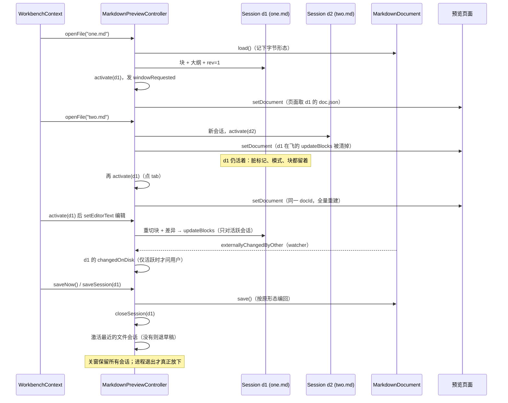
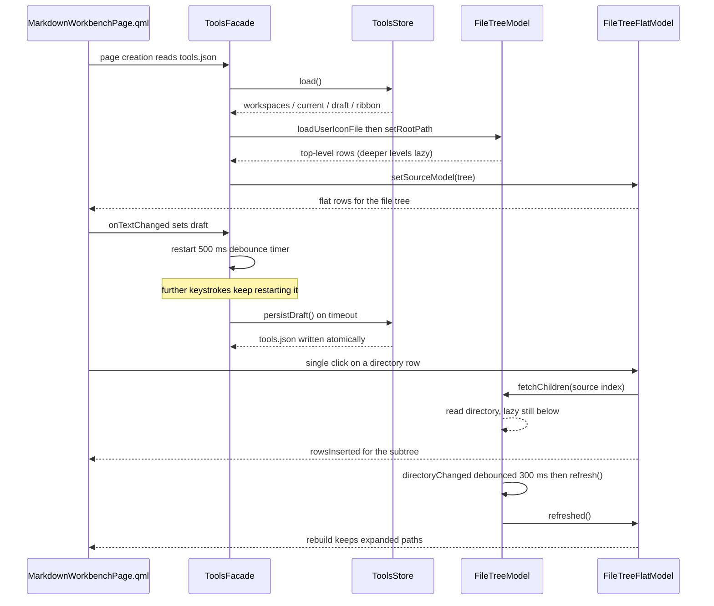
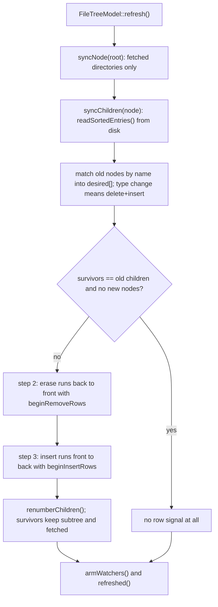
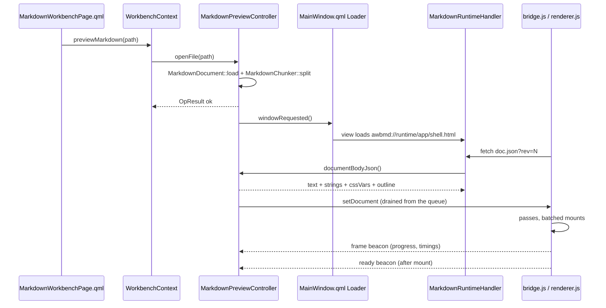

# Markdown 工作台

Markdown 工作台是**主窗 `Workspace` 里的一个页面**，把原先的提示词撰写页与 Markdown 预览窗合为一体：一个页面、两种预设、多个会话。**提示词模式**对着工作区文件树撰写提示词；**文档模式**阅读并编辑 Markdown 文件，一个文件一个 tab。它从侧栏 **Agent Tools** 分组下的 **Prompt Writing** 条目、工作区文件树、或系统文件管理器里双击已关联的 `.md` 文件进入。它是 `keepAlive` 页：首次进入时创建，之后常驻到应用关闭——编辑器的撤销栈、滚动位置与分屏比例在切页之间原样保留。

它为三个具体理由而存在。在提示词里引用文件，通常要手拼相对路径——文件树经拖放或右键菜单的「Insert path at cursor」插入 `` `./相对路径` `` 引用（双击留给**打开**文件：Markdown 开成新文档 tab，其余交给系统默认打开器）。直接把提示词敲进 agent CLI，有在半成品上误触回车的风险——因此工作台**没有发送动作**：回车只换行，什么都不会离开这个页面，交付只有复制。以及：几百 KB 的文档，首屏时间被**第一趟**而不是**整篇文档**决定——「渲染器：分趟、攒批与可见性」一节写的是这句承诺怎么兑现，数字与实验过程记在调研记录里（`docs/research/markdown-preview-runtime.md`，调研记录只写英文、不做镜像）。

用户视角见 [Markdown 工作台](../guide/Markdown工作台.md)。
架构背景见 [分层与依赖](../architecture/分层与依赖.md) 与
[前端设计](../architecture/前端设计.md)。

## 这个页面是什么，以及它不是什么

- **一个页面，两种预设。** 预设是同一套代码的两份界面配置，不是两个应用：

  | | 提示词模式 | 文档模式 |
  |---|---|---|
  | 左侧面板 | 工作区文件树，默认展开 | 收起为一条可点击展开的窄边 |
  | Ribbon | 展开（默认单行） | 折叠为 tab 行 |
  | 中间区 | 提示词草稿，带 预览 / 分栏 / 源码 | 打开的文档们，一 tab 一份，带 预览 / 分栏 / 源码 |

  2026-10 的重组拆掉了两侧业务侧栏：左栏只剩工作区文件树，右栏整个移除——编辑区占满中栏。体检与草稿历史改为**非模态悬浮窗**（从命令条「提示词」页打开，可关、从不挡操作），大纲仍是**渲染窗右缘的悬浮面板**——跟进轮起可收成一行标题、可拖动调大小（服务**活跃会话**——草稿也有标题）。从侧栏进入得到提示词模式；从工作区文件树打开一份 Markdown 文件得到文档模式（或让活着的工作台切到那个文件）；点草稿或文件 tab 切到各自的预设。渲染不了的文档预设（无能力、无文件 tab）会退回提示词模式，而不是亮出一片坏区。用户视角里没有「模式」这个概念——只有同一个工作台、工具多一点少一点。
- **页面常驻，会话也常驻。** 页面是 `Workspace` 常驻 Repeater 里的一个 `keepAlive` 条目：首次进入（导航或预览请求）时实例化，之后活到进程退出，别的页面在前面时仅仅隐藏。`Component.onCompleted` 报一次 `MarkdownPreviewController::notifyWindowOpened()`——从此控制器排队命令，页面里的 `Connections` 即使在隐藏状态也泵它们（预览面活着，往返照常；没有任何东西要等到重新可见才处理）。一轮运行里会话从不睡觉；它们随进程一起死。只有关 tab 才真正销毁一个会话。常驻的代价是一个 WebEngine 视图（连带它那约 4 MB 的运行时）在首次进入后一直温着——这是「切页不丢写作现场」的价格，也是页面**不**在启动时就创建的原因：只有用户第一次需要它时它才存在。
- **提示词模式在每种构建里都可用。** 它是纯 QML 编辑器加高亮；Qt 5 与无 WebEngine 的构建里预览面根本不装载（进程里不存在 `WebEngineView`）、视图切换器不出现，文档模式的入口如实降级——文件树的菜单项可见但禁用（2026-10 起：目标不适用是禁用，不是隐藏），打开请求报出原因（见「能力门禁」一节）。
- **一个渲染面，多个会话。** 控制器是会话容器：每个会话带着自己的文档、块序列、大纲、rev、每 tab 三态与导出目录，按 `docId` 寻址。同一时刻只有一个**活跃会话**；切换会话整篇重建页面（`setDocument`）。`doc.json` 供活跃会话，而 `asset/<docId>/…` 对**所有活着的会话**解析——刚切走的 tab 的图片请求可能还在飞。每个内嵌视图都是一个 Chromium 帧、各自带着渲染进程那侧的内存，所以只有一个且复用，不做池化。
- **文件 tab 上限 8 个。** 同一路径再开是激活既有 tab（按绝对路径去重）；开第 9 份会被拒绝并说明原因，而不是静默挤掉最久没看的——用户正在改的 tab 不该因为又开了一份文件而消失。
- **存盘不能改写文件。** 一份 CRLF + BOM 的 README，Ctrl+S 之后必须还是 CRLF + BOM——文档管线在载入时记下字节形态、存盘时按原样编回（见「纯层」一节）。草稿则从不直接碰文件系统：它活在 `tools.json` 里。
- **不是通用 HTML 查看器。** 只有 Markdown 后缀的路径会被接受（`MarkdownPreviewController::isMarkdownPath()`——后缀清单唯一的一处，同时决定文件树菜单项与命令行文件参数）。用这块表面渲染任意 HTML 等于执行文档自带的脚本，而渲染器的 `html: false` 明确拒绝这件事。
- **不与 agent 耦合。** 页面不与任何 agent 通信、不运行任何东西，除了用户显式打开的那些文档之外不编辑任何仓库文件。它的写入只有 `tools.json`（工作区记忆、草稿、Ribbon 偏好）、`markdown_session.json`（会话快照）、系统剪贴板、文档自己的存盘，以及导出副本。

## Ribbon

页面的动作住在顶部一条命令带里。`AWB_ENABLE_RIBBON` 的构建里它是 SARibbon 的 `RibbonBar`（`WorkbenchRibbon.qml`）；其余场合——以及没注册过 SARibbon 类型的单测引擎——它是普通工具栏 `WorkbenchToolbar.qml`。本节记录 SARibbon 怎么进构建、每个标签页里有什么、以及集成必须遵守的约束。

### SARibbon 怎么引入

- SARibbon 是 `third_party/SARibbon` 处的 git submodule（MIT 许可），**钉在 `3806723`**（dev-3.0 线，2026-10-12；相对 `42099a4` 的升级只是随附一份可安装的 QML 使用 skill——无代码变化）——已越过 3.0 的 QAction 命令层重构：`RibbonMenuItem` 退役，ribbon 菜单改以 `menuActions`（`RibbonAction` 声明的 QAction 列表）编写；这个 pin 同时带着本集成需要的修复（面板子项顺序、面板内分隔线、注册 category 的 hit-test 可见性）、这条线随之而来的 tab 行为（双击 tab 切换最小模式、收起态单击 tab 预览其 category、上下文 tab 标题恢复正确渲染），QWK submodule 也回到无本地补丁的上游 `1.5.0` 正式版。自 `c7f9bfd` 起 QML 模块硬依赖 QWindowKit；SARibbon 的 CMake 会从它自己的嵌套子模块链（`3rdparty/qwindowkit` → `qmsetup`，离线时逐级从已检出的克隆初始化）树内构建它。链接 QWK **不**强制无边框窗口：任何地方都没声明 `RibbonWindowAgent`，工作台保留系统原生边框。
- `AWB_ENABLE_RIBBON`（默认 `ON`，声明在 `cmake/AwbOptions.cmake`）负责接线：`SARIBBON_BUILD_QML=ON`、`SARIBBON_BUILD_WIDGETS` / `SARIBBON_BUILD_EXAMPLES` / `SARIBBON_BUILD_TESTS` / `SARIBBON_INSTALL` = `OFF`、静态库。只编 QML 模块——SARibbon 的 QWidget 部分永远进不了二进制。
- qmsetup（QWindowKit 的构建系统）会在构建树里生成转发头，其 `../../` 链以构建目录为锚点。在深层影子构建目录——Qt Creator 默认的 `<父目录>/build/Desktop_<kit>-<配置>`——里，`cl.exe` 要打开的路径超过 `MAX_PATH`（260），而它不支持长路径，于是 QWK 的每个编译单元都报一条指向「实际存在文件」的误导性 `C1083`。因此根 `CMakeLists.txt` 在 `add_subdirectory(third_party/SARibbon)` 之后把这些单行相对 include 改写为绝对路径（`cmake/AwbThirdParty.cmake` 的 `awb_absolutize_forwarding_headers`）；树内 `build/` 目录本就不受影响，但改写对两种目录同样执行。
- `app/main.cpp` 在 `engine.load()` **之前**调 `saRibbonRegisterQmlTypes(&engine)`。注册是命令式的（没有 qmldir 插件）；函数自带重复调用守卫。
- 领域库不链 SARibbon。`awb_tools` 与 `awb_markdown` 照旧只依赖 `awb_core` + `awb_theme`；集成点在 `app/`（CMake 链接 + 注册）与命令带 QML（`import SARibbon`）。第三方模块因此进不了领域层。

### 标签页与内容

命令带有三个标签页：**开始**、**提示词** 与 **视图**。

- **开始** 装着日常编辑动作，分组以不滚动为底线：剪贴板面板 **Paste / Cut / Undo / Redo**、格式与列表**同一面板**（**Bold / Italic / Underline / Strikethrough / Link / Bullets / Numbered / Task List / Quote / Divider**——十枚按钮；全都不 `checkable`——选中态得跟光标走，而光标位置进不了 QML 绑定，翻转态只能骗人；下划线写 `<u>` 记号对——唯一可移植的写法）、**Heading** 独占一个面板（菜单：1/2/3 与取消——不与列表混排）、插入组 **Inline Code / Code Block / Table**（icon + text；Code Block 带语言菜单：无、C++、Python、JavaScript、QML、Bash）、**Copy Prompt** 独占面板（交付动作），以及**查找**面板——一个常驻命令条的输入框（**Enter** 查找、再按 **Enter** 查下一个、× 清空并交还焦点；**Ctrl+F** 从任何地方直达）。每一个动作都转发到页面的动作层或 `MarkdownEdit` 静态操作——命令带只做入口，不含自己的逻辑。剪贴板、格式、标题与查找清除按钮的形态**随样式档走**：紧凑档 icon-only、宽松档带文字（`WorkbenchRibbon.qml` 的 `startIconStyle()`，绑 `tools.ribbonStyle`）——未显式设置的 `proportion` 解析为大按钮，而大按钮配 IconOnly 会把图标撑满整个按钮高度（2026-10 用户报告的「宽松档图标巨大失衡」正是它），于是宽松档给它们与插入组一致的图标加文字形态，紧凑档维持纯图标省行宽。ribbon **不声明应用按钮**（同一轮退役）：它没有任何动作——没有应用菜单、没有 backstage——「在哪份文档」由页面的 tab 条回答；`applicationLabel` 留空即整体退场。
- **提示词**（2026-10 重组后是普通 category——原 `RibbonContextCategory` 退役：模板是常驻工具，不该跟着预设出现消失）装着**模板 gallery** 与**收藏 gallery**——SARibbon 的 `RibbonGallery`，经库的 `addGroup()`/`addItem()` 动态填充（见[模板与收藏](#模板与收藏)）、**Save as Template / Save Favorite**，以及打开两个非模态悬浮窗的 **Check Prompt / History** 开关。插入在文档形态下同样可用（插入目标是草稿，gallery 会先切回提示词形态）——原来把 tab 在文档形态藏掉的决定随上下文页一起退役。
- **视图** 分两个面板：编辑器视图（对**活跃会话**生效的 **Preview / Split / Source** 三态——草稿也渲染，加**显示当前值**的 **Font Size** / **Width** 下拉，以及分隔线之后的**大纲**开关），以及 ribbon 自身（**Style** 下拉——紧凑/宽松，三行档 2026-10 退役——**Follow Theme**、**Collapse**）。

单行是默认样式档，它的后果在加按钮前值得知道：面板标题隐藏，所有按钮不论 `proportion` 一律按小尺寸渲染——层级靠分组与按钮顺序表达，文字必须短。`minimumMode` 把功能带折叠成一行 tab；文档模式预设默认折叠，点 tab 行即再展开。

### 主题桥接

两套设计系统只在一个点相遇。`WorkbenchRibbon.qml` 在每次 `Theme::changed` 后把应用 `theme` 推进 `RibbonTheme`，由 **Follow Theme** 偏好（`tools.ribbonFollowAppTheme`，默认开）把关；关掉时 ribbon 保留自己的调色板。映射比看上去要紧：SARibbon 的 **`accent` 令牌就是标题/tab 行的底色**，所以桥把 `theme.chromeBg` 推进去——推 `theme.accent`（亮蓝）会把整条 tab 行涂成窗口其它地方从不出现的颜色，这正是 2026-10 重组修掉的「tab 栏与软件主体割裂」；`theme.surfaceBg` 当面板底色、`theme.textPrimary` 当 ribbon 文字。桥接是**单向**的（应用 → ribbon），没有反向同步，也没有第二套自动跟随。页面自己的 QML 照旧只用 `theme.*` 令牌；「QML 无字面颜色」的架构门禁对本仓源码的约束一寸不变。

**Ribbon 图标是 data URL SVG**，不是静态的 `icons/*.svg`：`RibbonIcons.js` 持有一张 24×24 描边字形表，`iconUrl(name, color)` 把请求的字形包进 `data:image/svg+xml;…`、按调用方的颜色现染（命令条传 `theme.textPrimary`）。SARibbon 的叶子经裸 `Image` 渲染 `iconSource`、没有任何着色管线，要字形在深浅两个面板上都可读，随主题现染的 data URL 是唯一可移植的做法——两代引擎都能栅格化 data URL（5.15 上实测验证）。

### 命令带的约束

- ribbon 是独立组件，由页面经 `Loader` **按资源 URL** 装载——与预览面同一个模式。`WorkbenchRibbon.qml` 只在 `AWB_ENABLE_RIBBON` 的构建里登记进资源清单；装载失败（开关关着，或没注册过 SARibbon 类型的测试引擎）时页面改载 `WorkbenchToolbar.qml`。装载发生在页面创建那一刻、绝不按需反复切换：SARibbon 的叶子在 `Component.onCompleted` 期间创建，按需创建的 bar 会因上下文早死而亡。
- 两张皮都是对同一页面动作层的纯转发——谁都不许长自己的行为，否则两种构建各自漂移。按钮集与右键菜单、两个 ribbon 标签页对齐。
- 不在 `RibbonPanel` 里声明 `Popup`/`Dialog`/`Menu`——bar 的 `componentComplete` 期间创建的弹窗会变成独立原生窗口、毁掉窗口场景。凡是弹窗形状的都经 `Loader` 创建。
- Ribbon 菜单以 `menuActions` 编写——`RibbonAction` 声明的 QAction 列表（SARibbon 3.0 退役了 2.x 的 `RibbonMenuItem` 类型）；`AMenu` 家族留给工作台内的上下文菜单。一个动作只有一处出口——同一个动作不许同时出现在命令带标签页和侧面板里，否则文案与启用态必然漂移。
- SARibbon 自带的字符串不进本仓 `.ts`，中文环境下是英文。工作台除这条 bar 本体外不引入任何 ribbon 自带界面。

## 会话：一个容器，一个渲染面

`MarkdownPreviewController`（QML 单例 `Markdown`）是一台**会话容器 + 单渲染面**。一个**会话**就是用户正在看的一份文档：

- **文件会话**——磁盘上的一个文件，经 `openFile()` 打开（文件树、命令行参数、第二实例消息都落到这里）；每个会话有生成的 `docId`（`d1`、`d2`…）。
- **草稿会话**——一份**虚拟文档**（`MarkdownDocument::setVirtual()`）承载提示词草稿，`docId` 固定为 `"draft"`。它不占 tab、不能由 tab 关闭（它是提示词形态的本体），可编辑、可渲染——渲染管线吃文本不吃路径。草稿的默认三态是**分栏**（它存在的意义就是写，preview 起步会把编辑器整个藏掉）；无预览能力的构建退到源码。

每个会话拥有自己的 `MarkdownDocument`、块序列、大纲、`rev`、每 tab 三态、导出目录与 `doc.json` 载荷缓存。QML 属性面（`filePath`、`dirty`、`mode`、`outline`…）反映**活跃会话**；`tabs` 是 tab 条的模型——`[{docId, title, path, mode, dirty, active}]`，按打开顺序，只装文件（`path` 与 `mode` 两个字段是给会话文件用的；界面读其余的）。

**切换 = 整篇重建页面。** `activateSession()` 把 `setDocument` 排进队列，其「同命令覆盖」语义会清掉上一会话在飞的 `updateBlocks`——正是防止一条过期增量与全量重建打架的那道闸。增量编辑（`updateBlocks`）永远只作用于活跃会话。

**生命周期：**

- 对已有会话的路径再调 `openFile()` 是**激活**它（tab 已在条上、未保存的改动也还在），而不是再开一个 tab；否则建会话、激活它、发 `windowRequested()`。上限是 8 个文件会话，第 9 份被拒绝并说明原因。
- `closeSession(docId)` 关的是** tab**——视图收起来，磁盘文件不动。关的是活跃 tab 时顺位激活最近打开的剩余文件会话；一个不剩就退到草稿。
- `notifyWindowClosed()` 放下在飞命令、让会话睡觉。应用里页面从不报关闭——它常驻到进程退出，会话活满整轮；这个报点为拆卸路径与测试 harness 而存在。只有重启才需要会话文件（见下节）。
- 草稿由 `setDraftText()` 喂入（页面的草稿编辑器，经 200 ms 防抖——一次敲键要整篇重切块，与文件编辑器同一个 CPU 陷阱）；草稿正文的持久化仍在 tools 域（`tools.draft`，它自己的 500 ms 防抖）。

下图是一个会话跨越打开、切换、编辑、外部修改、保存与关闭的一生：



两条值得钉住的不变量：

- **脏标记按会话隔离。** 编辑一个 tab 永远不会翻转另一个的脏标记；关窗守卫（见下）检查的是全部脏 tab，不只有激活的那个。
- **信号按活跃门控。** 后台会话的脏或只读翻转不发控制器的全局信号——只有会话自己的状态在动；它再次激活的那一刻属性自然是对的。

## 文件 tab 条

中间区顶部那条渲染 `markdown.tabs`：一个**文件或草稿**会话一个 delegate——标题、脏圆点（不只靠颜色）和关闭按钮（`AIconButton`）。点 tab 激活该会话并切到文档预设；delegate 的根是普通 `Item`、视觉放在子项里（required-property 遮蔽规则），处理器经 delegate 根上的 `scope` 属性调页面动作层——编译型页面（qmlcachegen）里 delegate 信号处理器直接写文档根 id（`workbenchWindow`）会抛 `ReferenceError`（2026-10 缺陷：解释器与编译引擎对此不一致，UI 测试因此漏抓）。**页面引用要在触碰模型之前先取进局部变量**：`activateSession` / `switchDraftTo` 同步发 `tabsChanged`，tab 条的 Repeater 随之重建、当前 delegate 的作用域当场失效——模型变更之后再解析 `scope` 同样抛 `ReferenceError`（2026-10 用户报的「点文件 tab 左栏整个收起」就是它：预设切换死在 handler 半路）；局部变量活在 JS 栈上，不受 delegate 销毁影响。tab 条右端是**新建草稿（+）**——新建住在这里、不住 ribbon——与文档形态的 **More actions** 菜单（保存、复制、导出、重载）。tab 条只回答「在哪份文档」，「怎么看」的一切住在命令条**视图**页。草稿与文件 tab 共用一份右键菜单（**Rename / Delete draft / Close tab**）；草稿专属条目在文件 tab 上**禁用而不隐藏**——隐藏会在菜单里留出空白槽位、也让动作无从被发现（2026-10 的交互规则：目标不适用是禁用，只有构建级缺席的功能才可以整个消失）——**Close tab** 对两种会话都生效。

草稿 tab 与文件 tab 混排。会话文件在文件 tab 的路径旁边用 `draftId` 记草稿 tab；草稿已从 `tools.json` 删除的 tab 恢复时跳过——与「文件不存在跳过」同一条容错纪律。**关草稿 tab 不删草稿**：`tools.json` 记录还在，再开即回；删草稿是一个显式、要确认、不可撤销的动作（快照与恢复副本一起走）。页面把预设与会话耦合：提示词预设激活当前草稿的会话，文档预设激活用户上次看的文件会话（`lastFileDocId`——prompt ⇄ document 来回切时回到正在读的那份，而不是最新打开的）。

## 会话持久化（跨启动）

`markdown_session.json`（`MarkdownSessionStore`，workbench 域——会话状态横跨 tools 与 markdown 两个域，只有 L3 可以拥有它）跨启动记住现场：

- tab 组：每个 tab 的**路径**（文件 tab）或 **draftId**（草稿 tab），各带自己的**三态**（不含正文——文件从磁盘重读、草稿从 `tools.json` 重读）；
- 激活 tab 下标；
- 预设与每预设的面板/Ribbon 折叠状态；
- 最近文档 MRU（20 条），每次成功打开都会触碰。

恢复只发生一次：本轮应用第一次创建页面时（之后的一切走控制器内存里的会话）——`WorkbenchContext::restoreMarkdownSession()` 按顺序逐条重开（已不存在的文件、或已删除的草稿跳过并记一条日志，绝不让整组恢复失败），套用每个 tab 记录的三态，最后激活记录的激活位。草稿 tab 的标题与正文来自 tools 域，`WorkbenchContext::setToolsFacade()` 就是那条缝（装配层是唯一同时看得见两个域的层——域模块互不 include；单测里门面缺席，草稿 tab 干脆跳过）。写盘在 tab/激活/预设/面板变化后防抖 800 ms（脏标记的翻转搭同一趟防抖；逐键持久化买不到任何东西）。损坏的文件整体作废、记一条警告：布局状态不值得抢救。隐私口径是刻意的——只有本地路径与草稿 id、无正文、不加密、不清理：「找回上次开着的」就是全部语义。

**最近文档** MRU 由 `WorkbenchContext::recentMarkdownDocuments()` 提供，随会话文件保存。

## 文件关联（双击 .md）

三件套，仅 Windows，都不做轻量查看器：

1. **命令行。** `app/main.cpp` 扫描参数里真实存在、后缀认作 Markdown 的路径（`isMarkdownPath()`——与文件树菜单项、双击同一个后缀判定），UI 装载完成后逐条经 `previewMarkdown()` 开成 tab。无能力的构建如实弹原因 toast；那种构建里树的菜单项是禁用的、双击退到系统打开器，所以 toast 只能从命令线来。
2. **单实例消息。** 带文件参数的第二实例不再发裸 `"raise"`，而是 `"open:<JSON 路径数组>"`（`WorkbenchContext::encodeOpenMessage()` / `decodeOpenMessage()`；无请求时仍是 `"raise"`）。首实例逐条开成 tab 并导航到工作台页（`WorkbenchContext::previewMarkdown()` 的最后一步是 `showPage("tools")`）。
3. **设置页动作。** **关联 .md 文件**（启动器分区）只写 HKCU：ProgId `AgentWorkbench.Markdown.1` 的 `shell\open\command` 指向当前可执行文件，并在 `.md` 与 `.markdown` 的 `OpenWithProgids` 里登记。**绝不碰 UserChoice**——Win10+ 的默认应用选择有签名保护，静默抢默认既不可靠也不礼貌；目标是出现在「打开方式」列表里，默认应用由用户在系统设置里选，界面文案说的就是这句话。注册表被策略挡住时如实报错。卸载不清理这些键（残留无害，Windows 惯例）。

在资源管理器里双击文件启动的是**完整应用**——外壳、侧栏、引擎——不是秒开的查看器；这是刻意的决策，诚实的代价就是启动时间。无预览能力的构建整个隐藏关联入口（登记一个只会报错的条目，比不提供更糟）。

## 草稿：多条并行

M4 把单草稿变成一组。`tools.json` 多出三个键（全部纯增量——旧 `draft` 键照旧可读：M3 时代的文件升级成一条草稿、正文原封不动，这就是兼容红线）：

- **`drafts`**——`[{id, title, body, workspace, createdAt, updatedAt}]`，上限 20。满了**拒绝**而不是静默淘汰：草稿是用户资产，砍谁的轮不到程序决定。id 形如 `d%1` 且**不许手改**——它是会话文件与 tab 条的寻址地址。
- **`snapshots`**——`[{draftId, body, reason, createdAt, charCount}]`，每草稿新在前、有上限（超限从最旧开始淘汰）。六种 reason：`copy`、`clear`、`replace`、`switch`、`manual`、`rollback`。
- **`recovery`**——`{draftId, body}`：崩溃恢复副本。编辑期降频写、正常退出清、下次启动问一次（「恢复成新草稿 / 丢弃」）。

控制器**每草稿一个会话**（`openDraftSession(draftId, title, body)` 幂等；`closeDraftSession`、`setDraftTitle`、`setDraftText(draftId, …)`），于是草稿走与文件同一条渲染管线，草稿 tab 在条上的行为与文件 tab 完全一致。关草稿 tab 的顺位：最近的草稿 → 最后打开的文件会话 → 空态。

**docId 命名空间。** 文件会话是 `f%1`，草稿沿用 tools 域的 `d%1`。两个域各自数各自的序号，同前缀必然撞名——M4 装配时真的撞了：文件 `d1` 与草稿 `d1` 并存，`isDraftId()` 按字符串判定，文件会话被误判成草稿、预设切换把草稿顶回活跃位。id 是 tab、激活与 asset 路由的公共地址；撞名就是串会话。

**回滚。** `rollbackToSnapshot(id, createdAt)` 返回 `{ok, body, error}`——不是 `OpResult`，它的 `Q_GADGET` 属性表只有 `ok`/`error`。QML 侧需要 body 来换编辑器正文；gadget 带不了它，`result.body` 是 undefined、编辑器静默不动。当前版在替换**之前**先存成 `rollback` 快照——两头都有退路。

**切换在边界冲缓冲。** 500 ms 编辑防抖缓冲在 `m_draft` 里；任何替换活跃草稿的路径（`createDraft`、`duplicateDraft`、`recoverToNewDraft`）都要先把缓冲冲进**旧**草稿、再把 id 缓存挪过去——顺序反了会把新草稿的空体写进旧草稿的 id。撤销栈不共享：切换时编辑器 text 重置，undo 历史各自为政。

页面层补动作：`newDraft`（tab 条的 **+**）、`rename` / `delete`（草稿 tab 的右键菜单；delete 要确认且不可撤销——历史与恢复副本一起走）、`closeCurrentDraftTab`、`switchDraftTo`（切走前给源草稿存一版）、`saveDraftVersion`，以及确认弹窗后的 `rollbackDraftVersion`。2026-10 重组把 Ribbon 的草稿 Panel 连同**从文档新建草稿**、**复制草稿**、**复制文本**、**清空草稿**一起退役——四个 tab 条与编辑器自己的撤销已经覆盖的按钮。历史悬浮窗（非模态，从「提示词」页打开）列出当前草稿的快照并提供回滚。

## 模板与收藏

页面的提示词一侧长出了一座库：**模板**是带占位符要填的骨架，**收藏**是拿来就用的成稿。这条区分不只写在文档里，也在界面上强制执行——两者住在不同的面板、不同的存储、不同的动作里，因为混在一起会让每次点击都先问一遍「这是哪种东西？」。

### 模板从哪来，覆盖规则是什么

`PromptTemplateLibrary`（tools 域）合并两层来源：

1. **内置**——`config/default_prompt_templates.json`，随包只读地嵌进二进制（`:/config/…`），与 agent、图标的内置默认同一套惯例：数据不是代码，绝不在 C++ 里硬编码。随包十条骨架：fix-a-bug、add-a-feature、write-tests、review-code、refactor、write-documentation、explain-this-code、commit-message、reproduce-an-issue、plan-a-change。每条只有结构与提问——具体信息交给变量。
2. **用户模板**——`<dataRoot>/prompt_templates/`，一模板一文件。用户能手改、能备份、能进 git；坏文件跳过并记警告，不会拖垮整个模板库。

id 与某条内置相同的用户文件**原位覆盖**它——与 `agents.json` 同一条心智（「用户改动优先，内置每次随包再生」）。删除一份用户模板文件只是让内置回到随包形态；内置删不掉。

### 一模板一文件的最小头部

用户模板是带一个最小头部的 Markdown——分隔线、几行 `键: 值`、再一条分隔线。**它不是 YAML**；解析器刻意只做这一层：

```markdown
---
title: Fix a parser bug
category: My templates
tags: parser, bug
description: My own shape for bug reports.
---
## Symptom
{{symptom:What visibly goes wrong}}
...
```

解析是宽容的：没有头部的文件整篇是正文（标题回落为文件名），头部开了没关的整篇退回正文，坏行（没有冒号、键不认识）跳过并记警告。经 `PromptTemplateIo::serialize()` 往返能保真每一个字段。头部的键是 `id`（可选；缺省回落文件主名）、`title`、`category`、`tags`（逗号分隔）、`description`。

### 变量引擎

`PromptVariables` 是纯字符串操作——不联网、不调模型、不是模板语言（没有循环、没有条件；哪天真需要那些，该做的是模板组合，不是一门编程语言）。

| 语法 | 含义 |
|---|---|
| `{{task}}` | 待填占位符 |
| `{{task:兜底文字}}` | 带默认值的占位符 |
| `{{workspace}}` / `{{date}}` | 内置变量，自动求值，不会问用户 |
| `{{selection}}` | 内置变量，插入瞬间取编辑区的选区 |

实现与测试共同锁住的规则：

- **名字语法：**仅 ASCII 标识符（不要中文、不能数字开头）。包含形式 `{{> name}}` 与非标识符的花括号都不匹配。
- **一个名字一次填。**`{{task}}` 的每一处出现都从同一个值替换。
- **值优先于默认值，默认值优先于没有。**显式给的值赢过 `{{task:兜底}}` 的兜底；两者都没有时，占位符**原样保留**——跳过是一个有意的行为，留下一个看得见的 `{{task}}` 等你回来，而不是一次失败。
- **内置变量在 `renderTemplate()` 里求值：**`workspace` 是当前工作区，`date` 是今天（ISO 形式）。`selection` 由页面带入（门面看不到编辑器）。

### 界面装配：提示词页的两个 gallery、工具栏的一个菜单

- **gallery 住在命令条的「提示词」页**（2026-10 重组，同月换进 SARibbon 自己的 gallery）：左栏只剩工作区文件树——模板与收藏两段从这里搬走。每个面板托管一个 `RibbonGallery`——全高网格、逐组翻页、滚动按钮与展开视口——经库的动态数据 API 填充（`clear()` → `addGroup(title)` → `group.addItem(text, icon, tooltip, userData)`，`tools.templates` / `tools.favorites` 一变就重建）。格子的 `userData` 携带模板 id（收藏则是标题）；激活经 gallery 的 `triggered(item, index)` 到达，转发到页面的 `insertTemplate()` / `insertFavorite()`——收藏插的是正文，不走模板渲染器。更早的自绘 `PromptGallery` 在 SARibbon 补齐动态 API 后退役：同一门视觉语言不该有两个宿主。
- **降级工具栏带一个模板菜单**（`AMenu` + 对 `tools.templates` 的 `Repeater`）——同一个插入动作、不需要 SARibbon。工具栏在菜单旁保留 **Save as Template / Save Favorite** 按钮。
- **插入永远落草稿。**文件 tab 是别人的文档——模板与收藏绝不进它。文档形态下点模板，先切回提示词预设，再在光标处插入。
- **变量表单**（`variableForm`，一个 `ADialog`）只在所选模板有待填变量时出现：每个变量一行（名字 + 预填默认值的 `ATextField`），`Enter` 确认，`Esc` 取消，**留空 = 跳过**——副行文案就是这么说的，占位符留在正文里。Tab 在字段间跳；整个流程键盘优先。
- **Save as Template**（ribbon 与工具栏都有）弹一个小对话框：标题（预填草稿首行、去掉 markdown 记号）、分类（默认 "My templates"）与描述；`saveAsTemplate()` 从标题派生文件名 slug，**撞名自动加序号**——绝不静默覆盖既有文件。覆盖内置是用户在模板目录里手改一个同 id 文件的事，一个显式动作。

### `tools.json` 新增 `favorites`

一个 `{title, body, tags, createdAt}` 的数组——成稿提示词，新在前，上限 50 淘汰最旧，同标题同全文的保存是幂等的（重存刷新时间戳并挪到队首，不占新位），移除按标题**加**全文精确匹配。这个键是纯增量：旧的三键 `tools.json` 读进来收藏为空、`draft` 原样保留——有兼容测试压着。

一处明确的范围裁剪：规划文档描述过 `templateVariables` 在存模板时*提议*转换（文件引用 → `{{file}}`、反复出现的专有名词 → `{{name}}`）。**提议式转换没有实现**——保存对话框原样收正文，想要变量的用户自己往模板里写。流程里的任何其它环节都不假设提议存在。

## 编辑动作、体检与预算

页面的编辑侧长出三层，全部离线：**格式动作**（B1）、**查找**（B2），以及两个质量面——**提示词体检**（B9）与**上下文预算估算**（C4/E6）。它们共用一个形状：`awb_tools` 里一层纯的、由 `QTextDocument` 或字符串驱动的逻辑（测试直接驱动它），页面里一层薄 QML 装配。

### 格式动作与查询侧

`MarkdownEdit`（tools 域单例，页面把它 attach 到每个编辑器）现在带全集。每个动作都与最初三个同一形状——静态 `*ToCursor(QTextCursor &)` 包一层 `Q_INVOKABLE` 实例方法——正是这让它们无需焦点就可测、菜单抢走焦点后照常工作。每个动作一个 `beginEditBlock`，一次 `Ctrl+Z` 整体回退。

| 动作 | 行为 |
|---|---|
| `applyHeading(level)` | 行首设 `#`/`##`/`###`；已有标题**改级不叠加**，同级再点取消 |
| `applyNumbered()` | 选区每行加 `1. ` `2. ` … 递增；已全部编号的选择再去掉编号 |
| `applyTask()` | 每行 `- [ ] `（验收清单是常见用法）；同样可再点去除 |
| `applyQuote()` | 每行 `> `，**空行保持空行**；已全部引用的选择去引用 |
| `applyLink()` | 有选区 `[选区](url)` 并选中 url 待改；无选区 `[](url)` 光标在方括号里 |
| `applyFence(language)` | 按**整行**围栏：```-语言 行插在首行行首、闭行补在末行行尾；空选区落在空行上时插围栏骨架（```-语言、空行、```），光标停在中间。行内形态是 `applyCode()` 的职责——两个按钮的差别由此成立 |
| `insertTable(columns)` | 表头行 + 分隔行 + 一行示例；前后空行规范化 |
| `insertDivider()` | 插 `---`，前后空行规范化，不与标题粘连 |
| `applyItalic()` / `applyStrike()` | 真的包裹动作——M3 之前是路由到加粗的占位，让（早已存在的）checkable 状态成为谎言；已修，带测试 |

**查询侧**（`isBoldAt` / `isItalicAt` / `isStrikeAt` / `isCodeAt` / `headingLevelAt`）回答「光标处是什么状态」（格式查询看选区首字符，标题查询看行首 `#` 数量）。它曾喂给 Ribbon 的 checkable 格式按钮；2026-10 整改把那些翻转态删了——查询是函数调用，光标移动不会让 QML 绑定重算，选中态永远跟不上光标、只能停在原地骗人。查询仍是公开 API（测试与将来的消费者在用）；它教出的规矩留下来：状态进不了绑定的动作不许设 `checkable`。

**统一编辑器的红利，如实陈述：**动作打在 `activeEditor` 上——提示词形态是草稿编辑器，文档形态是文件源码区（文件可编辑时）。格式化因此两边都生效，查找也一样（2026-10 的统一输入框在一个动作内按预设分流）。

### 查找

纯层是 `MarkdownEdit::findFrom()` 对 `QTextDocument::find()` 的包装：`find(textArea, needle, from, caseSensitive, wholeWords)` 返回 `{start, length, wrapped}`——`wrapped` 就是 UI 说「已从头开始」的依据，而不是把尾部命中装作下一个。

2026-10 的重组把草稿查找条、预览搜索条连同替换/全部替换的随行件换成了**一个常驻命令条的查找框**——页面动作层的 `findNext(needle)` 按预设分流：提示词形态经 `MarkdownEdit.find` 查草稿源码，文档形态经 `markdown.requestFind` 查渲染页。**Enter** 查找、再按 **Enter** 查下一个，× 清空并把焦点还给编辑器，**Ctrl+F** 从任何地方直达。大小写/全词偏好（`tools.json` → `editor.findCaseSensitive` / `findWholeWords`）仍喂给纯层，但重组后没有 UI 开关——带七个随行按钮的查找条正是这次要清掉的杂乱。替换与全部替换随查找条退役：`replaceAndFindNext()` / `replaceAll()` 留在 `MarkdownEdit`（纯层与它们的测试都在），只是页面不再有入口。

### 提示词体检（纯规则）

`PromptChecks::run(text)` 是纯函数：文本进、命中出，同输入同输出，无 IO。随包十条规则：

| id | 触发 | 建议 |
|---|---|---|
| `vague-wording` | 模糊措辞（优化一下 / 尽量 / improve it / asap …） | 换成可验证的表述 |
| `question-only` | 正文只问不指令 | 写成明确指令 |
| `no-acceptance` | 没有测试/期望/断言类词汇 | 说清「完成」长什么样 |
| `backslash-path` | `.\src\a.cpp` 或裸 Windows 路径 | `./src/a.cpp` |
| `no-context` | 没提到语言/框架/文件 | 点名技术栈 |
| `token-risk` | 估算超过分级阈值 | 用文件引用替代内联整段 |
| `flat-structure` | 超过 30 行没有任何标题或列表 | 分段 |
| `unfilled-placeholder` | 正文里还有 `{{…}}`（与模板引擎**同一份正则**——一套语法一个解析器） | 填掉或删掉 |
| `trailing-whitespace` | 行尾空白 / 连续 3+ 空行 | 清理 |
| `smart-quotes` | `“”‘’` / `—`（它们会弄坏命令行） | 直引号、连字符 |

每条命中带 `ruleId`、严重度（0 提示 / 1 提醒 / 2 警告）、区间（`start`/`length`；无可定位区间的规则级命中用 `start = -1`）与建议文案。**不评分不打等级**——分数会诱导人为分数写作，清单引导补全信息。命中清单住在**非模态悬浮窗**里（2026-10：右栏移除，体检段变成 `checksPopup`，由命令条「提示词」页的 **Check Prompt** 开关打开——没跑过时开窗顺路跑一次）。它不挡任何操作：写作期间可以一直开着，× 或 `Esc` 关掉。带区间的行点击跳到编辑区选中；行尾的 ×（「不再提醒此类」）把规则 id 追加进 `checks.disabled`，列表立刻重跑、该类命中当场消失。

`PromptChecks` 本身不知道开关列表的存在——纯层只判定，调用方过滤。这个切分正是函数可测的原因。

### 上下文预算估算

`ContextBudget::estimateTokens(text)`：ASCII 字符数 ÷ 4 + 非 ASCII × 0.9。它给的是量级感，而**「估算」措辞是硬要求，不是客套**——状态行写「~1,240 tokens (estimated)」，tooltip 解释这个数字对着什么量，guide 再说一遍。公式不承诺与任何分词器一致；声称一致会让它变成一个误导功能。

分级对着上下文窗口（`tools.json` → `editor.contextWindowTokens`，默认 32000，夹在 1000–1000000）：低于 25% **安全**，25–60% **提醒**，高于 60% **超限**。状态行里 token 标签的颜色跟级别走（中性 → warning → danger 令牌）；状态从不只靠颜色——数字与「(估算)」字样永远在场。

**文档 tab 显示同一个估算**（E6）：文件的源码文本过同一个函数，挨着文件大小与版本号。一个估算器，两个显示面——草稿那条回答「这条提示词会不会撑爆上下文」，文档那行回答「这份文件读起来有多大」。

### 清空草稿

**Clear** 按钮随 2026-10 重组退役（命令条不装低频一次性动作）：全选 + 删除、配合编辑器自己的撤销（`Ctrl+A`、`Del`、`Ctrl+Z`）是同一条退路、还少一块界面。原确认对话框、它的快照触发点与全部替换确认一起走人。

### `tools.json` 新增 `editor` 与 `checks`

两个键都纯增量——M2 时代的文件读进来取默认值、原有内容分毫不动。`editor`：`findCaseSensitive`（false）、`findWholeWords`（false）、`contextWindowTokens`（32000）。`checks`：`disabled`（规则 id 数组，默认空）。这两个键还没有设置页 UI；上下文窗口与规则开关直接改文件，guide 里如实写了。

## 文件与类清单

| 文件 | 类 / 组件 | 职责 | 与谁协作 |
|---|---|---|---|
| `src/workbench/qml/MarkdownWorkbenchPage.qml` | `MarkdownWorkbenchPage` | 页面（`keepAlive` 的 `Item`，首次进入后常驻）。2026-10 组件化之后它**只剩状态、动作与接线**：两种预设各自的界面状态、文件 tab 条与命令带槽位、草稿/文档中间区、状态行、统一查找动作层（`findNext`/`cancelFind`）、留下的对话框（变量表单、存为模板、重命名、删除确认、回滚确认、崩溃恢复）、快捷键（`Ctrl+F` 聚焦命令条查找框，全部门控在 `pageCurrent`）、动作层（模板、收藏、草稿增删改、渲染命令泵）与会话保存恢复（由原 `MarkdownPreviewWindow.qml` 演化而来；资源别名从 `markdown/` 挪到 `workbench/`）。能独立成件的可见区块都在下面几个组件里 | `ToolsFacade`、`Markdown`、`MarkdownEdit`、`MarkdownContextMenu`、`WorkspaceTreePanel`、`PromptChecksPopup`、`DraftHistoryPopup`、`MarkdownOutlinePanel`、`ASplitHandle`、`workbench`、`theme`、`nav` |
| `src/tools/qml/WorkspaceTreePanel.qml` | `WorkspaceTreePanel` | 左栏——**容器件**：工作区下拉（每个条目带移除）、选文件夹与刷新、段头及其收起键、文件树及其行 delegate（拖出引用、双击打开、右键菜单）、两个空态、收起后的窄边、以及它自己的宽度。凡是页面或别的域该做的事一律发信号（`expandRequested` / `collapseRequested` / `addWorkspaceRequested` / `fileActivated` / `referenceRequested` / `copyRequested` / `previewRequested` / `notifyRequested`）；能否预览由宿主注入的 `canPreview` 决定 | `ToolsFacade`、页面 QML |
| `src/tools/qml/PromptChecksPopup.qml` | `PromptChecksPopup` | 体检悬浮窗——**容器件**：严重度色点、点一条跳到对应区间、「不再提醒」经 `tools.disabledCheckIds` 写回规则 id | `ToolsFacade`、页面 QML |
| `src/tools/qml/DraftHistoryPopup.qml` | `DraftHistoryPopup` | 版本历史悬浮窗——**容器件**：快照清单（由 `tools` 的信号驱动重建，因为 `snapshots()` 是方法调用、QML 追不到依赖）、存版本与回滚 | `ToolsFacade`、页面 QML |
| `src/markdown/qml/MarkdownOutlinePanel.qml` | `MarkdownOutlinePanel` | 悬浮大纲——**展示件**：条目进、`anchorActivated` 出，三个几何状态由它自己持有，宿主不必再维护。它在**每个**构建里都注册——不像预览面，它不需要 WebEngine | 页面 QML |
| `src/shell/qml/components/ASplitHandle.qml` | `ASplitHandle` | 可拖分隔条，在货架上：4px 的视觉条 + 12px 的命中区，把指针位置换算到宿主坐标系上报，语义留给调用方（左栏要像素宽度、分栏要比例） | 页面 QML |
| `src/workbench/qml/WorkbenchRibbon.qml` | `WorkbenchRibbon` | SARibbon 命令带：**开始 / 提示词 / 视图**三个标签页（提示词页 2026-10 起是普通 category——没有上下文页）、默认单行、样式档取自 `tools.ribbonStyle`（紧凑/宽松）、单向主题桥（`theme.chromeBg` 当 accent，让 tab 行跟应用 chrome 同色）、gallery 与常驻查找框；对页面动作层纯转发 | 页面 QML、`RibbonIcons.js`、`RibbonTheme`、`tools.*` |
| `src/workbench/qml/WorkbenchToolbar.qml` | `WorkbenchToolbar` | 无 Ribbon 的降级形态：一条普通工具栏、同一批动作（格式图标、Copy Prompt、模板菜单、保存动作、体检/历史开关、常驻查找框、视图选项），ribbon 文件缺席时装载它 | 页面 QML |
| `src/markdown/qml/MarkdownPreviewPane.qml` | `MarkdownPreviewPane` | 预览面（`WebEngineView` 及其接线），仅在有能力的构建里按资源 URL 装载 | `Markdown`、页面 QML |
| `src/workbench/BuiltinPages.{h,cpp}` | `BuiltinPages` | 注册内置页面与侧栏分组标签，含 **Agent Tools** 分组下的 **Prompt Writing** 条目（`id: tools`、`keepAlive`、`level: 1`） | `NavigationModel`、`WorkbenchContext` |
| `src/tools/ToolsStore.{h,cpp}` | `ToolsStore` | `tools.json` 状态：MRU 工作区列表、当前工作区、提示词草稿、`ribbon` 段（`collapsed` / `style` / `followAppTheme` / `lastTabIndex`）、`favorites` 数组（新在前、上限 50、同标题同全文幂等重存）、`editor` 段（`findCaseSensitive` / `findWholeWords` / `contextWindowTokens`，默认 32000）与 `checks` 段（`disabled` 规则 id 列表）；`kMaxWorkspaces` = 20 | `ToolsFacade`、`core::JsonStore` |
| `src/tools/ToolsFacade.{h,cpp}` | `ToolsFacade` | QML 门面：工作区属性、草稿属性、`addWorkspace`/`removeWorkspace`/`refresh`/`fileReference`、经 `model` 暴露的扁平树模型、四个 `ribbon*` 界面偏好；M2 的面——`templates` / `filteredTemplates` / `templateVariables` / `renderTemplate` / `saveAsTemplate` / `removeTemplate` / `templateDirectory` 与 `favorites` / `addFavorite` / `removeFavorite`（加 `templatesChanged` / `favoritesChanged` 信号）；M3 的面——`findCaseSensitive` / `findWholeWords` / `contextWindowTokens` / `disabledCheckIds` 属性与 `runChecks()` / `checkRuleTitle()` / `checkRuleIds()` / `estimateTokens()` / `budgetLevel()`；500 ms 草稿防抖加析构补写 | 页面 QML、`app/main.cpp`（`tools` 别名）、`FileTreeModel`、`FileTreeFlatModel`、`PromptTemplateLibrary`、`PromptChecks` |
| `src/tools/PromptTemplate.{h,cpp}` | `PromptTemplate`、`PromptTemplateIo`、`PromptVariables` | 值类型（id/title/category/tags/description/body/scope）、最小头部的解析/序列化，以及纯字符串变量引擎（提取/求值，内置 `workspace`/`date`） | `PromptTemplateLibrary`、`ToolsFacade::renderTemplate()` |
| `src/tools/PromptTemplateLibrary.{h,cpp}` | `PromptTemplateLibrary` | 合并随包内置（`config/default_prompt_templates.json`，只读）与 `<dataRoot>/prompt_templates/*.md`（用户 id 原位覆盖内置）；检索匹配标题/描述/标签/正文并与关系过滤标签；存/删写用户目录 | `ToolsFacade`（持有一个）、`core::JsonStore` |
| `src/tools/FileTreeModel.{h,cpp}` | `FileTreeModel`（含私有 `Node`） | 单个工作区根上的懒加载目录树；增量 `refresh()`；`QFileSystemWatcher` | `ToolsFacade`、`FileTreeFlatModel` |
| `src/tools/FileTreeFlatModel.{h,cpp}` | `FileTreeFlatModel`（含私有 `Row`） | 供 QML `ListView` 消费的扁平投影；持有展开路径集合 | 页面 QML、`FileTreeModel` |
| `src/tools/FileIcons.{h,cpp}` | `FileIcons` | 三张查找表（文件名 / 后缀 / 目录名）加兜底；`forFile()`/`forFolder()` | `FileTreeModel`（`IconRole`）、`core::IconResolver` |
| `src/tools/MarkdownEdit.{h,cpp}` | `MarkdownEdit` | QML 单例（`AgentWorkbench.App`）：`attach()`、动作全集（`applyBold/Italic/Underline/Strike/Code/Bullet/Numbered/Task/Quote/Link/Fence(language)/Heading(level)`、`insertTable(columns)`、`insertDivider()`）、**光标查询**（`isBoldAt/isItalicAt/isUnderlineAt/isStrikeAt/isCodeAt/headingLevelAt`），以及查找族（`find()`，加暂时无入口的 `replaceAndFindNext()` / `replaceAll()`，包着 `QTextDocument::find()`）——全部是 `Q_INVOKABLE` 包着的静态 `QTextCursor`/`QTextDocument` 操作，各一个编辑块 | 页面 QML、`MarkdownContextMenu`、`theme::Theme` |
| `src/tools/PromptChecks.{h,cpp}` | `PromptChecks`、`ContextBudget` | 纯函数：十条体检规则（文本 → 带 ruleId/严重度/区间/文案的命中；开关列表是调用方的事）与 token 估算 + 分级阈值（同输入同输出——草稿预算标签与文档状态行消费同一个估算器） | `ToolsFacade`（为 QML 包一层）、页面 QML |
| `src/tools/MarkdownHighlighter.{h,cpp}` | `MarkdownHighlighter`、`MarkdownColors` | 轻量逐块 Markdown 高亮器；配色令牌 | `MarkdownEdit` |
| `src/tools/qml/MarkdownContextMenu.qml` | `MarkdownContextMenu` | 草稿编辑器的 `AMenu`：顶部格式化工具栏 + 撤销/重做/剪切/复制/粘贴条目 | `MarkdownEdit`、`AMenu`/`AMenuItem` |
| `src/markdown/MarkdownDocument.{h,cpp}` | `MarkdownDocument` | 磁盘上那一个文件：文本、脏标记、只读判定，以及**载入时看到的字节形态**（BOM、行尾、UTF-8 是否合法）；`setVirtual()` 把它变成无文件载体（草稿会话：永不脏、`save()` 拒绝、2 MB 编辑上限照算） | `MarkdownPreviewController`、`core::OpResult` |
| `src/markdown/MarkdownChunker.{h,cpp}` | `MarkdownChunker`、`MarkdownBlock` | 顶层块切分、两次切分之间的最小替换区间、块摘要 | `MarkdownPreviewController`、`renderer.js`、`scripts/spike-markdown-chunker.js` |
| `src/markdown/MarkdownRuntime.{h,cpp}` | `MarkdownRuntime` | 页面侧全部的纯字符串与纯计算：URL 布局、MIME 表、资源映射、主题 → CSS 变量、页面文案、大纲、命令/事件名表、能力判定 | 下面所有成员；页面协议唯一对着的 C++ |
| `src/markdown/MarkdownPreviewController.{h,cpp}` | `MarkdownPreviewController` | QML 单例 `Markdown`：**会话容器**（每个打开的文档一个 `Session`，外加草稿，按 `docId` 寻址；`kMaxFileSessions` = 8、`isMarkdownPath()` 是唯一的后缀判定）+ 待发送命令队列 + 导出件的落盘点；`saveSession(docId)` 按 id 存文件会话、不换激活 | `core::Settings`、`theme::Theme`、`MarkdownRuntimeHandler`、页面 QML |
| `src/markdown/webengine/MarkdownPreviewProvider.{h,cpp}` | `MarkdownPreviewProvider` | 注册 scheme、持有只服务预览的 profile、装好供体，并告诉控制器「表面现在真的存在」 | `app/main.cpp`、`MarkdownRuntimeHandler` |
| `src/markdown/webengine/MarkdownRuntimeHandler.{h,cpp}` | `MarkdownRuntimeHandler` | `awbmd://runtime/…` 的唯一供体，随包字节带内存缓存 | `MarkdownPreviewController` |
| `src/markdown/webengine/runtime/*` | `shell.html`、`bridge.js`、`renderer.js`、`markdown-config.js`、`math-rule.js`、`diagram.js`、`find.js`、`theme.css` | 页面：启动与命令分发、分块管线、markdown-it 配置、KaTeX/任务项/告警规则、懒加载 mermaid、文档内搜索 | `MarkdownRuntime`（协议）、`third_party/markdown-runtime/` |
| `src/workbench/WorkbenchContext.{h,cpp}` | `WorkbenchContext` | 跨域入口：文档形态走 `previewMarkdown()` / `canPreviewMarkdown()`，提示词形态走 `openMarkdownWorkbench()`，会话文件走 `restoreMarkdownSession()` / `saveMarkdownSession()` / `recentMarkdownDocuments()`，文件关联走 `registerMarkdownFileAssociation()` / `markdownFileAssociationRegistered()` 加单实例的 `encodeOpenMessage()` / `decodeOpenMessage()`，以及 `openTemplateDirectory()`（按需建用户模板目录并在文件管理器里打开）——替不许互相点名的域说话 | `MarkdownPreviewController`、`MarkdownSessionStore`、页面 QML、`BuiltinPages`、`app/main.cpp` |
| `src/workbench/MarkdownSessionStore.{h,cpp}` | `MarkdownSessionStore`、`MarkdownSessionState` | `markdown_session.json`：tab 组（路径 + 三态）、激活位、预设与面板状态、20 条最近文档 MRU；损坏 = 默认态加一条警告 | `WorkbenchContext`、`core::JsonStore` |
| `src/shell/qml/MainWindow.qml` | `MainWindow` | 承载未保存 markdown 文档的退出守卫（页面常驻，守卫住主窗的退出流：`requestExit()` 拦一道，对话框给全部保存 / 放弃 / 取消三选） | `Markdown`、`WorkbenchContext` |
| `cmake/AwbOptions.cmake`、`app/CMakeLists.txt` | `AWB_ENABLE_RIBBON` 接线 | SARibbon submodule 构建（含嵌套的 QWindowKit 链）与页面的资源登记 | `third_party/SARibbon` |
| `third_party/markdown-runtime/` | —— | 随包的浏览器构建产物，外加 `manifest.json`（版本、许可、sha256） | `tst_markdown`、`scripts/update-markdown-runtime.sh` |

模块之外，页面依赖 `core::Paths::dataRoot()`、`config/default_file_icons.json`、`theme::Theme`、shell 的 `A*` 组件、`workbench.copyText()`/`notify()` 与 `ui.pickFolder()`。

## 前端设计

### 页面骨架与两种预设

```
┌────────────────────────────────────────────────────────────────┐
│ 命令带：WorkbenchRibbon.qml（SARibbon）或工具栏降级；            │
│  标签页：开始 · 提示词 · 视图                                     │
├───────────────┬────────────────────────────────────────────────┤
│ 左侧面板       │ 中间区                                          │
│ 工作区         │ 文件 tab 条（脏圆点 · + · 右键菜单）              │
│ + 文件树       │ 编辑器 / 预览 · 状态行                           │
│ （仅此一段）    │ 悬浮：大纲 · 体检窗 · 历史窗                     │
└───────────────┴────────────────────────────────────────────────┘
```

- 左侧面板 2026-10 重组后**只剩工作区文件树**这一段（带 `ASectionHeader`：顶部一排紧凑头部，`Layout.fillWidth` 的工作区 `AComboBox`、选文件夹的 `AIconButton`、刷新 `AIconButton`，下面是树；段头上的收起键收起的是**整个左栏**——与把分隔条拖过收起阈值是同一状态，不是段级折叠：段折叠是多段布局时代的遗留，同一轮 2026-10 已删除；窄边上的箭头是收起态唯一的还原入口，文档模式预设默认收起）。模板与收藏两段搬去了命令条「提示词」页；右栏整个移除。面板本体在其后的 2026-10 组件化里变成 **`WorkspaceTreePanel`**（`tools` 域的容器件）：只收 `expanded` 与宿主注入的 `canPreview` 判据，页面该做的动作一律发信号，宽度 `panelWidth` 由它自己持有。面板与编辑器在相接处都不带圆角——直角齐平。面板右缘是拖拽手柄（视觉 4px、命中 12px），在 180–520 之间调那个宽度；拖过 140 收起面板，窄边上的箭头还原。宽度公式是「会挪动的手柄」这一类陷阱：手柄随面板变宽变窄跟着挪位，宽度必须按指针的绝对位置减去**按下时**记录的抓取偏移——减逐事件的相对坐标会让拖动彼此抵消成无操作，减面板*当前*宽度（2026-10 用户报告「一拖整个面板就收起」）则任何拖动都直接落进收起分支。
- 大纲是渲染窗右缘的**悬浮面板**（`outlineFloat`），跟在大纲开关后面，服务**活跃会话**——草稿也有标题。它不占布局空间，纯源码态退场（没有渲染窗可悬浮）。2026-10 跟进轮起面板**可收起、可调大小**，不再强制通高：头部右侧的按钮（`outlineCollapseButton`）把它收成一行标题、再点还原；右下角手柄（`outlineSizeGrip`）拖高度；左边界（`outlineWidthEdge`）拖宽度——右缘恒锚在渲染窗右缘。面板在其后的 2026-10 组件化里变成 **`MarkdownOutlinePanel`**（markdown 域的展示件）：条目由宿主注入，点击经 `anchorActivated` 报出，收起位与拖出的几何由它自己持有、只在内存——拖一下不该写设置，与 `editorShare` 同一条纪律。首次拖动前高度就是整个渲染窗（初见观感），收起态下手柄退场。**体检窗与历史窗**是页面右侧的非模态 `Popup`（体检窗给大纲条让位左移；两窗同开时历史窗排在体检窗下方）——它们不挡任何操作，× 或 `Esc` 关闭；两者也已是组件（`PromptChecksPopup` / `DraftHistoryPopup`），都是 `tools` 域的容器件。
- 中间区的头部是**文件 tab 条**（`Repeater` 消费 `markdown.tabs`）：一个文件或草稿会话一个 tab，带标题、脏圆点与关闭按钮；条右端是**新建草稿 +** 与文档形态的 **More actions** 菜单（保存、复制、导出、重载）。草稿与文件 tab 右键出共用的**重命名 / 删除草稿 / 关闭**菜单（草稿条目在文件 tab 上禁用；**关闭**对两种都生效）。切换器与字号、栏宽选择住在命令条「视图」页。
- 中间主体是**一套两栏结构服务两种预设**：编辑槽位在草稿会话激活时装草稿编辑器、文件会话激活时装文件源码区，预览面渲染活跃会话。是手写两栏布局，不是 `SplitView`：三态里有两态要把一栏挤成 0 宽，而 `SplitView` 对 `visible` 栏的处理跨 Qt 版本不一致。分隔条用组件货架上的 `ASplitHandle`——视觉 4 px、命中区 12 px，把指针位置换算到宿主坐标系上报，「位置代表什么」留给页面（左栏的手柄用同一个组件，代表的是像素宽度而不是比例）；分栏比例（`editorShare`）是页面内状态——拖一下不该碰磁盘。
- 中间区底部是**状态行**：提示词模式显示草稿的字符数、行数**与 token 估算**（「~N tokens (estimated)」，颜色跟分级走，tooltip 写明上下文窗口基数——见「编辑动作、体检与预算」一节）；文档模式显示文件路径、**有未保存的改动** 标记、只读原因（若有）、文件大小、渲染器版本号**与同一估算对文件文本的数字**。状态永远不只靠颜色——脏与只读都写成文字。
- 提示词模式的 Ribbon 偏好（折叠位、样式档、上次标签页、主题跟随）持久化在 `tools.json` 的 `ribbon` 段里。每预设的面板状态与文档模式的 Ribbon 折叠位持久化在**会话文件**里；一轮应用之内它们随页面的常驻天然活过切页。

### 草稿编辑器

编辑器就是迁过来的提示词编辑器，如今住在页面的编辑槽位里。一个纵向 `Flickable`（`objectName: "promptScroll"`、`clip`、`StopAtBounds`、`ScrollBar.vertical: AScrollBar {}`）经 `TextArea.flickable` 附加属性挂一个 `ATextArea`（`objectName: "promptEditor"`）。文本只在 `Component.onCompleted` 初始化一次（`text = tools.draft`，随后 `MarkdownEdit.attach(promptEditor)`），不做双向绑定——常驻绑定会与用户输入打架。写路径是**双写**：`onTextChanged` 既写 `tools.draft`（tools 域经它自己的 500 ms 防抖持久化），又重启 200 ms 的 `draftSyncTimer`，由它把草稿**会话**喂给 `setDraftText()`——一次敲键要整篇重切块，逐键喂是把 CPU 花在马上会被改掉的中间态上。占位文本把契约写在明处：回车只插入一个新行，这个页面不发送任何东西。

铺满编辑器的 `DropArea` 只接受来自文件树的拖拽（`drop.source.isFileReferenceDrag`），用 `promptEditor.positionAt(drop.x, drop.y)` 求插入偏移并把 `drop.text` 插进去；落点坐标本身就是文档坐标。只吃右键的 `MouseArea` 设 `editorMenu.editor = promptEditor` 再弹 `MarkdownContextMenu`。

### 文档主体

中间主体在编辑槽位装源码编辑器（文件会话激活时；草稿激活时这个槽位装的是草稿编辑器）。源码编辑器是第二个 `ATextArea`（`editorArea`），同样走 `Flickable` 那套结构，用主题的等宽字体（表格与代码块依赖对齐），文档不可编辑时只读，并且与草稿一样挂着 `MarkdownEdit.attach()` 高亮——只读文档也挂，读源码与写源码同样受益。它的文本只在初始化与「换文档/磁盘那份进来了」时写入，从不双向绑定；编辑经 200 ms 防抖交给控制器：一次敲键要把整篇重新切块并算差异，2 MB 文档上每键一次就是把 CPU 花在马上会被改掉的中间态上。

预览面是一个 `Loader`（`active: markdown.available`），`source` 是 `MarkdownPreviewPane.qml` 的资源 URL——只在跑得动它的构建里登记进二进制，无 WebEngine 的构建里进程根本不会创建 `WebEngineView`。装载失败弹 error toast，不留一个无声的空白。

### 文件树面板

- **工作区 `AComboBox`。** `model: tools.workspaces`。`contentItem` 与 `delegate` 都被覆写——默认 `ItemDelegate` 的背景是硬编码浅色系、深色主题下不可读——内容行里带逐项删除的 `AIconButton`。
- **文件树 `ListView`（`objectName: "fileTree"`）。** `model: tools.model`（扁平投影）、`AScrollBar.vertical`、工作区已设但 `tools.model.visibleCount === 0` 时的空提示，以及未选工作区时的 `AEmptyState`。
- **delegate。** 每个 role 都声明为 `required property`（`name`、`path`、`relativePath`、`isDir`、`iconSource`、`depth`、`expanded`、`hasChildren`）**外加** `index`——Qt 5.15 里一旦声明任何 required property `contextObject` 就被清空，裸 `index` 会抛 `ReferenceError`、单击展开的 handler 整段中止。一个由 `Connections` 监听 `onModelReset` 翻转的 `rebinding` 标记让模型 reset 期间箭头动画保持安静。拖出用 `Drag.Automatic`、`Drag.mimeData` 取 `tools.fileReference(relativePath)`。两个 `TapHandler` 负责单击展开与双击**打开**：双击转发到页面动作 `openFileFromTree(path)`，由同一个判定分车道——Markdown 交给 `previewMarkdown()` 开成新 tab（同路径去重），其余（含无预览能力构建里的 `.md`）交给系统默认打开器（`workbench.openLocalFileExternal()`）；插引用挪进了菜单与拖放。只吃右键的 `MouseArea` 弹一份 `AMenu`（`objectName: "treeRowMenu"`）：**预览 Markdown** 恒可见、`enabled: workbench.canPreviewMarkdown(treeRow.path)`——这一行不是 Markdown 时**禁用而非隐藏**（2026-10 的交互规则），外加**Insert path at cursor**（原双击的行为，经页面的 `insertTextAtCursor`）与两条复制路径。后缀清单与能力判定都住在预览域里，QML 从不判断后缀。
- **`AEmptyState` 的约束。** 它的根是普通 `Item`，不能带 `anchors`；内部用 `Column` 而不是 `ColumnLayout`（Qt 5 的递归重排）。

### 编辑器右键菜单与命令带的两张皮

`MarkdownContextMenu.qml` 是一个 `AMenu`，第一个子项是普通 `Item`——一个 34 px 工具栏，放三个 `AIconButton`（Bold、Code、Bulleted list）——把它与 `AMenuItem` 混排就得到「工具栏在上、条目在下」的形态，中间一条极淡分隔线。动作统一经 `run(action)`：先关菜单、把焦点还给 `editor`，再执行——编辑器的选区与插入必须先拿到焦点，否则输入与选区写入都落不到目标上。同一条纪律管着命令带：两张皮（`WorkbenchRibbon.qml`、`WorkbenchToolbar.qml`）都只转发到页面的动作层，后者在应用格式或剪贴板操作之前同样先把焦点还给激活的编辑器。

## 后端设计

### `ToolsStore`

持有数据根下的 `tools.json`。键是 `workspaces`（字符串数组，MRU 在前）、`current`（当前工作区绝对路径）、`draft`（提示词全文）与 `ribbon`（一个对象，含 `collapsed`、`style`、`followAppTheme`、`lastTabIndex`）。**键名是磁盘格式的一部分，改键名等于丢用户数据。** `load()` 跳过非字符串条目并去重，`current` 不在列表里时清空。`ribbon` 段的读取带容错：段缺失、类型不对、样式串不认识，都落回默认值（展开、单行、跟随开、第一个标签页），而不是让装载失败。`addWorkspace()` 先移除再插队首（统一两条 MRU 触碰路径），超出 `kMaxWorkspaces` = 20 从队尾淘汰，并设为当前。`removeWorkspace()` 移除该路径，若它正是当前项则把剩余队首顺延上来。`setCurrentWorkspace()` 接受空串。`setDraft()` 内容未变时不写盘。`save()` 经 `core::JsonStore` 原子写。

### `ToolsFacade`

属性：`model`（CONSTANT，扁平投影）、`workspaces`、`currentWorkspace`（WRITE）、`draft`（WRITE），外加四个 Ribbon 偏好——`ribbonCollapsed`、`ribbonStyle`、`ribbonFollowAppTheme`、`ribbonLastTabIndex`——每个都带立即写盘的 `WRITE`，共用一条 `ribbonSettingsChanged()` 信号。invokable：`addWorkspace`、`removeWorkspace`、`refresh`、`fileReference`。`addWorkspace`/`removeWorkspace` 的 `awb::core::OpResult` 返回类型必须保持全限定名：Qt 5 的 moc 按书写形式记录，而 QML 按 `QMetaType` 注册名解析，短名会抛 "Unknown method return type"、按钮静默无响应。

- **草稿防抖。** `setDraft()` 更新缓冲、发 `draftChanged()` 并重启一个单次 500 ms 的 `QTimer`；`persistDraft()` 在超时时执行，析构函数也补写一次，最后一次敲键能活过关闭。
- **图标表时序。** 构造函数在设根**之前**调 `loadUserIconFile(dataRoot + "/file_icons.json")`——模型不会为已经渲染的行补发 `dataChanged`。
- **根选择。** 只在记忆的目录存在时才设树根；否则树保持空，而不是显示一个永远为空的假根。
- **`refresh()`。** 按异步形状设计、当前同步完成；转发到 `FileTreeModel::refresh()`，后者的 `refreshed` 信号被转到 `refreshFinished()`，所以 QML 分不出 watcher 触发的重扫与手动重扫。

### `FileTreeModel`、`FileTreeFlatModel`、`FileIcons`

`FileTreeModel` 是单个根上的懒加载树：`hasChildren()` 对任何未读取的目录返回 true（视图据此提前显示展开箭头），`fetchMore()` 读取它，`fetchChildren()` 是幂等的 `Q_INVOKABLE` 兜底。`setRootPath()` 把整棵 staging 树——含顶层——建在 `beginResetModel` 之外；reset 之后立刻插入的行会被视图重复计入。增量 `refresh()` 遍历每个**已读取**目录（读过的收起目录也要对账，否则下次展开就是过期数据），在 `begin`/`end` 之间做三步对账：按名字匹配旧节点得到目标序列（类型变了的按「删一个插一个」处理）、从后往前逐段删除、从前往后逐段插入。幸存者的子树、`fetched` 状态与展开状态全部保留；没有任何变化时一个行信号都不发。`QFileSystemWatcher::directoryChanged` 经 300 ms 单次防抖触发 `refresh()`；任何结构变化后 `armWatchers()` 都按「已读目录」集合重建监听列表。排序：目录在前，再按文件名大小写不敏感排序，同字母异大小写按原序保证稳定。

`FileTreeFlatModel` 把树投影成 `ListView` 可消费的线性行序，展开状态由它自己持有（Qt 6.3 的 QML `TreeView` 在 Qt 5.15 不存在，两个版本共用一份 delegate）。它只消费 `modelReset`（换根 → 清展开路径并重投影）与 `FileTreeModel::refreshed`；refresh 过程中的逐目录 `rows*` 信号不消费，避免一个 burst 重建多次。展开状态用相对根的路径集合持有，因此能跨 refresh 保留。`toggleExpanded(row)` 或展开（fetch 兜底，子树经一次 `rowsInserted` 递归投影）或**递归**收起。role 枚举显式映射到源模型的枚举，因为数值不同。

`FileIcons` 持有三张表——`fileNames`、`suffixes`、`folderNames`——加每种一个兜底；构造函数并入内置的 `:/config/default_file_icons.json`，`loadUserFile()` 叠加 `<dataRoot>/file_icons.json`，同名键用户赢。查表大小写不敏感，顺序是完整文件名 → 后缀 → 兜底，所有值经 `core::IconResolver` 归一。

### `MarkdownEdit` 与 `MarkdownHighlighter`

`MarkdownEdit` 是格式动作背后的 QML 单例。`attach(textArea)` 从控件读 `QQuickTextDocument` 并挂一个以文档为父的 `MarkdownHighlighter`；对同一文档重复调用无害。配色取自当前 `theme::Theme`，在 `Theme::changed` 时重灌并 `rehighlight()`；已死的高亮器指针经 `QPointer` 回收。草稿编辑器与文档源码区都是它的客户。

三个格式化动作是纯静态光标操作，测试可直接拿 `QTextDocument` 驱动：

- `applyBoldToCursor()`：空选区插入 `****` 并把光标停在中间；否则把去空白的选区包进 `**`，两端空白留在标记外，再重新选中内容。
- `applyCodeToCursor()`：空选区插入 ` `` `；单行选区加行内反引号；含换行的选区改围栏块（`` ``` `` 行插在首换行之后、尾换行之前，复用现成的行分隔）。
- `applyBulletToCursor()`：给选区（无选区时给光标所在行）每一行行首加 `- `，完成后重新选中整个受影响范围。

每个动作都在一次 `beginEditBlock`/`endEditBlock` 内完成，一次撤销即可回退。选区经控件的 `selectionStart`/`selectionEnd` 属性读取，**不**依赖焦点——这正是右键菜单和命令带都可以拿走焦点、却仍能操作编辑器选区的原因。

### 草稿防抖与懒加载树

第一张图展示页面与门面一侧的草稿防抖与懒加载文件树。



第二张图展示 `FileTreeModel` 内部的增量对账。



### 工作区记忆与文件引用

工作区列表按 MRU 排序、上限 20，当前项要么在列表里要么为空；删除当前项把剩余列表的队首顺延上来；空串是合法的当前值。`ToolsFacade::fileReference()` 产出 `` `./相对路径` ``——反引号包裹、正斜杠——拖放与右键菜单的「Insert path at cursor」都走它，提示词收到的形状始终一致。

## 渲染管线

### 为什么要自定义 scheme，以及 `awbmd://` 的形状

预览页面同时需要三件事：`fetch()` 自己那份文档、经 `@font-face` 加载 KaTeX 的 `woff2` 字体、引用与 Markdown 文件放在一起的图片——并且全程不落盘、不开端口。`data:` URL 前两件做不到（不透明 origin）；把运行时解包到数据目录等于把 4 MB 第三方 JavaScript 放进用户目录；本机 HTTP 服务要端口、要生命周期、还要一套 token 说辞。所以适配层注册了一个 scheme，**`awbmd://runtime/…`**，一个供体把所有东西从同一个 origin 供出去。

| URL | 由谁供给 | 说明 |
|---|---|---|
| `awbmd://runtime/app/shell.html` | `:/markdown/app/` | 视图真正加载的页面；`MarkdownPreviewController::pageUrl()` 是它唯一的拼装处 |
| `awbmd://runtime/app/<file>.js` / `.css` | `:/markdown/app/` | 本项目自有的页面运行时 |
| `awbmd://runtime/vendor/<dir>/<file>` | `:/markdown/vendor/` | markdown-it、KaTeX（含字体）、mermaid、highlight.js |
| `awbmd://runtime/doc.json?rev=N` | `MarkdownPreviewController::documentBodyJson()` | 文本、`strings`、CSS 变量、大纲、块数；`rev` 只在内容真的变了时才动 |
| `awbmd://runtime/asset/<docId>/<rel>` | 文档自己所在目录 | 文档里的相对图片路径以此为基准解析；解析后的绝对路径必须仍落在该目录内 |
| `awbmd://runtime/event?k=<kind>&p=<json>` | —— | 页面 → C++ 的信标；回一张 1×1 的 PNG |

URL 的形状只由 `MarkdownRuntime` 一处决定；`MarkdownRuntimeHandler::routeOf()` 把 URL 归到 `Resource`、`Document`、`Asset`、`Event`、`Unknown` 之一，认不出来的一律 `UrlNotFound` 而不是猜。信标天然只有 GET，供体把其它方法一律挡在这里，页面脚本就借不到这条通道去碰本机任何东西。

**注册顺序是一条启动契约。** `MarkdownPreviewProvider::registerScheme()` 必须排在 `QtWebEngineQuick::initialize()` **之前**：引擎在第一次创建上下文时就把 scheme 表锁死，之后注册会被静默忽略。失败的表现不是 404——供体照样把文档、脚本、字体供出去，坏掉的是 `fetch()`，页面于是「正文在、公式和图表永远出不来」，而构建和所有纯函数用例照样全绿。因此 `MarkdownPreviewProvider` 在构造时用 `QWebEngineUrlScheme::schemeByName()` 当场核对一次自己的注册，核对不上就让 `available` 落成假并留下日志。语法用的是 `QWebEngineUrlScheme::Syntax::Host`，不是 `HostAndPort`（选了 `HostAndPort` 就必须给默认端口，端口留空会让 `registerScheme()` 直接提前返回——只有一条警告，正是上面那种半失效状态）。标志位：`SecureScheme`、`LocalScheme`、`LocalAccessAllowed`、`CorsEnabled`、`ServiceWorkersAllowed`，Qt ≥ 6.6 再加 `FetchApiAllowed`——没有这个 flag 的引擎（Qt 5 与 Qt 6.2–6.5，`CorsEnabled` 也救不了）上页面 `fetch()` 直接报 "URL scheme awbmd is not supported"，这正是数据通道分车道的原因（见下一节）。另一个 Qt 5.15 的坑：job 的 `reply()` 只认**裸 MIME**——`"text/html; charset=utf-8"` 这种复合值会让整条响应解析失败，文档按空 HTML 装载、`<script>` 全被丢掉；MIME 表因此一律不带 charset 后缀，编码由各格式自身的默认兜底（HTML 的 meta 标签、ES 模块规范强制 UTF-8、CSS 与 JSON 的默认）。

### 纯层：文档、块、页面文案

`src/markdown/` 里没有 WebEngine；只有 `src/markdown/webengine/`（`awb_markdown_webengine` 适配层）链引擎。这条分界换来的是：整套状态机能在一个根本渲染不出东西的构建里编译并测试。

`MarkdownDocument` 存在的理由是「存盘不能改写文件」：载入时把形态记下来（`m_bom`、`m_crlf`、`m_validUtf8`），`encodeText()` 按原样编回去。`m_crlf` 只在**每一个**换行都是 CRLF 时才置真——混用的文件若按 CRLF 处理，保存会把整篇改掉；让 `\r` 留在文本里原样回写，`encodeText(text)` 与来路逐字节相同。两个大小上限来自产品要求（几百 KB 到 2 MB 要流畅）：超过 `kOpenCapBytes` 直接拒绝打开，超过 `kEditCapBytes` 只给只读预览。非法 UTF-8 是只读的第三个来源——解码那一步已经丢过信息，再写回去就是把用户的字节换成一片 U+FFFD。外部改动经 `QFileSystemWatcher` 上报，另加了一处刻意的补偿：`MarkdownPreviewController::refreshDiskState()` 在窗口激活时也会重新比对一次磁盘快照——Windows 上 watcher 会静默丢掉「删除后重建」的文件。自己保存引起的那一次不算外部改动：`save()` 会重记快照。

`MarkdownChunker` 是增量渲染得以成立的前提：它切出的块与页面上的 `<section>` 一一对应，因此 `startLine`/`endLine` 同时也是「编辑器行号 → 预览块」的定位锚点。等价性要求决定了它必须是行级状态机而不是「按空行 split」——围栏、显示数学、setext 标题下划线、松散列表的延续段、表格连续段都要显式处理，因为块边界切错会改变语义。`scripts/spike-markdown-chunker.js` 拿本仓库自己的 Markdown 当语料比对「整篇渲染」与「逐块渲染」，且 import 的是页面**同一份**解析配置。

`MarkdownRuntime` 收的是「页面在意、但必须由 C++ 决定」的那一堆：URL 构造、MIME、主题令牌 → `--awb-*` CSS 自定义属性、页面文案字典（`pageStrings()`）、大纲提取，以及两张协议名表。`.js` 文件里一个可翻译源串都没有——它们对 `lupdate` 不可见，文案放在那里等于永远不被翻译。`commandNames()` 与 `eventKinds()` 是唯一权威：`enqueue()` 按表挡下写错的名字，页面的分发分支也对着同一张表断言。

### 渲染器：分趟、攒批与可见性

`renderer.js` 就是那件性能工作。它的文件注释留着测量结果：一篇 486 KB / 3150 块的文档，解析加建元素约 1.9 s 的实际主线程工作，把攒好的块挂上树约 0.03 s，强制整篇布局也是 0.03 s 量级。这条管线省的不是**总量**——该做的解析一次都省不掉——而是**一次性**：首屏只付第一趟的账。

三个机制刻意分开：

1. **分趟。** 解析每占用满 `PASS_BUDGET_MS`（48 ms，卡在 50 ms 长任务门槛之下，再大就开始丢输入）就让出事件循环；第一趟另给更宽裕的 `FIRST_BUDGET_MS`，另有 `SLICE_BLOCKS` 上限，防止一块病态内容独占一趟。
2. **攒批挂载。** DOM 的代价按「上树次数」算，不按块数算。块先攒进 batch，攒够 `MOUNT_BATCH_BLOCKS`、或解析已排空、或一批已经等了 `MOUNT_MAX_WAIT_MS` 才上树——最后那条是兜底，别让短文档的内容瘫在半路。乱序批插入时参照点只认**已在树上**的节点：batch 里的块「已解析、未挂载」，拿它们当 `insertBefore` 的参照点会抛 `NotFoundError`、打断整个 flush 任务，批内其余块从此既不在 DOM 也不在 pending——永久丢块（2026-10 用户报的编辑后顶部内容消失；参照点须核对 `parentNode === root`）。
3. **CSS `content-visibility`** 跳过屏外块的布局与绘制（在 `theme.css`）。这才是「布局几乎不要钱」的原因，也正是**不做 JS 窗口虚拟化**的原因：虚拟化会废掉文本选区、原生滚动定位与文本可访问性。这项优化是**按能力启用**的，不是无条件：`contain-intrinsic-size: auto 48px`（给屏外块稳定的占位高度）依赖 `auto` 关键字，Chromium **98** 才有——87–97（Qt 5 全线与 Qt 6.2–6.5）不认这条复合值、整条声明作废，锁死块**零高度**、滚动高度失真（整篇被压进一屏半），87 还会在滚动驱动的锁转换上崩渲染进程（`compositing_requirements_updater.cc` 的 CHECK，2026-10 用户报的「拉到最底部」）。`bridge.js` 在 `boot()` 里用 `CSS.supports("contain-intrinsic-size", "auto 48px")` 探测，第一块挂载前给 `<html>` 挂上 `awb-no-cv`；`theme.css` 把这些引擎降回普通布局（`content-visibility: visible`）——用丢掉屏外跳过的收益，换回真实的滚动高度与不崩的渲染进程；优化只在特性完整的引擎上回来。

调度是自己滚定时器的，没有用 `requestIdleCallback` 也没有用 `requestAnimationFrame`：同一份工作放在 idle 回调下要慢一个数量级（回调数上千之后 Chromium 给的 idle 预算会饿死），放在帧回调下则被帧率而不是时间预算卡住。编辑态走 `updateBlocks`：C++ 侧按块摘要算出最小替换区间（`MarkdownChunker::diff()`），页面只重渲染那几个 `<section>`——敲一个字不重排全篇。

图表单独成层是体积决定的：mermaid 的构建是 2.6 MB，一篇没有图表的文档不该为它付加载与解析时间。`diagram.js` 在第一个图表真的靠近视口时才插入 `<script>`；并发渲染数压到 2，SVG 结果按图表源码缓存，图表数超过 `DEFER_LIMIT`（40）之后占位改成点击再画。搜索也是自己实现的：Chromium 的原生查找面对 `content-visibility` 下「在 DOM 里但引擎跳过排版」的内容行为不受我们控制，`find.js` 自己数、自己跳——代价是只数**已挂载**的块，且跨行内标记的匹配找不到。

### 命令队列与页面协议



这条生命周期的两边都是异步的，且谁都不能假设对方已就位。队列存在的理由是：QML 进页面的唯一入口是 `WebEngineView.runJavaScript`，页面还没启动时发的命令会全部丢掉。`MarkdownPreviewController::enqueue()` 先把命令停下、发 `commandQueued()`，适配器在两个时刻各排空一次——视图报到就绪时，以及有新命令进来时。队列里每一类只留最新的一条（连续五次编辑只送出一次 `updateBlocks`）。

传输方向按负载大小刻意劈开。C++ → 页面的命令走 `runJavaScript("AWB.dispatch(<json>)")`。页面 → C++ 的大结果以 `runJavaScript` **返回值**的形式回来（`serialize()` 与 `renderAll()` 交回导出 HTML 用的就是这条），因为信标是 GET 的 URL，超过 `kEventPayloadBytes`（8 KiB）会被截断。小事件——`ready`、`frame`、`error`、`find`——走信标。导出的整篇 HTML 刻意不进事件表：一张收了一个大负载的表，会诱使下一个人在旁边再加一个。

**小事件的传输按引擎分车道。** `FetchApiAllowed` 在（Qt ≥ 6.6）信标就是 `/event` 的 GET 像素请求；不在（Qt 5 与 Qt 6.2–6.5——fetch 对自定义 scheme 一律被拒）时页面连文档与样式表都拉不了，于是 `MarkdownPreviewPane` 接手：没有该 flag 的构建上，控制器的 `pageUrl()` 给 shell 地址追加 `?lane=push`，`boot()` 读到提示即定格车道、不发探测（探测是一次注定失败的 fetch，除了每次启动在引擎控制台留一条 `"URL scheme awbmd is not supported"` 警告没有任何收获——2026-10 用户报的日志噪声）；页面把结论定格在 `AWB.channel()`，pane 轮询这个同步值，读到 `push` 就经 `runJavaScript` 调 `AWB.push("document"/"stylesheet", …)` 投递（每次 `setDocument` 前重推文档——那条命令体里只有 rev）。没带提示的页面仍照旧自探一次（真的发一次 fetch）——提示只是捷径，实测才是真相（注册标志失效的 fetch 构建自己会退回推入车道）。推入车道上的信标以 `console.warn("AWBEVT:<kind>:<json>")` 打出，pane 的 `javaScriptConsoleMessage` 处理器解析它并转发到 `/event` 供体服务的那四个控制器入口。车道结论不能指望 `runJavaScript` 的回调带回——Qt 5 上回调等不到 Promise，页面因此自己暴露同步答案。

### 一个预览面

渲染管线住在 `MarkdownPreviewPane.qml` 后面，仅当 `markdown.available` 时按资源 URL 装载——无 WebEngine 的构建里进程根本不建 `WebEngineView`。页面里只有一个预览面，它渲染**活跃会话**：文件 tab 或草稿。无能力的构建里预览面与视图切换器缺席（构建级的功能整个消失）；而「目标不适用」的条目——比如文件树菜单里的**预览 Markdown**——只是灰着：2026-10 的交互规则把这两种情形分开。草稿的三态退到源码。

## 入口与接线

文件树只问，不判断。它的右键菜单绑定 `enabled: workbench.canPreviewMarkdown(treeRow.path)` 与 `onTriggered: workbench.previewMarkdown(treeRow.path)`；双击转发到页面动作 `openFileFromTree(path)`，按同一个答案分车道（答「行」走 `previewMarkdown()`，答「不行」走 `workbench.openLocalFileExternal()`）。后缀清单归预览域管（`isMarkdownPath()`），QML 只对它手上已有的路径问一个结果。`canPreviewMarkdown()` 是**方法**而不是绑定源，这一点有关系：这个表达式不会重算，条目的可用态在菜单建出来时就算定了——这里可以接受，因为能力位不可能在进程运行期间改变。

同一个 `previewMarkdown()` 是一切「打开一份 Markdown 文件」意图的落点：文件树（右键菜单与双击）、启动页的最近文档行、命令行参数、第二实例消息、资源管理器里双击已关联的文件。一个入口、一套失败路径、一次 MRU 触碰。

`WorkbenchContext` 是唯一可以同时点名这两个域的地方（`src/tools` 不许 include `src/markdown`，门禁规则 1）。它持有预览控制器的可空指针，由 `app/main.cpp` 经 `setMarkdownPreview()` 设一次。指针为空——或者控制器自报没有能力——时，`previewMarkdown()` 只发一条带原因的 toast，不做别的，于是失败只有一条解释路径而不是两条。第二个意图 `openMarkdownWorkbench()` 是纯导航（自动打开的启动项也调它）。会话意图——页面首次创建时的 `restoreMarkdownSession()`、页面变化背后的 `saveMarkdownSession()`——与文件关联那一对都住在这里，全都挂在 QML 已经对话的那个对象上。

页面按普通页面注册：`BuiltinPages` 把资源 URL 交给 `PageDescriptor::source`（id `tools`、`keepAlive`），`Workspace` 的常驻 Repeater 在首次访问时实例化它。外壳不掺和命令带差异的原因与从前相同：页面里惰性装载的部分（命令带、预览面）仍按 URL 字符串寻址、绝不用类型名——那些文件只在部分构建里登记进模块，类型名引用会在其余构建里留下解析不到的名字。页面的 `Component.onCompleted` 按控制器现状推断起始预设：活跃的是文件会话（预览请求、或恢复出的现场）落在文档形态，否则提示词形态。页面装载失败刻意要弹 toast——否则资源漏登记的表现为「右键点了没反应」，比一个错误框难查得多。

文件关联与自动打开的启动侧也在 `app/main.cpp`：参数扫描与第二实例消息解码排在引擎装载之后（UI 已就绪，tab 走正常路径开），`markdown.autoOpenWorkbench` 在托盘接线之后调一次 `openMarkdownWorkbench()`——一次纯导航。

## 视图设置、大纲、导出、外部浏览器

视图设置在控制器构造时由 `loadView()` 读进来，改动后由 `persistView()` 写回。三项**全局**偏好——`fontSizePx`、`contentWidthPx`、`showOutline`——对所有会话生效；两个尺寸的 `0` 都表示「跟随主题的度量」，`contentWidthPx` 给出一个超过视口的值就是界面上的**满栏**。**三态模式**（`preview`/`split`/`source`）是**每会话一份**：每个 tab 记住自己的，从会话文件恢复的会话取回它保存时的模式；设置值是新开会话的默认，`setMode()` 会把它同步过去，让偏好跟着用户最新的选择走。草稿与文件切视图都走同一条 `setView` 命令。

大纲由块序列派生（`MarkdownRuntime::outlineFromBlocks()`），定位锚是 `blockIndex`，所以点一行大纲发的是一条带块下标的 `scrollTo` 命令，而不是一次脆弱的 DOM 查询。标题文本在进大纲之前会先去掉强调、链接、行内代码、图片与 HTML 标签。大纲跟随活跃会话——草稿的标题也在一次点击之内。

导出与「在浏览器打开」都要页面自己序列化，所以两者都先 `requestFullRender()`（把懒渲染的图表补齐），再 `requestMarkup(purpose)`。页面把 HTML 交回，而 **`reportMarkup()` 是全功能唯一的写盘点**——QML 不碰文件系统。导出目录**按会话隔离**：在这份文档上挑过的目录不会漏到下一份（残留的选择会把 README 导出到别的项目里去）。落点按 purpose 分流：`"export"` 默认写在文档旁边，除非用户经 `setExportDirectory()` 挑了别的目录（导出件里的图片是**相对**引用，只有落在文档旁边才取到）；`"browser"` 写到 `core::Paths::markdownPreviewDir()`（`<dataRoot>/preview`），因为外部浏览器根本不认识 `awbmd://`。`exportFileName()` 给的是文档主名换 `.html`，没有文档时退回 `Markdown.html`。

## 能力门禁：Qt 5 与无 WebEngine

`MarkdownRuntime::isSupportedBuild()` 是编译期结论（开了 WebEngine 即真，两个大版本都在），同一个条件还决定链不链 `awb_markdown_webengine`、嵌不嵌 `:/markdown/` 运行时、注不注册预览面。收在一处就是全部意义——它们不一致的表现为「菜单项可点、页面 404」。

Qt 5.15.16 拿得出预览需要的整面 C++ 表面——`QWebEngineUrlScheme`（注册加 `CorsEnabled`，正是那一代引擎让自定义 scheme 上 `fetch()` 可用的组合）、`QQuickWebEngineProfile`、预览面声明的那几个 QML 视图信号。唯一的显式版本分支是导航请求的应答面（`WebEngineCompat::respondNavigation()`）：Qt 6 调请求对象的 `accept()`/`reject()`，Qt 5 写它的 `action` 属性。**mermaid 在 Qt 5 的 Chromium 87 上跑不了**——11.x 的构建用了 87 之后的语法（类静态块），任何 polyfill 都接不住——图表退化为逐块错误占位，正文、公式与代码高亮照常。**屏外块跳过在 Chromium 87–97 上同样关着**：能力门（见上文「渲染器：分趟、攒批与可见性」一节）只在 `contain-intrinsic-size: auto` 存在的引擎上保留 `content-visibility: auto`，Qt 5 因此把每块都正常排版——滚动高度真实、滚动不再崩渲染进程——代价是丢掉布局跳过的收益。这些是 Qt 5 车线与同一套 vendor 共存的既定代价。

运行期只会收紧、不会放松：`available` 是 `m_surfaceReady && isSupportedBuild()`，而 `m_surfaceReady` 由提供者在 handler 真的装到 profile 上之后置位。`unavailableReason()` 负责给用户那句话说清楚。没有能力的构建里，文件树的预览条目保持可见但禁用、预览面的 `Loader` 永不激活、视图切换器缺席、文档预设的请求退回提示词模式——「目标不适用」的条目灰着（不适用的动作是禁用而非隐藏，菜单里不留空白槽位），构建级的表面则干脆不存在。提示词模式一样都不需要，照常全可用，草稿的三态退到源码。

文档 tab 与文件关联的入口在无能力构建里如实报因而不是静默失败：到达的打开请求产生一条如实的 toast（关联入口则干脆隐藏——登记一个只会报错的条目，比不提供更糟）。

命令带给矩阵加了第二条轴：`AWB_ENABLE_RIBBON` 的开与关都必须各自配置、构建、过测试，关的那态显示的就是上文那条工具栏降级。

## 随包运行时与怎么更新

`third_party/markdown-runtime/` 放的是预先构建好的浏览器 bundle，作为构建产物提交进仓库。没有 CDN，没有构建期下载：打包那台机器可能在内网、什么都连不上，而应用必须离线渲染。`manifest.json` 记录每个文件的版本、许可、字节数与 sha256，`tst_markdown` 从源码树重算这些哈希——被改过或被截断的 vendor 文件会让测试套件失败，而不是变成一个查不出来的渲染 bug。

只取单文件的浏览器构建：mermaid 的 ESM 形态是一张 `chunks/*.mjs` 图，而 chunk 图会把「用自定义 scheme 供本机关文件」变成一个动态 import 解析问题；11.x 的 `mermaid.min.js` 是自包含的 IIFE。KaTeX 字体只取 woff2；highlight.js 取的是 `@highlightjs/cdn-assets`。脚本永远不由构建调用；`.gitattributes` 把该目录标成 `-text`，因为开了 `core.autocrlf=true` 时一次 EOL 转换就会静默破坏哈希比对。

```bash
bash scripts/update-markdown-runtime.sh                 # 锁定版本；需要网络与 Node 20+
bash scripts/update-markdown-runtime.sh --set mermaid 11.18.0
bash scripts/build.sh --test                            # tst_markdown 断言 sha256 表
```

## 代价与有意的边界

- **永远没有发送路径。** 工作台没有发送动作，除复制之外没有任何交付通道；回车只换行。任何引入发送路径的改动都与这个功能存在的理由相抵触。
- **一个渲染面。** 切换会话是整篇重建（`setDocument`）；只有活跃会话享受增量编辑。新切到的 tab 的首屏要再付第一趟的钱——「首屏被第一趟限制」的承诺不外延成「切 tab 免费」。
- **文件 tab 上限 8 个。** 第 9 份被拒绝并说明原因；什么都不静默淘汰。
- **会话文件存路径，不存正文。** 两次启动之间磁盘上变了的文件按现在的样子重读；会话恢复的是**布局**，不是文本。
- **双击已关联的文件启动的是完整应用。** 刻意不做轻量查看器进程；诚实的代价是启动时间。
- **每个 WebEngine 二进制（Qt 5 与 Qt 6 同样）嵌约 4 MB**，其中 2.6 MB 是 mermaid——只有真的含图表的文档才会加载它；在 Qt 5 的 Chromium 87 上这次加载优雅失败，图表退化为错误占位。
- **不渲染内嵌 HTML**（`html: false`）。在一条没有 CSP 兜底的通道上预览别人写的 Markdown，那就是脚本注入面；代价是一份靠 `<br>`、`<details>` 排版的文档会把这些标签显示成正文。
- **一次只渲染一个面，但可以开很多文档。** 命令队列与 `doc.json` 载荷服务活跃会话；`docId` 资源命名空间对所有活会话解析。预览面复用、内容换掉，绝不池化。
- **搜索只数已挂载的块**，且匹配不能跨行内标记。
- **图表超过 40 个就变成点击再画。**
- **超过 `kOpenCapBytes` 的文件直接拒绝**，不给「渲染一半」。
- **`content-visibility` 意味着浏览器自己的 Ctrl+F 在这里不可用**，所以搜索必须是个功能，不能是附送。
- **mermaid 停在 11.x**，直到确认 12.x 的 `dist` 布局仍然出自包含 IIFE bundle。
- **隐藏的 WebEngineView 不泵 rAF/idle 是个真实约束**：任何等渲染器的测试都必须真的把宿主窗口显示出来。
- **单行 Ribbon**：没有面板标题、没有大按钮——层级靠分组与顺序表达，文字必须短。
- **Ribbon 自带字符串在非英文环境下是英文**；它们在本仓翻译管线之外。

## 坑与约定

- **role 名与顺序是契约。** `FileTreeModel::Roles`、`FileTreeFlatModel::Roles` 与 delegate 的 `required property` 名必须同步；扁平模型的显式 `case` 映射存在是因为编号不同。
- **`ListView` 没有池化信号。** 模型 reset 期间用 `Connections` 的 `onModelReset` 与 `rebinding` 标记让箭头旋转动画闭嘴。
- **草稿防抖。** 绝不逐字符写 `tools.json`；500 ms 防抖加析构补写是契约。
- **`awb::core::OpResult` 写全限定名**（门面 invokable）。
- **`ui.pickFolder` 是选目录入口。** QML 的 `FolderDialog` 是 Qt 6 QuickDialogs2 独有；C++ 原生对话框是 Qt 5/Qt 6 行为一致的唯一路线。
- **`objectName` 是测试契约。** 交互冒烟按 `objectName` 定位 `promptEditor`、`promptScroll`、`promptScrollBar`、`editorMenu`、`fileTree`、`treeRowMenu`；改名会打断测试，把这些条目搬进组件却没把 `objectName` 一起带走也一样——冒烟搜的是整扇窗口，只要名字在，搬进组件无妨。有一条断言比名字走得更远：+80 拖拽用例直接读 `leftPanel` 条目的 `panelWidth`，因为宽度随组件化搬进了 `WorkspaceTreePanel`（它原本是页面属性）。命令带控件由第三方宿主或降级工具栏创建、没有可靠的 `objectName`——动作测试走页面动作层、门面方法与 `MarkdownEdit` 的纯函数。
- **命令带的两张皮只做转发。** `WorkbenchRibbon.qml` 与 `WorkbenchToolbar.qml` 把同一批动作接到同一组窗口函数上；在任一张皮里长出行为就是漂移 bug。
- **动作只有一处出口。** 一个控件要么在命令带、要么在侧面板、要么在右键菜单——绝不许出现在两处。
- **会话写盘只走 `saveMarkdownSession()`。** 窗口把状态合成一次交给 `WorkbenchContext`（tab 组取自控制器、预设取自窗口、MRU 取自 context）——从别处写文件会丢掉三个来源之一。
- **多类套件与 `-o`。** `awbRunRegisteredTests()` 现在把 `-o <文件>` 透传给每个类的 `qExec`；这个参数曾被当成用例过滤器吞掉，套件静默跳过全部类还报成功。调试多类套件时按名字跑单个用例，并确认它真的跑了。
- **Dialog 直接声明，不经 Loader。** `variableForm` 与 `saveTemplateDialog` 是窗口的普通 `ADialog` 子项，不是 `Loader` 创建的：从 `Loader` 的 `sourceComponent` 实例化的 Popup 会在弹层重定父子期间踩进已释放内存（实测崩溃，`feeefeee` 模式——三种规避形状都试过）。没 `open()` 的弹窗零开销，惰性在这里买不到任何东西。
- **QML JavaScript 没有 `.trimmed()`。** 有 `String.prototype.trim()`；没有 `.trimmed()`。存模板对话框的标题预填在剥掉 markdown 记号后手工 trim。
- **`AListRow` 行必须显式给宽度。** `AListRow` 没有 `implicitWidth`，不绑宽度就是 0 宽、点击落空——旧的 `ObjectModel` 手工行如此，delegate 行同样如此。行上绑 `width: theList.width`。
- **不用 `ObjectModel`：上限列表是 JS 数组模型。** `ObjectModel` 是 Qt 6.5+ 的类型——Qt 5 车道解析不到它、整页打挂（`ObjectModel is not a type`，页面永远装载失败，2026-10）。每个上限列表持一个 `rows` 数组属性，`rebuild()` 整体重新赋值；数组就是模型，行是读 `modelData` 的 delegate。整体赋值即模型重置，与旧的 remove/append 循环同为全量重建。
- **测试资源同目录不许重名。** `qt_add_resources` 给同一目录里的所有目标写一份共享的 `.qt/rcc/<名字>.qrc`——`tst_tools` 与 `tst_toolsui` 都叫 `test_resources` 时，图标清单静默胜出、模板资源永远进不了二进制。给资源名加目标前缀。
- **纯层的字符串要 `QT_TRANSLATE_NOOP`。** `PromptChecks` 从自由函数返回英文建议——没有 QObject，没有 `tr()` 上下文。字符串声明为 `QT_TRANSLATE_NOOP("PromptChecks", "…")`，lupdate 才能抽到、界面层才能在显示时用同一上下文翻译。没有这个模式，纯层的用户可见文案会永远静默不可翻译。

## 测试

| 目标 | 覆盖 |
|---|---|
| `tst_tools` | `ToolsStore` 语义（MRU、上限、草稿防抖、ribbon 段容错、**favorites 生命周期、旧三键文件兼容红线，以及 M2 时代文件上 `editor`/`checks` 取默认值**）、懒加载树模型（角色、取子、增量刷新）、图标映射、门面接线，以及 `TestPromptTemplates`——头部往返/容错、变量提取/求值、库合并（覆盖 + 追加）/检索/存删，以及随包资源真的装着那十条内置模板；`TestPromptChecks`——规则表、空文本干净、确定性、每条规则的正反例，以及估算的稳定性（纯 ASCII、纯中文、混合）与分级阈值 |
| `tst_markdownedit`（在 `tst_tools` 内） | B1 动作对着真实 `QTextDocument`：每个动作的三种输入形态（空 / 单行 / 跨行选区）、一次撤销回退、标题改级与同级取消、列表类动作的再点去除（编号/任务/引用全已应用时）、有无选区的链接、带语言的围栏、表格骨架与分隔线的空行规范化、若干光标位置上的查询——以及 B2 纯层：正向查找带回卷、大小写与全词开关、替换并前进、全部替换的计数（含替换词里含查找词的自包含用例）与一步撤销 |
| `tst_toolsui` | 页面级交互冒烟：把工作台页装进宿主视图，经 `objectName` 契约驱动草稿编辑器、文件树与右键菜单；模板用例覆盖入口按钮、内置模板表与变量表单端到端（含跳过语义——留空字段在正文里留下 `{{占位符}}`）、经页面动作层插入收藏、经工具栏真实点击把草稿存进收藏；查找用例覆盖 `Ctrl+F` 聚焦命令条查找框、`Enter` 在编辑器里选中命中；工具栏真实点击把草稿格式化成编号列表；体检用例经工具栏按钮开体检悬浮窗并出现预算标签；草稿用例覆盖经 tab 条的 + 新建并切换（编辑器换正文、undo 历史不串草稿）、经历史悬浮窗存快照并走确认弹窗真实回滚；左栏手柄用例以真实鼠标事件拖分隔条——+80 把文件树拖宽且不收起、拖过阈值才收起（2026-10「一拖整个面板就收起」的回归——宽度公式减了面板当前宽度） |
| `tst_markdown` | `MarkdownChunker`（含语料等价性）、`MarkdownDocument`（保形态存盘、两个上限、只读的来源、watcher 语义、**虚拟文档**）、`MarkdownRuntime`（URL、MIME、路由、协议表、主题 → CSS、大纲）、`MarkdownPreviewController`（**会话容器**：开/切/关、路径去重、8 tab 上限、脏隔离、doc.json 跟随活跃会话、活会话的资源解析、草稿会话、关窗保留会话、按 id 存盘不换激活；队列去重、打开/保存/导出、能力判定），以及 vendor 的 sha256 表 |
| `tst_markdownpreview` | 对着真实 `WebEngineView` 的页面管线：文档挂载、块出现、增量更新落地。大文档用例只在 `AWB_MD_PERF` 下跑 |
| `tst_markdownpreviewui` | 随包那份 `MarkdownWorkbenchPage.qml`（装进宿主窗口与 keepAlive 式 Loader 两种形态）：能编译加载、命令泵真在跑、find/serialize 往返、报到契约、第二次请求不重建页面（WebEngine 构建，两个大版本都跑）；悬浮大纲用例经真实鼠标事件驱动收起按钮、右下角手柄与左边界——收起把面板折半并隐藏列表，手柄与边界各自独立地拖动两个自由度 |
| `tst_webengine` | scheme 端到端供出资源、字体、`doc.json` 与信标 |
| `tst_workbench` | `previewMarkdown()` / `openMarkdownWorkbench()` 的委派与只报原因不开窗的失败路径；单实例 **open 消息的编解码往返**；文件关联的**注册态判定**（默认与已注册两态，注册表可写的构建上） |
| `tst_core` | 五个 `markdown.*` 设置键与 `Paths::markdownPreviewDir()` |

把 `tst_markdownpreview` 与 `tst_markdownpreviewui` 挡在 Qt 5 与无 WebEngine 构建之外的条件写在 `tests/CMakeLists.txt`，与功能自身的守卫同一个判据。命令带那条轴（`AWB_ENABLE_RIBBON` 开/关）作用于整个套件：两态都必须全绿。

## 改动检查清单

- [ ] 新增的 `.cpp`/`.h` 已加进所属模块的 `CMakeLists.txt`；用了 `tr()` 的新源文件要加进 `cmake/AwbTranslations.cmake`。
- [ ] 新增/移动的 `.qml` 已登记进 `app/CMakeLists.txt`（窗口与命令带在 `workbench/` 资源别名下；ribbon 文件只在 `AWB_ENABLE_RIBBON` 构建里登记），含 `qsTr()` 时还要进 `AWB_TS_SOURCES`。
- [ ] 交互冒烟依赖的 `objectName` 未改，或同一提交里改了测试。
- [ ] `tools.json` 的键名（`workspaces`、`current`、`draft`、含四个内键的 `ribbon`、含 `title`/`body`/`tags`/`createdAt` 的 `favorites`、含 `findCaseSensitive`/`findWholeWords`/`contextWindowTokens` 的 `editor`、含 `disabled` 的 `checks`）未变——它们是磁盘格式。模板头部的键（`id`/`title`/`category`/`tags`/`description`）也是磁盘格式——改一个等于丢用户模板。`PromptChecks.cpp` 里的规则 id 同样是磁盘格式：改一个 id 会把用户「不再提醒」的选择变成孤儿。
- [ ] `markdown_session.json` 的键名（`tabs`、`activeIndex`、`preset`、`promptLeftOpen`、`documentLeftOpen`、`documentRibbonCollapsed`、`recentDocuments`，及每 tab 的 `path`/`mode`）未变——同一条纪律。
- [ ] 单实例消息格式（`open:<JSON 数组>` / `raise`）在 `encodeOpenMessage()` 与 `decodeOpenMessage()` 之间保持同步，ProgId（`AgentWorkbench.Markdown.1`）不改名——改名会把用户已注册的注册表条目变成孤儿。
- [ ] `config/default_file_icons.json` 里的键名未被改名。
- [ ] `AWB_ENABLE_RIBBON` 两态都能配置、构建、过测试。
- [ ] `bash scripts/build.sh --test` 全绿，含 `check_architecture`。

## 相关

- [Skills 浏览器](Skill浏览.md) —— 另一个扫描目录的界面，也是共享 `A*` 组件的第一个消费者。
- [外壳与导航](外壳与导航.md) —— 页面如何注册与装载，工作台页落在哪里。
- [workbench 与页面](workbench与页面.md) —— 窗口脚下的跨域接线。
- [WebEngine 适配层](WebEngine适配层.md) —— 另一个链 WebEngine 的适配器，以及本管线共享的兼容桥模式。
- [设置](设置.md) —— 本窗口复用的 `A*` 表单控件。
- [Markdown 工作台（使用）](../guide/Markdown工作台.md) —— 面向用户的描述。
- [前端设计](../architecture/前端设计.md) —— `A*` 组件货架与 `AMenu` 家族。
- [分层与依赖](../architecture/分层与依赖.md) —— 为什么 `tools` 与 `markdown` 不许互相依赖、窗口为什么住在 `workbench`。
