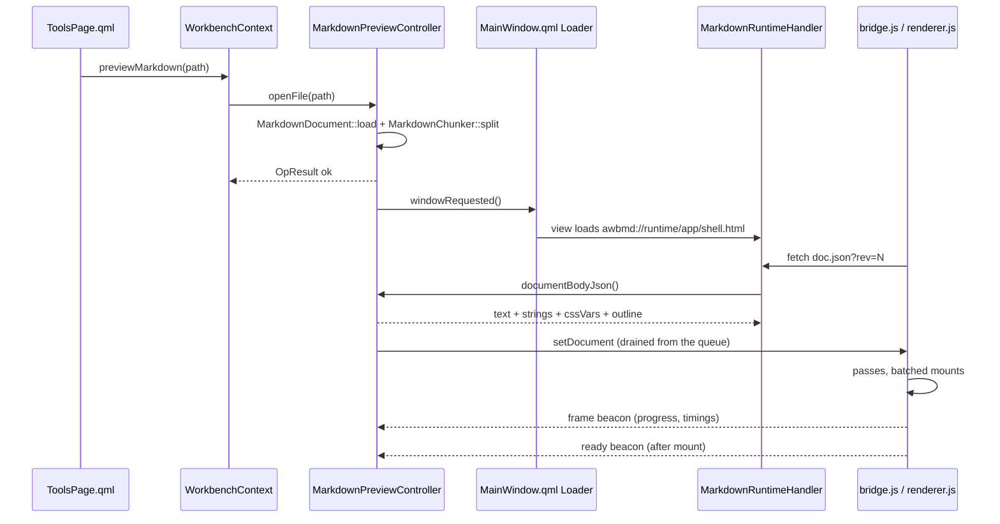

# Markdown 预览

Markdown 预览是一个**独立弹窗**，把一份 Markdown 文件渲染成公式、图表、带语法高亮的代码，并且可以
改源码、存盘。它从 Agent Tools 页的文件树打开，不在侧栏里，也不是 `Workspace` 的一个页面。

这个功能存在的理由来自对现有 Markdown 预览的一个测量结论：几百 KB 的文档，首屏时间被**整篇文档**
决定的。而这里的首屏时间只被**第一趟**决定。「渲染器：分趟、攒批与可见性」一节写的是这句承诺怎么
兑现的，数字与实验过程记在调研记录里（`docs/research/markdown-preview-runtime.md`，调研记录只写英文、
不做镜像）。

用户视角见 [Markdown 预览](../guide/Markdown预览.md)。
架构背景见 [分层与依赖](../architecture/分层与依赖.md) 与
[前端设计](../architecture/前端设计.md)。

## 这个功能是什么，以及它不是什么

- **一个窗口，一份文档。** 再打开第二个文件会复用活着的那个窗口、换掉它的内容，而不是建第二个
  `WebEngineView`。每个内嵌视图都是一个 Chromium 帧，各自带着渲染进程那侧的内存；一个会攒着多个
  预览视图的功能，代价比它服务的场景更大。
- **窗口关掉即销毁。** `MainWindow.qml` 用一个 `Loader` 持有它，`active` 是
  `markdownWindowOpen && markdown.available`，而 `markdownWindowOpen` 由 `Markdown.activeChanged`
  落回假。预览是低频动作，两次使用之间常驻一个活视图（连带它那约 4 MB 的运行时）等于给每次启动都
  加税。
- **预览 + 源码编辑 + 存盘。** 三态是 **预览 / 分栏 / 源码**。它不是编辑器框架：没有 Markdown
  感知的重排，没有格式化工具栏，撤销只有文本框自己提供的那一层。
- **不是通用 HTML 查看器。** 只有 `.md` 与 `.markdown` 会被接受
  （`MarkdownPreviewController::canPreviewPath`，它同时也是菜单项出不出场的依据）。用这块表面渲染
  任意 HTML 等于执行文档自带的脚本，而渲染器的 `html: false` 明确拒绝这件事。
- **不是面向 agent 的能力。** 这里没有任何东西导出给插件，也没有任何 agent 定义引用它。

## 为什么要自定义 scheme，以及 `awbmd://` 的形状

页面同时需要三件事，而没有别的方案能一次给全：它要 `fetch()` 自己那份文档、要通过 `@font-face`
加载 KaTeX 的 `woff2` 字体、要引用与 Markdown 文件放在一起的图片——并且全程不落盘、不开端口。

`data:` URL 前两件做不到（`data:` 文档是不透明 origin，`fetch()` 与 `@font-face` 都会被挡）。把运行
时解包到数据目录可行，但等于把 4 MB 第三方 JavaScript 放进用户目录，在那里它可以被改、被删一半。
本机 HTTP 服务要端口、要生命周期、还要一套 token 说辞。

所以适配层注册了一个 scheme，**`awbmd://runtime/…`**，一个供体把上面所有东西从同一个 origin 供出
去。同源就是全部目的：一个 host，不带端口。

| URL | 由谁供给 | 说明 |
|---|---|---|
| `awbmd://runtime/app/shell.html` | `:/markdown/app/` | 视图真正加载的页面；`MarkdownPreviewController::pageUrl()` 是它唯一的拼装处 |
| `awbmd://runtime/app/<file>.js` / `.css` | `:/markdown/app/` | 本项目自有的页面运行时 |
| `awbmd://runtime/vendor/<dir>/<file>` | `:/markdown/vendor/` | markdown-it、KaTeX（含字体）、mermaid、highlight.js |
| `awbmd://runtime/doc.json?rev=N` | `MarkdownPreviewController::documentBodyJson()` | 文本、`strings`、CSS 变量、大纲、块数；`rev` 只在内容真的变了时才动 |
| `awbmd://runtime/asset/<docId>/<rel>` | 文档自己所在目录 | 文档里的相对图片路径以此为基准解析；解析后的绝对路径必须仍落在该目录内 |
| `awbmd://runtime/event?k=<kind>&p=<json>` | —— | 页面 → C++ 的信标；回一张 1×1 的 PNG |

URL 的形状只由 `MarkdownRuntime` 一处决定，页面和供体都不认第二种形式。
`MarkdownRuntimeHandler::routeOf()` 把 URL 归到 `Resource`、`Document`、`Asset`、`Event`、`Unknown`
之一，认不出来的一律 `UrlNotFound` 而不是猜。信标天然只有 GET，供体把其它方法一律挡在这里，页面
脚本就借不到这条通道去碰本机任何东西。

**注册顺序是一条启动契约。** `MarkdownPreviewProvider::registerScheme()` 必须排在
`QtWebEngineQuick::initialize()` **之前**：引擎在第一次创建上下文时就把 scheme 表锁死，之后注册会被
静默忽略并给一条警告。失败的表现不是 404——供体照样把文档、脚本、字体供出去，坏掉的是 `fetch()`，
页面于是「正文在、公式和图表永远出不来」，而构建和所有纯函数用例照样全绿。因此
`MarkdownPreviewProvider` 在构造时用 `QWebEngineUrlScheme::schemeByName()` 当场核对一次自己的注册，
核对不上就让 `available` 落成假并留下日志。

语法用的是 `QWebEngineUrlScheme::Syntax::Host`，不是 `HostAndPort`。选了 `HostAndPort` 就必须给默认
端口，端口留空会让 `registerScheme()` 直接提前返回——只有一条警告，正是上面那种半失效状态。我们的
URL 里没有端口，语法本身就不该声明端口段。标志位：`SecureScheme`、`LocalScheme`、
`LocalAccessAllowed`、`CorsEnabled`、`ServiceWorkersAllowed`，Qt ≥ 6.6 再加 `FetchApiAllowed`
（6.5 上这个标志还不存在，该构建走「文本由 C++ 经 `runJavaScript` 推进页面」的兜底路径）。

## 文件与类清单

| 文件 | 类 / 组件 | 职责 | 与谁协作 |
|---|---|---|---|
| `src/markdown/MarkdownDocument.{h,cpp}` | `MarkdownDocument` | 磁盘上那一个文件：文本、脏标记、只读判定，以及**载入时看到的字节形态**（BOM、行尾、UTF-8 是否合法） | `MarkdownPreviewController`、`core::OpResult` |
| `src/markdown/MarkdownChunker.{h,cpp}` | `MarkdownChunker`、`MarkdownBlock` | 顶层块切分、两次切分之间的最小替换区间、块摘要 | `MarkdownPreviewController`、`renderer.js`、`scripts/spike-markdown-chunker.js` |
| `src/markdown/MarkdownRuntime.{h,cpp}` | `MarkdownRuntime` | 页面侧全部的纯字符串与纯计算：URL 布局、MIME 表、资源映射、主题 → CSS 变量、页面文案、大纲、命令/事件名表、能力判定 | 下面所有成员；页面协议唯一对着的 C++ |
| `src/markdown/MarkdownPreviewController.{h,cpp}` | `MarkdownPreviewController` | QML 单例 `Markdown`：文档 + 块 + 视图设置 + 待发送命令队列；也是导出件的落盘点 | `core::Settings`、`theme::Theme`、`MarkdownRuntimeHandler`、`MarkdownPreviewWindow.qml` |
| `src/markdown/webengine/MarkdownPreviewProvider.{h,cpp}` | `MarkdownPreviewProvider` | 注册 scheme、持有只服务预览的 profile、装好供体，并告诉控制器「表面现在真的存在」 | `app/main.cpp`、`MarkdownRuntimeHandler` |
| `src/markdown/webengine/MarkdownRuntimeHandler.{h,cpp}` | `MarkdownRuntimeHandler` | `awbmd://runtime/…` 的唯一供体，随包字节带内存缓存 | `MarkdownPreviewController` |
| `src/markdown/webengine/runtime/*` | `shell.html`、`bridge.js`、`renderer.js`、`markdown-config.js`、`math-rule.js`、`diagram.js`、`find.js`、`theme.css` | 页面：启动与命令分发、分块管线、markdown-it 配置、KaTeX/任务项/告警规则、懒加载 mermaid、文档内搜索 | `MarkdownRuntime`（协议）、`third_party/markdown-runtime/` |
| `src/markdown/qml/MarkdownPreviewWindow.qml` | `MarkdownPreviewWindow` | 窗口：工具行、大纲、视图、编辑器、搜索条、状态栏、对话框、快捷键 | `Markdown`、`MarkdownPreview`、`theme`、`workbench` |
| `src/workbench/WorkbenchContext.{h,cpp}` | `WorkbenchContext` | 跨域入口：`previewMarkdown()` 与 `canPreviewMarkdown()`，替 Tools 页说出它不许点名的域 | `MarkdownPreviewController`、`ToolsPage.qml` |
| `src/shell/qml/MainWindow.qml` | `MainWindow` | 承载那个 `Loader`，并把 `markdown.active` 镜像进 `markdownWindowOpen` | `Markdown` |
| `cmake/AwbQtCompat.cmake` | `awb_add_vendor_resources()` | 把整个目录树嵌进资源并保留其内部相对路径（KaTeX 字体就在 `fonts/` 子目录里） | `app/CMakeLists.txt`、`tests/*/CMakeLists.txt` |
| `third_party/markdown-runtime/` | —— | 随包的浏览器构建产物，外加 `manifest.json`（版本、许可、sha256） | `tst_markdown`、`scripts/update-markdown-runtime.sh` |

## 纯层：文档、块、页面文案

`src/markdown/` 里没有 WebEngine，也没有 QML 类型；只有 `src/markdown/webengine/`
（`awb_markdown_webengine` 适配层）链引擎，和 `src/web/webengine/` 之于 web 标签是同一件事。这条分界
换来的是：整套状态机能在一个根本渲染不出东西的构建里编译，并且能在没有浏览器的情况下被测试。

**`MarkdownDocument` 存在的理由是「存盘不能改写文件」。** 一份 CRLF + BOM 的 README，Ctrl+S 之后必须
还是 CRLF + BOM——把它「规范化」掉是对用户数据的实打实的字节改动。所以载入时把形态记下来
（`m_bom`、`m_crlf`、`m_validUtf8`），`encodeText()` 按原样编回去。两个大小上限来自产品要求（几百 KB
到 2 MB 要流畅）：超过 `kOpenCapBytes` 直接拒绝打开，超过 `kEditCapBytes` 只给只读预览。一个不能打字
的预览窗口仍然有用；而一个每敲一键就重排 8 MB 文本的编辑器会把整个应用拖死。非法 UTF-8 是只读的第三
个来源——解码那一步已经丢过信息，再写回去就是把用户的字节换成一片 U+FFFD。

`m_crlf` 只在**每一个**换行都是 CRLF 时才置真。混用的文件若按 CRLF 处理，保存会把整篇改掉；而让 `\r`
留在文本里原样回写，两种情况下 `encodeText(text)` 都与来路逐字节相同。

外部改动经 `QFileSystemWatcher` 上报，另加了一处刻意的补偿：
`MarkdownPreviewController::refreshDiskState()` 在窗口激活时也会重新比对一次磁盘快照。Windows 上
watcher 会静默丢掉「删除后重建」的文件（生成的文档很常见），少了这条轮询式复查就会出现「别人改了却
始终不提示」。自己保存引起的那一次不算外部改动：`save()` 会重记快照，watcher 回调比对不出差异就闭嘴。

**`MarkdownChunker` 是增量渲染得以成立的前提。** 它切出的块与页面上的 `<section>` 一一对应，因此
`startLine`/`endLine` 同时也是「编辑器行号 → 预览块」的定位锚点。之所以必须是行级状态机而不是「按空
行 split」，代价就在等价性上：块边界切错会改变语义（列表后面的段落被吞进列表项、围栏里的空行被当成
分隔），所以围栏、显示数学、setext 标题下划线、松散列表的延续段、表格连续段都要显式处理。
`scripts/spike-markdown-chunker.js` 拿本仓库自己的 Markdown 当语料比对「整篇渲染」与「逐块渲染」，
而且它 import 的是页面**同一份**解析配置（`markdown-config.js`）——两边配置不一致时比的是两个不同的
解析器，那份结论就没有意义。

**`MarkdownRuntime` 收的是「页面在意、但必须由 C++ 决定」的那一堆**：URL 构造、MIME、主题令牌 →
`--awb-*` CSS 自定义属性、页面文案字典（`pageStrings()`）、大纲提取，以及两张协议名表。`.js` 文件里
一个可翻译源串都没有——它们对 `lupdate` 和门禁都不可见，文案放在那里等于永远不被翻译。
`commandNames()` 与 `eventKinds()` 是唯一权威：`enqueue()` 按表挡下写错的名字，页面的分发分支也对着
同一张表断言。字符串协议没有这么一张表，就会漂移到「页面收了一个没人发的命令」。

## 渲染器：分趟、攒批与可见性

`renderer.js` 就是那件性能工作。它的文件注释留着测量结果：一篇 486 KB / 3150 块的文档，解析加建元素
约 1.9 s 的实际主线程工作，把攒好的块挂上树约 0.03 s，强制整篇布局也是 0.03 s 量级。所以这条管线省的
不是**总量**——该做的解析一次都省不掉——而是**一次性**：首屏只付第一趟的账。

三个机制刻意分开：

1. **分趟。** 解析每占用满 `PASS_BUDGET_MS`（48 ms，卡在 50 ms 长任务门槛之下，再大就开始丢输入）就
   让出事件循环；第一趟另给 `FIRST_BUDGET_MS`（白屏比迟几毫秒更难受），另有 `SLICE_BLOCKS` 上限，防止
   一块病态内容（半屏大的表格）独占一趟。
2. **攒批挂载。** DOM 的代价按「上树次数」算，不按块数算。块先攒进 batch，攒够 `MOUNT_BATCH_BLOCKS`、
   或解析已排空、或一批已经等了 `MOUNT_MAX_WAIT_MS` 才上树——最后那条是兜底，别让短文档的内容瘫在半路。
3. **CSS `content-visibility`** 跳过屏外块的布局与绘制（在 `theme.css`）。这才是「布局几乎不要钱」的
   原因，也正是**不做 JS 窗口虚拟化**的原因：虚拟化会废掉文本选区、原生滚动定位与文本可访问性。

调度是自己滚定时器的，没有用 `requestIdleCallback` 也没有用 `requestAnimationFrame`，原因记在调研
记录里：同一份工作放在 idle 回调下要慢一个数量级（回调数上千之后 Chromium 给的 idle 预算会饿死），
放在帧回调下则被帧率而不是时间预算卡住。所以 `schedule()` 只要定时器，自己看已经过了多少毫秒。

编辑态走 `updateBlocks`：C++ 侧按块摘要算出最小替换区间（`MarkdownChunker::diff()`），页面只重渲染那
几个 `<section>`。「敲一个字不重排全篇」这句话，这一半在这里，另一半是上一条。

**图表单独成层是体积决定的。** mermaid 的构建是 2.6 MB，一篇没有图表的文档不该为它付加载与解析时间，
所以 `<script>` 是第一个图表真的靠近视口时才插进去的。代价是这条路径上有异步与状态
（`queued / rendering / rendered / deferred / error`），散进 `renderer.js` 会变成没人能跟的回调网，
因此收在 `diagram.js` 一个文件里。并发渲染数压到 2（mermaid 是同步布局大户），SVG 结果按图表源码缓存，
图表数超过 `DEFER_LIMIT`（40）之后占位改成点击再画。

**搜索也是自己实现的。** Chromium 的原生查找面对 `content-visibility: auto` 下「在 DOM 里但引擎跳过
排版」的内容行为不受我们控制——命中数、当前第几个、跳过去的滚动位置都拿不到，也没法用主题色画高亮。
`find.js` 自己数、自己跳。两条已知取舍都是有意的：只数**已挂载**的块（刚打开大文档就搜，会少算还没挂
上的尾部），以及跨行内标记的匹配找不到（`强**调查**研` 里搜「调查」）。高亮只落在当前命中所在的那一
块，于是一次搜索步进不是 20 000 次 DOM 变更。

## 命令队列与页面协议



这条生命周期值得画，是因为两边都是异步的，且谁都不能假设对方已就位。队列存在的理由是：QML 进页面的
唯一入口是 `WebEngineView.runJavaScript`，页面还没启动时发的命令会全部丢掉。所以
`MarkdownPreviewController::enqueue()` 先把命令停下、发 `commandQueued()`，适配器在两个时刻各排空一次：
视图报到就绪时，以及有新命令进来时。队列里每一类只留最新的一条——连续五次编辑只送出一次
`updateBlocks`。

传输方向按负载大小刻意劈开。C++ → 页面的命令走 `runJavaScript("AWB.dispatch(<json>)")`。页面 → C++
的大结果以 `runJavaScript` **返回值**的形式回来（除了 `documentBodyJson()`，`serialize()` 与
`renderAll()` 交回导出 HTML 用的就是这条），因为信标是 GET 的 URL，超过 `kEventPayloadBytes`（8 KiB）
会被截断。小事件——`ready`、`frame`、`error`、`find`——走信标。这个不对称写在代码注释里；导出的整篇
HTML 刻意不进事件表，因为一张收了一个大负载的表，会诱使下一个人在旁边再加一个。

## 入口与接线

`ToolsPage.qml` 只问，不判断。它的文件树右键菜单里写的是
`visible: workbench.canPreviewMarkdown(treeRow.path)` 与
`onTriggered: workbench.previewMarkdown(treeRow.path)`。后缀清单归预览域管，QML 只对它手上已有的路径
问一个结果。`canPreviewMarkdown()` 是**方法**而不是绑定源，这一点有关系：这个表达式不会重算，条目可见性
在菜单建出来时就算定了——这里可以接受，因为能力位不可能在进程运行期间改变。

`WorkbenchContext` 是唯一可以同时点名这两个域的地方（`src/tools` 不许 include `src/markdown`，门禁
规则 1）。它持有的是可空指针，由 `app/main.cpp` 经 `setMarkdownPreview()` 设一次。指针为空——或者控制
器自报没有能力——时，`previewMarkdown()` 只发一条带原因的 toast，不做别的，于是失败只有一条解释路径
而不是两条。

`MainWindow.qml` 用 `Loader` 承载窗口，并且用 `source`（资源 URL 字符串）而不是 `sourceComponent`
（类型名）：`MarkdownPreviewWindow.qml` 只在跑得动这个功能的构建里登记进 QML 模块，写类型名会在其余
构建里留下一个解析不到的引用。Loader 加载失败刻意要弹 toast——否则资源漏登记的表现为「右键点了没反应」，
比一个错误框难查得多。

## 视图设置、大纲、导出、外部浏览器

四个视图设置（`mode`、`fontSizePx`、`contentWidthPx`、`showOutline`）在控制器构造时由 `loadView()`
读进来，改动后由 `persistView()` 写回。两个尺寸的 `0` 都表示「跟随主题的度量」；`contentWidthPx` 给出
一个超过视口的值就是界面上的**满栏**——它诚实，因为它本来就是 CSS 的 max-width，不是一个魔法值。

大纲由块序列派生（`MarkdownRuntime::outlineFromBlocks()`），定位锚是 `blockIndex`，所以点一行大纲发的
是一条带块下标的 `scrollTo` 命令，而不是一次脆弱的 DOM 查询。标题文本在进大纲之前会先去掉强调、链接、
行内代码、图片与 HTML 标签。

导出与「在浏览器打开」都要页面自己序列化，所以两者都先 `requestFullRender()`（把懒渲染的图表补齐），
再 `requestMarkup(purpose)`。页面把 HTML 交回，而 **`reportMarkup()` 是全功能唯一的写盘点**——QML 不碰
文件系统。落点按 purpose 分流，两条都是选择：

- `"export"` 默认写在文档旁边，除非用户经 `setExportDirectory()` 挑了别的目录。导出件里的图片是**相对
  引用**，只有落在文档旁边才取到；换目录导出是用户知情选择的降级，不是默认。
- `"browser"` 写到 `core::Paths::markdownPreviewDir()`（`<dataRoot>/preview`），因为外部浏览器根本不
  认识 `awbmd://`。

`exportFileName()` 给的是文档主名换 `.html`，没有文档时退回 `Markdown.html`（那也是 `requestMarkup()`
直接拒绝的时候）。

## 能力门禁：Qt 5 与 `AWB_ENABLE_WEBENGINE=OFF`

`MarkdownRuntime::isSupportedBuild()` 是编译期结论（Qt 6 **且** WebEngine），同一个条件还出现在另外三
处：链不链 `awb_markdown_webengine`、嵌不嵌 `:/markdown/` 运行时、`MarkdownPreviewWindow.qml` 注不注册。
收在一处就是全部意义——它们不一致的表现为「菜单项可点、页面 404」。

运行期只会收紧、不会放松：`available` 是 `m_surfaceReady && isSupportedBuild()`，而 `m_surfaceReady`
由提供者在 handler 真的装到 profile 上之后置位。第二个条件抓的正是上面那种顺序错误——二进制确实链了
WebEngine，但 scheme 从没注册成功。`unavailableReason()` 负责给用户那句话说清楚。

纯层（`awb_markdown`）**永远**参与链接，`Markdown` 在每种构建里都是注册好的单例。于是 Qt 5 与关掉
WebEngine 的构建把 `markdown.available` 算成假、隐藏菜单项、永不建窗口——功能是**不存在**，而不是存在
且坏掉。`MarkdownRuntimeHandler` 与页面运行时本身就只有 Qt 6 的源文件，所以整条管线里不需要 Qt 5 分支；
这个功能内部唯一的 Qt 5/6 差异就是 `FetchApiAllowed` 那一个标志位。

## 随包运行时与怎么更新

`third_party/markdown-runtime/` 放的是预先构建好的浏览器 bundle，作为构建产物提交进仓库。没有 CDN，
没有构建期下载，也没有 submodule：打包那台机器可能在内网、什么都连不上，而应用必须离线渲染。
`manifest.json` 记录每个文件的版本、许可、字节数与 sha256，`tst_markdown` 从源码树重算这些哈希——被改过
或被截断的 vendor 文件会让测试套件失败，而不是变成一个查不出来的渲染 bug。

只取单文件的浏览器构建。mermaid 的 ESM 形态是 `dist/mermaid.esm.min.mjs` 外加一张 `chunks/*.mjs` 图，
而 chunk 图会把「用自定义 scheme 供本机关文件」变成一个动态 import 解析问题；11.x 的 `mermaid.min.js`
是自包含的 IIFE，里面既没有 `import(` 也不引用 `chunks/`。KaTeX 字体只取 woff2，且上游 CSS 原样入库
（不改一字节）：它的 `@font-face` 把 woff2 排在第一位，Chromium 停在第一个能加载的源，那些
`woff`/`ttf` URL 根本不会被请求。highlight.js 取的是 `@highlightjs/cdn-assets`，只有那一个包里有浏览器
bundle。

```bash
bash scripts/update-markdown-runtime.sh                 # 锁定版本；需要网络与 Node 20+
bash scripts/update-markdown-runtime.sh --set mermaid 11.18.0
bash scripts/build.sh --test                            # tst_markdown 断言 sha256 表
```

这个脚本永远不由构建调用。`.gitattributes` 把该目录标成 `-text`，因为开了 `core.autocrlf=true` 时一次
EOL 转换就会静默破坏哈希比对。

## 代价与有意的边界

- **Qt 6 + WebEngine 的二进制里嵌了约 4 MB**，其中 2.6 MB 是 mermaid——只有真的含图表的文档才会加载
  它。
- **不渲染内嵌 HTML**（`markdown-config.js` 里的 `html: false`）。在一条没有 CSP 兜底的通道上预览别人
  写的 Markdown，那就是脚本注入面；代价是一份靠 `<br>`、`<details>` 排版的文档会把这些标签显示成正文。
- **一次一份文档。** 命令队列、`docId` 资源命名空间、大纲都是按单文档构造的。
- **搜索只数已挂载的块**，且匹配不能跨行内标记。
- **图表超过 40 个就变成点击再画。**
- **超过 `kOpenCapBytes` 的文件直接拒绝**，不给「渲染一半」。
- **`content-visibility` 意味着浏览器自己的 Ctrl+F 在这里不可用**，所以搜索必须是个功能，不能是附送。
- **mermaid 停在 11.x**，直到确认 12.x 的 `dist` 布局仍然出自包含 IIFE bundle。
- **隐藏窗口不泵 rAF/idle 是个真实约束**：任何等渲染器的测试都必须真的把窗口显示出来。

## 测试

| 目标 | 覆盖 |
|---|---|
| `tst_markdown` | `MarkdownChunker`（含语料等价性）、`MarkdownDocument`（保形态存盘、两个上限、只读的三个来源、watcher 语义）、`MarkdownRuntime`（URL、MIME、路由、协议表、主题 → CSS、大纲）、`MarkdownPreviewController`（队列去重、打开/保存/导出、能力判定），以及 vendor 的 sha256 表 |
| `tst_markdownpreview` | 对着真实 `WebEngineView` 的页面管线：文档挂载、块出现、增量更新落地。大文档用例只在 `AWB_MD_PERF` 下跑 |
| `tst_markdownpreviewui` | 真实加载 `MarkdownPreviewWindow.qml`：工具行控件驱动控制器、搜索条、三态切换 |
| `tst_webengine` | scheme 端到端供出资源、字体、`doc.json` 与信标 |
| `tst_toolsui` | 文件树那个菜单项：有能力时出现且可点、没有能力时不出现，并且把该行的绝对路径交给 `workbench.previewMarkdown` |
| `tst_workbench` | `previewMarkdown()` 的委派，以及它只报原因不开窗的失败路径 |
| `tst_core` | 四个 `markdown.*` 设置键与 `Paths::markdownPreviewDir()` |

把 `tst_markdownpreview` 与 `tst_markdownpreviewui` 挡在 Qt 5 与无 WebEngine 构建之外的条件写在
`tests/CMakeLists.txt`，与功能自身的守卫同一个判据。
